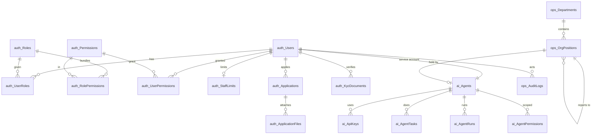
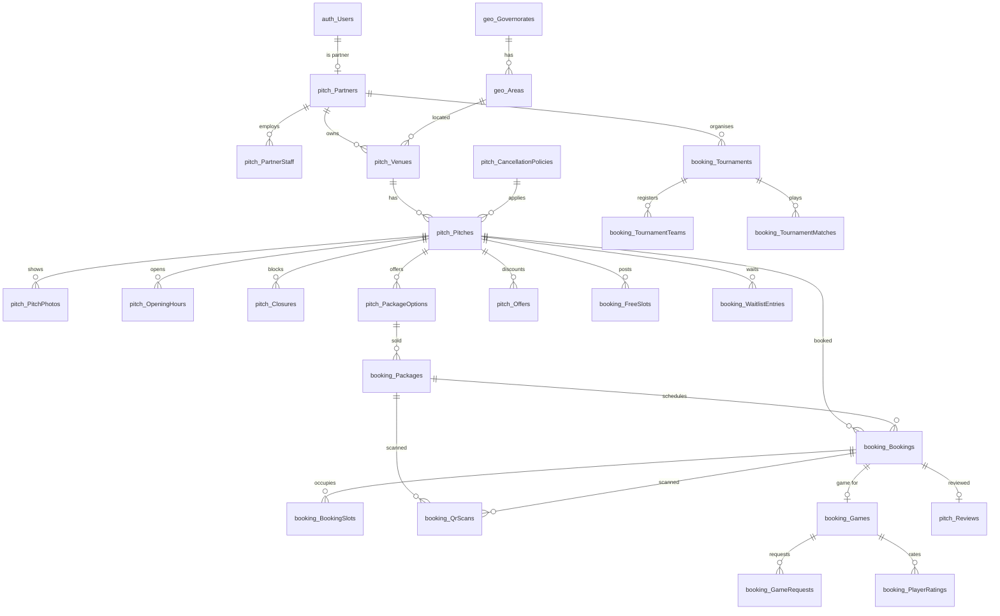
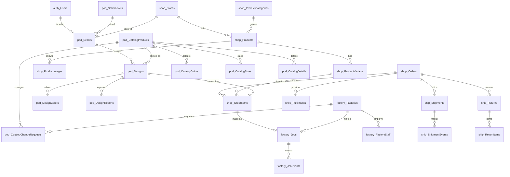
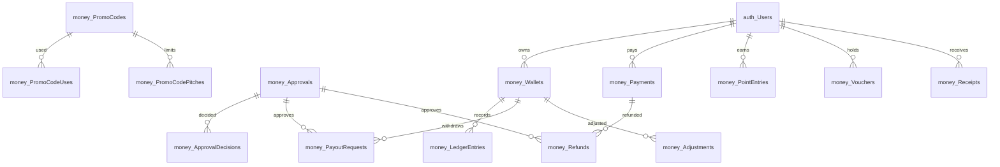
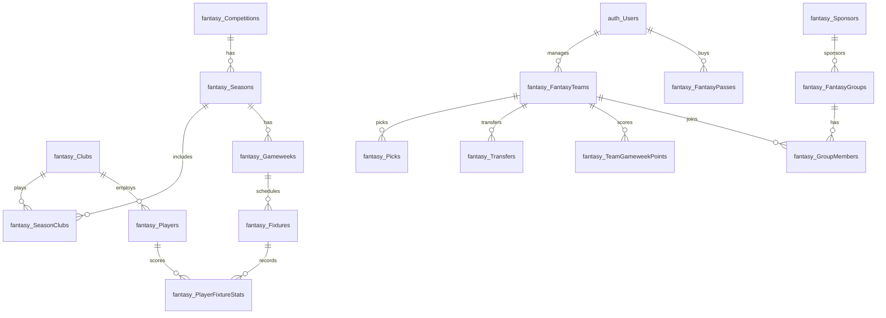
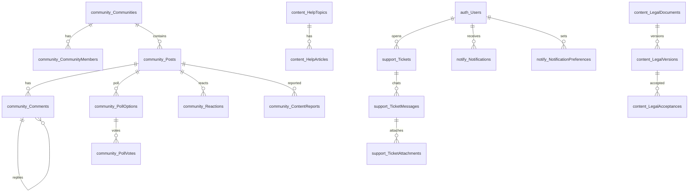

# Entity Relationship Design (ERD)
Subtitle: Every table, column, relationship, constraint and index of the Super App database — SQL Server, EF Core Code-First.
Document: ERD — backend phase
Version: 1.0 (draft for review)
Date: 16 October 2026
Owner: Sharaf (CEO)
Status: For review — the entities and Fluent API configurations are written from this document
Audience: Backend engineers, database reviewers

# 1. How to read this document

## 1.1 Approach
- **Code-First:** each table below becomes an entity class (`Domain/Entities`) and a Fluent API configuration class (`Infrastructure/Persistence/Configurations`). The owner runs `Add-Migration InitialCreate` and `Update-Database`.
- **Creation order** follows the rule *parent before child*: **Part A** lookup and independent tables (no foreign keys), **Part B** child tables (each one after every table it references), **Part C** junction tables (many-to-many).
- Every table states its **five constraints** where they apply: `NOT NULL`, `UNIQUE`, `DEFAULT`, `CHECK`, `FOREIGN KEY` with its `ON DELETE` behaviour.
- After the migration, open **SSMS → Database Diagrams → New Database Diagram**, add the tables of one schema at a time, and compare with the Mermaid diagrams in section 9.

## 1.2 Schemas
Tables are grouped in SQL Server schemas so the database is easy to browse:

| Schema | Holds |
|---|---|
| `auth` | Users, roles, permissions, Identity tables, applications, ID documents |
| `geo` | Governorates and areas |
| `ops` | Settings, feature flags, integrations, webhooks, outbox, audit log, files, org chart, goals, budgets |
| `ai` | AI agents, their keys, tasks and runs |
| `pitch` | Partners, venues, pitches, hours, closures, packages options, offers, reviews |
| `booking` | Bookings, slots, packages, QR scans, waitlist, games, free slots, alerts, tournaments |
| `shop` | Stores, products, variants, carts, orders, fulfilments |
| `pod` | Seller levels, sellers, catalogue, designs, reports, strikes, samples |
| `factory` | Factories, staff, devices, prices, jobs |
| `ship` | Shipments, courier events, returns |
| `money` | Wallets, ledger, payments, refunds, payouts, approvals, receipts, promo codes, points, vouchers |
| `fantasy` | Competitions, seasons, clubs, players, gameweeks, fixtures, stats, teams, picks, groups, passes |
| `community` | Communities, posts, polls, comments, reactions, reports, banned words |
| `support` | Tickets, chat messages, attachments |
| `content` | Banners, pop-ups, news, legal documents and acceptances, help center, cookie consents |
| `notify` | Notifications, preferences, email outbox, broadcasts |

## 1.3 Conventions
| Topic | Rule |
|---|---|
| Names | Tables plural PascalCase (`Bookings`), columns PascalCase, foreign keys `<Parent>Id` |
| Primary keys | `Id bigint IDENTITY(1,1)` for business tables; `Id int` for lookups; `Id uniqueidentifier` for `auth.Users` and `auth.Roles` (ASP.NET Identity) |
| Public codes | Things customers see (booking, order, ticket, return, receipt) also have a short unique `Code` (e.g. `SA-7K2M9Q`); internal ids are never shown |
| Money | `decimal(12,2)`, EGP. Percentages `decimal(5,2)` (e.g. 12.50 = 12.5 %) |
| Dates | `datetime2(0)` in **UTC**; calendar dates `date`; hours `tinyint` 0–23 (Cairo local hour of the slot) |
| Status / type values | `tinyint` with a `CHECK` on the allowed values; the meaning of each value is listed in the table (and as a C# enum) |
| JSON | `nvarchar(max)` with `CHECK (ISJSON(col) = 1)`, only for flexible snapshots (addresses at order time, application answers, event payloads) |
| Text in two languages | `...Ar` and `...En` columns where Super App writes the text (legal, help, catalogue details, pop-ups) |
| Constraint names | `PK_Table`, `FK_Child_Parent_Column`, `UQ_Table_Columns`, `CK_Table_Rule`, `DF_Table_Column`, `IX_Table_Columns` |

**Common column sets** (written once here, referenced as tags in each table):

| Tag | Columns |
|---|---|
| **[B] base** | `Id bigint IDENTITY PK` · `CreatedAt datetime2(0) NOT NULL DEFAULT SYSUTCDATETIME()` · `UpdatedAt datetime2(0) NULL` |
| **[L] lookup** | `Id int IDENTITY PK` · `IsActive bit NOT NULL DEFAULT 1` · `SortOrder int NOT NULL DEFAULT 0` |
| **[S] soft delete** | `IsDeleted bit NOT NULL DEFAULT 0` · `DeletedAt datetime2(0) NULL` — EF global query filter; unique indexes are filtered `WHERE IsDeleted = 0` |
| **[V] concurrency** | `RowVersion rowversion NOT NULL` — two people cannot overwrite each other (stock, slots, wallets, payouts) |
| **[A] author** | `CreatedById uniqueidentifier NULL` FK → `auth.Users` **NO ACTION** |

## 1.4 Delete behaviour (ON DELETE)
| Rule | Used for |
|---|---|
| **NO ACTION / RESTRICT** (default) | Anything with history or money: users, pitches, products, designs, orders, bookings, payments, wallets, ledger. Business records are **soft-deleted** or switched off, never hard-deleted |
| **CASCADE** | Children that cannot live without their parent: photos, opening hours, variants, specs, order items, slots, messages, attachments, poll options, picks |
| **SET NULL** | Optional links where the child must survive (e.g. a ticket's linked order) |

SQL Server forbids several cascade paths into one table, so where two parents could cascade, one of them is **NO ACTION** (noted in the table).

# 2. Creation order

## Part A — Lookup and independent tables (no foreign keys)
| # | Table | Purpose |
|---|---|---|
| A1 | `geo.Governorates` | 27 governorates |
| A2 | `auth.Permissions` | Fine-grained permission codes |
| A3 | `auth.Roles` | Identity roles (Customer, PitchOwner, Seller, FactoryOwner, Admin, CEO, Agent, custom admin roles) |
| A4 | `auth.Users` | Identity users — every person and service account |
| A5 | `ops.Departments` | Company departments for the org chart |
| A6 | `ops.Settings` | Platform settings (key/value) |
| A7 | `ops.FeatureFlags` | Kill switches and API group switches |
| A8 | `ops.Integrations` | External services registry |
| A9 | `ops.WebhookSubscriptions` | Outgoing webhooks (n8n) |
| A10 | `ops.OutboxEvents` | Events waiting to be delivered |
| A11 | `pitch.Facilities` | Parking, showers, lights… |
| A12 | `pitch.CancellationPolicies` | Flexible, Standard, Moderate, Strict |
| A13 | `shop.ProductCategories` | Shop categories |
| A14 | `pod.DesignCategories` | Design sections (football, anime…) |
| A15 | `pod.SellerLevels` | Starter, Rising, Pro, Elite and their perks |
| A16 | `pod.CatalogProducts` | Printable products (tee, oversized tee, hoodie) |
| A17 | `fantasy.Competitions` | Egyptian Premier League, English Premier League |
| A18 | `fantasy.Clubs` | Football clubs |
| A19 | `fantasy.Sponsors` | Fantasy sponsors |
| A20 | `content.LegalDocuments` | Terms, privacy, refunds, waiver, agreements, cookies |
| A21 | `content.HelpTopics` | Help center topics |
| A22 | `content.Banners` | Home banners |
| A23 | `content.PopupAds` | Pop-up ads |
| A24 | `community.BannedWords` | Blocked words |

## Part B — Child tables (in dependency order)
| # | Table | Depends on |
|---|---|---|
| B1 | `geo.Areas` | Governorates |
| B2 | `auth.RoleClaims` | Roles |
| B3 | `auth.UserClaims` | Users |
| B4 | `auth.UserLogins` | Users |
| B5 | `auth.UserTokens` | Users |
| B6 | `auth.StaffLimits` | Users |
| B7 | `auth.UserAddresses` | Users, Areas |
| B8 | `ops.Files` | Users |
| B9 | `auth.KycDocuments` | Users, Files |
| B10 | `auth.Applications` | Users |
| B11 | `auth.ApplicationFiles` | Applications, Files |
| B12 | `ops.OrgPositions` | Departments, Users, OrgPositions (self) |
| B13 | `ai.Agents` | Users, OrgPositions |
| B14 | `ai.ApiKeys` | Agents |
| B15 | `ai.AgentTasks` | Agents |
| B16 | `ai.AgentRuns` | Agents, AgentTasks |
| B17 | `ops.AuditLogs` | Users, Agents |
| B18 | `ops.IntegrationUsage` | Integrations |
| B19 | `ops.WebhookDeliveries` | WebhookSubscriptions, OutboxEvents |
| B20 | `ops.Goals` | Departments, Users |
| B21 | `ops.KeyResults` | Goals |
| B22 | `ops.Budgets` | Departments |
| B23 | `ops.ComplianceItems` | Departments, Users |
| B24 | `pitch.Partners` | Users |
| B25 | `pitch.PartnerStaff` | Partners, Users |
| B26 | `pitch.Venues` | Partners, Areas |
| B27 | `pitch.Pitches` | Venues, CancellationPolicies, Users |
| B28 | `pitch.PitchPhotos` | Pitches, Files |
| B29 | `pitch.OpeningHours` | Pitches |
| B30 | `pitch.Closures` | Pitches, Users |
| B31 | `pitch.PackageOptions` | Pitches, Users |
| B32 | `pitch.Offers` | Pitches |
| B33 | `shop.Stores` | Users, Files |
| B34 | `pod.Sellers` | Users, SellerLevels, Stores |
| B35 | `pod.SellerStrikes` | Sellers, Users |
| B36 | `pod.LevelReviews` | Sellers, SellerLevels |
| B37 | `pod.CatalogColors` | CatalogProducts |
| B38 | `pod.CatalogSizes` | CatalogProducts |
| B39 | `pod.CatalogDetails` | CatalogProducts |
| B40 | `pod.CatalogPrintAreas` | CatalogProducts |
| B41 | `factory.Factories` | Users |
| B42 | `factory.FactoryStaff` | Factories |
| B43 | `factory.FactoryDevices` | Factories |
| B44 | `factory.FactoryPrices` | Factories, CatalogProducts |
| B45 | `pod.CatalogChangeRequests` | CatalogProducts, Factories, Users |
| B46 | `pod.Designs` | Sellers, CatalogProducts, DesignCategories, Files, Users |
| B47 | `pod.DesignTags` | Designs |
| B48 | `pod.DesignReports` | Designs, Users |
| B49 | `shop.Products` | Stores, ProductCategories, Users |
| B50 | `shop.ProductImages` | Products, Files |
| B51 | `shop.ProductVariants` | Products |
| B52 | `shop.ProductSpecs` | Products |
| B53 | `money.Wallets` | Users |
| B54 | `money.PromoCodes` | Users, Stores |
| B55 | `money.Payments` | Users |
| B56 | `booking.Packages` | Pitches, Users, PackageOptions, Payments |
| B57 | `booking.Series` | Pitches, Users |
| B58 | `booking.Bookings` | Pitches, Users, Packages, Series, Payments, PromoCodes |
| B59 | `booking.BookingSlots` | Bookings, Pitches |
| B60 | `booking.SlotHolds` | Pitches, Users |
| B61 | `booking.QrScans` | Bookings, Packages, Users |
| B62 | `booking.WaitlistEntries` | Pitches, Users |
| B63 | `booking.FreeSlots` | Pitches, Users, Bookings |
| B64 | `booking.SlotAlerts` | Users, Pitches, Areas |
| B65 | `booking.Games` | Users, Bookings |
| B66 | `booking.GameRequests` | Games, Users, Payments |
| B67 | `booking.PlayerRatings` | Games, Users |
| B68 | `booking.Tournaments` | Partners, Pitches |
| B69 | `booking.TournamentTeams` | Tournaments, Users, Payments |
| B70 | `booking.TournamentMatches` | Tournaments, TournamentTeams |
| B71 | `pitch.Reviews` | Pitches, Bookings, Users |
| B72 | `pitch.ReviewReports` | Reviews, Users |
| B73 | `shop.Orders` | Users, PromoCodes, Payments |
| B74 | `shop.OrderItems` | Orders, ProductVariants, Designs, Stores |
| B75 | `shop.Fulfilments` | Orders, Stores |
| B76 | `shop.CartItems` | Users, ProductVariants, Designs |
| B77 | `factory.Jobs` | OrderItems, Factories, FactoryStaff |
| B78 | `factory.JobEvents` | Jobs, FactoryStaff |
| B79 | `factory.JobProblems` | Jobs, FactoryStaff, Users |
| B80 | `pod.Samples` | Sellers, Designs, Orders |
| B81 | `ship.Shipments` | Orders, Fulfilments, Files |
| B82 | `ship.ShipmentEvents` | Shipments |
| B83 | `ship.Returns` | Orders, Users |
| B84 | `ship.ReturnItems` | Returns, OrderItems |
| B85 | `money.LedgerEntries` | Wallets |
| B86 | `money.Refunds` | Payments, Users |
| B87 | `money.PayoutRequests` | Wallets, Users |
| B88 | `money.Approvals` | Users |
| B89 | `money.ApprovalDecisions` | Approvals, Users |
| B90 | `money.Adjustments` | Wallets, Users |
| B91 | `money.Receipts` | Users, Files |
| B92 | `money.PromoCodeUses` | PromoCodes, Users, Orders, Bookings |
| B93 | `money.PointEntries` | Users |
| B94 | `money.Vouchers` | Users |
| B95 | `fantasy.Seasons` | Competitions |
| B96 | `fantasy.Players` | Clubs |
| B97 | `fantasy.Gameweeks` | Seasons |
| B98 | `fantasy.Fixtures` | Gameweeks, Clubs |
| B99 | `fantasy.PlayerFixtureStats` | Players, Fixtures |
| B100 | `fantasy.FantasyTeams` | Users, Seasons |
| B101 | `fantasy.Picks` | FantasyTeams, Gameweeks, Players |
| B102 | `fantasy.Transfers` | FantasyTeams, Gameweeks, Players |
| B103 | `fantasy.TeamGameweekPoints` | FantasyTeams, Gameweeks |
| B104 | `fantasy.FantasyGroups` | Seasons, Users, Sponsors |
| B105 | `fantasy.FantasyPasses` | Users, Competitions, Payments |
| B106 | `community.Communities` | Users |
| B107 | `community.Posts` | Communities, Users, Files |
| B108 | `community.PollOptions` | Posts |
| B109 | `community.Comments` | Posts, Comments (self), Users |
| B110 | `community.Reactions` | Users, Posts, Comments |
| B111 | `community.ContentReports` | Users, Posts, Comments |
| B112 | `support.Tickets` | Users, Agents, Bookings, Orders |
| B113 | `support.TicketMessages` | Tickets, Users |
| B114 | `support.TicketAttachments` | TicketMessages, Files |
| B115 | `content.HelpArticles` | HelpTopics |
| B116 | `content.HelpVotes` | HelpArticles, Users |
| B117 | `content.LegalVersions` | LegalDocuments, Users |
| B118 | `content.LegalAcceptances` | LegalVersions, Users |
| B119 | `content.CookieConsents` | Users |
| B120 | `content.NewsPosts` | Users, Files |
| B121 | `notify.Notifications` | Users |
| B122 | `notify.NotificationPreferences` | Users |
| B123 | `notify.EmailOutbox` | Users |
| B124 | `notify.Broadcasts` | Users |

## Part C — Junction tables (many-to-many)
| # | Table | Joins |
|---|---|---|
| C1 | `auth.UserRoles` | Users ↔ Roles |
| C2 | `auth.RolePermissions` | Roles ↔ Permissions |
| C3 | `auth.UserPermissions` | Users ↔ Permissions (direct grants, e.g. Approvals to one admin) |
| C4 | `ai.AgentPermissions` | Agents ↔ Permissions |
| C5 | `pitch.PitchFacilities` | Pitches ↔ Facilities |
| C6 | `pod.DesignColors` | Designs ↔ CatalogColors |
| C7 | `pod.SellerFollowers` | Sellers ↔ Users |
| C8 | `shop.WishlistItems` | Users ↔ Products / Designs |
| C9 | `money.PromoCodePitches` | PromoCodes ↔ Pitches |
| C10 | `fantasy.SeasonClubs` | Seasons ↔ Clubs |
| C11 | `fantasy.GroupMembers` | FantasyGroups ↔ FantasyTeams |
| C12 | `community.CommunityMembers` | Communities ↔ Users |
| C13 | `community.PollVotes` | PollOptions ↔ Users |

**Totals:** 24 lookup/independent tables, 124 child tables, 13 junction tables — **161 tables** in 16 schemas.

# 3. Part A — Lookup and independent tables

Columns are listed **in addition to** the tags. "Rules" uses: **PK**, **FK → table (ON DELETE)**, **UQ** unique, **DF** default, **CK** check.

### A1 geo.Governorates — [L]
| Column | Type | Null | Rules |
|---|---|---|---|
| Code | varchar(10) | NO | UQ (e.g. `CAI`, `GIZ`, `ALX`) |
| NameEn | nvarchar(80) | NO | UQ |
| NameAr | nvarchar(80) | NO | UQ |

### A2 auth.Permissions — [L]
| Column | Type | Null | Rules |
|---|---|---|---|
| Code | varchar(80) | NO | UQ, CK `Code LIKE '%.%'` (e.g. `payouts.send`, `approvals.partners`) |
| Area | varchar(40) | NO | e.g. `approvals`, `money`, `content`, `community`, `fantasy`, `settings`, `audit`, `ai` |
| NameEn / NameAr | nvarchar(120) | NO | |
| DescriptionEn | nvarchar(400) | YES | |
| IsSensitive | bit | NO | DF 0 — money or personal data; shown in red in the CEO matrix |

Index: `IX_Permissions_Area`.

### A3 auth.Roles (Identity `AspNetRoles`)
| Column | Type | Null | Rules |
|---|---|---|---|
| Id | uniqueidentifier | NO | PK, DF `NEWSEQUENTIALID()` |
| Name / NormalizedName | nvarchar(256) | NO | UQ on NormalizedName |
| ConcurrencyStamp | nvarchar(max) | YES | Identity |
| Kind | tinyint | NO | CK 0–2 (0 System, 1 Admin role made by the CEO, 2 Agent role) |
| DescriptionEn | nvarchar(400) | YES | |
| IsLocked | bit | NO | DF 0 — system roles (CEO, Customer…) cannot be deleted |

### A4 auth.Users (Identity `AspNetUsers`)
| Column | Type | Null | Rules |
|---|---|---|---|
| Id | uniqueidentifier | NO | PK, DF `NEWSEQUENTIALID()` |
| UserName / NormalizedUserName | nvarchar(256) | NO | UQ on NormalizedUserName |
| Email / NormalizedEmail | nvarchar(256) | NO | UQ on NormalizedEmail (filtered `WHERE IsDeleted = 0`) |
| EmailConfirmed, PhoneNumberConfirmed, TwoFactorEnabled, LockoutEnabled | bit | NO | Identity, DF 0 (LockoutEnabled DF 1) |
| PasswordHash, SecurityStamp, ConcurrencyStamp | nvarchar(max) | YES | Identity |
| PhoneNumber | varchar(20) | YES | UQ filtered `WHERE PhoneNumber IS NOT NULL`, CK `PhoneNumber LIKE '+20%'` |
| LockoutEnd | datetimeoffset | YES | Identity |
| AccessFailedCount | int | NO | DF 0 |
| FullName | nvarchar(120) | NO | CK `LEN(FullName) >= 2` |
| AvatarFileId | bigint | YES | (FK added after `ops.Files` exists — NO ACTION) |
| Language | char(2) | NO | DF `'ar'`, CK IN (`'ar'`,`'en'`) |
| AccountType | tinyint | NO | DF 0, CK 0–2 (0 Person, 1 AI agent service account, 2 System) |
| Status | tinyint | NO | DF 0, CK 0–2 (0 Active, 1 Suspended, 2 Blocked from booking/ordering) |
| SuspendedReason | nvarchar(400) | YES | |
| MustPrepay | tinyint | NO | DF 0, CK 0–2 (0 Automatic, 1 Always, 2 Never) — COD rule for printed items |
| CodRefusals | int | NO | DF 0, CK ≥ 0 |
| AdminNote | nvarchar(1000) | YES | private note by the Super App team |
| LastSeenAt | datetime2(0) | YES | |
| CreatedAt / UpdatedAt | datetime2(0) | NO / YES | DF SYSUTCDATETIME() |
| [S] | | | soft delete (data-protection deletion keeps money history anonymised) |

Indexes: `IX_Users_Status`, `IX_Users_CreatedAt`.

### A5 ops.Departments — [L]
| Column | Type | Null | Rules |
|---|---|---|---|
| Key | varchar(30) | NO | UQ (`ops`, `support`, `bizdev`, `finance`, `legal`, `marketing`, `tech`, `aiops`) |
| NameEn / NameAr | nvarchar(80) | NO | |
| Color | char(7) | NO | DF `'#0B6E4F'`, CK `Color LIKE '#%'` |

### A6 ops.Settings
| Column | Type | Null | Rules |
|---|---|---|---|
| Key | varchar(80) | NO | **PK** (e.g. `commission.bookings`, `vat.rate`, `pod.holdDays`, `limits.payoutCeo`, `package.maxDiscount`, `loyalty.pointValue`) |
| Value | nvarchar(max) | NO | JSON, CK `ISJSON(Value) = 1` |
| Group | varchar(40) | NO | `money`, `limits`, `pod`, `loyalty`, `delivery`, `fantasy`, `popups`… |
| UpdatedAt | datetime2(0) | NO | DF SYSUTCDATETIME() |
| UpdatedById | uniqueidentifier | YES | no FK (the audit log records the change) |

### A7 ops.FeatureFlags — [B]
| Column | Type | Null | Rules |
|---|---|---|---|
| Key | varchar(80) | NO | UQ (e.g. `kill.bookings`, `kill.payouts`, `api.fantasy`, `api.agents`) |
| Kind | tinyint | NO | CK 0–1 (0 Kill switch, 1 API group) |
| IsEnabled | bit | NO | DF 1 |
| Reason | nvarchar(400) | YES | why it was switched off |
| ChangedById | uniqueidentifier | YES | |

### A8 ops.Integrations — `Id int IDENTITY` PK + CreatedAt/UpdatedAt as [B]
| Column | Type | Null | Rules |
|---|---|---|---|
| Key | varchar(60) | NO | UQ (`payments.paymob`, `courier.bosta`, `email.smtp`, `football.apifootball`, `ai.claude`, `automation.n8n`, `storage.local`, `einvoice.eta`) |
| Category | tinyint | NO | CK 0–8 (Payment, Courier, Email, SMS, WhatsApp, Football data, AI model, Automation, Storage/E-invoice) |
| Name | nvarchar(80) | NO | |
| Mode | tinyint | NO | DF 0, CK 0–2 (0 Simulated, 1 Test/sandbox, 2 Live) |
| IsEnabled | bit | NO | DF 0 |
| IsPrimary | bit | NO | DF 0 — the active provider of its category (filtered UQ on `Category WHERE IsPrimary = 1`) |
| ConfigJson | nvarchar(max) | YES | non-secret settings, CK ISJSON |
| SecretName | varchar(120) | YES | name of the environment variable / encrypted secret — **the secret itself is never stored here** |
| SecretSetAt | datetime2(0) | YES | shown as "set / not set" |
| Status | tinyint | NO | DF 0, CK 0–3 (Unknown, Healthy, Degraded, Down) |
| LastCallAt / LastErrorAt | datetime2(0) | YES | |
| LastError | nvarchar(1000) | YES | |
| DailyQuota | int | YES | e.g. 100 for API-FOOTBALL free plan |

### A9 ops.WebhookSubscriptions — `Id int IDENTITY` PK + CreatedAt/UpdatedAt as [B]
| Column | Type | Null | Rules |
|---|---|---|---|
| Name | nvarchar(80) | NO | e.g. "n8n — operations" |
| Url | nvarchar(500) | NO | CK `Url LIKE 'https://%'` (http allowed only in development) |
| Events | nvarchar(1000) | NO | JSON array of event types, CK ISJSON |
| SecretHash | varbinary(64) | NO | HMAC key (encrypted) |
| IsEnabled | bit | NO | DF 1 |
| FailureCount | int | NO | DF 0 — auto-pause after 50 failures in a row |

### A10 ops.OutboxEvents
| Column | Type | Null | Rules |
|---|---|---|---|
| Id | bigint IDENTITY | NO | PK |
| EventId | uniqueidentifier | NO | UQ, DF NEWID() — idempotency for receivers |
| Type | varchar(80) | NO | e.g. `booking.created` |
| PayloadJson | nvarchar(max) | NO | CK ISJSON |
| OccurredAt | datetime2(3) | NO | DF SYSUTCDATETIME() |
| Status | tinyint | NO | DF 0, CK 0–3 (Pending, Delivered, Failed, Skipped) |
| Attempts | int | NO | DF 0 |
| NextAttemptAt | datetime2(0) | YES | |

Index: `IX_OutboxEvents_Status_NextAttemptAt` (the dispatcher reads pending events).

### A11 pitch.Facilities — [L]
| Column | Type | Null | Rules |
|---|---|---|---|
| Key | varchar(30) | NO | UQ (`lights`, `parking`, `showers`, `lockers`, `cafe`, `water`, `wc`, `prayer`, `seats`, `wifi`, `ac`, `firstaid`, `camera`) |
| NameEn / NameAr | nvarchar(60) | NO | |
| Icon | varchar(30) | NO | |

### A12 pitch.CancellationPolicies — [L]
| Column | Type | Null | Rules |
|---|---|---|---|
| Key | varchar(20) | NO | UQ (`flexible`, `standard`, `moderate`, `strict`) |
| NameEn / NameAr | nvarchar(40) | NO | |
| FullRefundHours | smallint | NO | CK ≥ 0 (2 / 6 / 24 / 48) |
| HalfRefundHours | smallint | NO | CK ≥ 0 and ≤ FullRefundHours (0 / 0 / 6 / 24) |
| SummaryEn / SummaryAr | nvarchar(300) | NO | |

### A13 shop.ProductCategories — [L]
| Column | Type | Null | Rules |
|---|---|---|---|
| Key | varchar(40) | NO | UQ (`boots`, `kits`, `balls`…) |
| NameEn / NameAr | nvarchar(60) | NO | |
| Icon | varchar(30) | NO | |
| IsHidden | bit | NO | DF 0 — hides its products from the shop |

### A14 pod.DesignCategories — [L]
| Column | Type | Null | Rules |
|---|---|---|---|
| Key | varchar(40) | NO | UQ |
| NameEn / NameAr | nvarchar(60) | NO | UQ on NameEn |

### A15 pod.SellerLevels — [L]
| Column | Type | Null | Rules |
|---|---|---|---|
| Key | varchar(20) | NO | UQ (`starter`, `rising`, `pro`, `elite`) |
| NameEn / NameAr | nvarchar(40) | NO | |
| Rank | tinyint | NO | UQ, CK 0–9 |
| SalesNeeded | int | NO | CK ≥ 0 |
| MinRating | decimal(2,1) | NO | DF 0, CK 0–5 |
| ActiveDesigns | int | YES | NULL = unlimited, CK > 0 |
| ActiveCodes | int | YES | NULL = unlimited |
| BaseDiscount | decimal(12,2) | NO | DF 0, CK ≥ 0 |
| StoreCommission | decimal(5,2) | NO | CK 0–100 |
| ReviewLane | tinyint | NO | CK 0–2 (Normal, Priority, Instant + spot check) |
| SearchBoost | tinyint | NO | DF 0, CK 0–5 |
| SampleDiscount | decimal(5,2) | NO | DF 0, CK 0–100 |
| FreeSamplesPerMonth | tinyint | NO | DF 0 |
| FantasyDiscount | decimal(5,2) | NO | DF 0, CK 0–100 |
| BulkUpload, TeamKits, EarlyAccess | bit | NO | DF 0 |
| AnalyticsTier | tinyint | NO | CK 0–2 (Basic, Advanced, Advanced + export) |
| CalendarTier | tinyint | NO | CK 0–3 |
| SupportTier | tinyint | NO | CK 0–2 (Normal, Priority, Account manager) |

### A16 pod.CatalogProducts — `Id int IDENTITY` PK + CreatedAt/UpdatedAt as [B], [S]
| Column | Type | Null | Rules |
|---|---|---|---|
| Key | varchar(40) | NO | UQ (`pod-tee`, `pod-oversized`, `pod-hoodie`) |
| NameEn / NameAr | nvarchar(80) | NO | |
| Kind | tinyint | NO | CK 0–1 (0 Tee, 1 Hoodie) |
| DescriptionEn / DescriptionAr | nvarchar(400) | NO | |
| BasePrice | decimal(12,2) | NO | CK > 0 |
| FactoryCost | decimal(12,2) | NO | CK > 0 and < BasePrice (the difference is Super App's margin) |
| BackPrintExtra | decimal(12,2) | NO | DF 0, CK ≥ 0 |
| BigSizeExtra | decimal(12,2) | NO | DF 0, CK ≥ 0 |
| MaxPrice | decimal(12,2) | NO | CK > BasePrice |
| HasBackPrint | bit | NO | DF 1 |
| Model3dUrl | nvarchar(300) | YES | e.g. `models/tee.glb` |
| Status | tinyint | NO | DF 0, CK 0–2 (Active, Paused, Retired) |

### A17 fantasy.Competitions — [L]
| Column | Type | Null | Rules |
|---|---|---|---|
| Key | varchar(10) | NO | UQ (`EGY`, `EPL`) |
| NameEn / NameAr | nvarchar(80) | NO | |
| ExternalLeagueId | int | NO | UQ — API-FOOTBALL league id |
| Country | nvarchar(40) | NO | |
| SquadBudget | decimal(6,1) | NO | DF 100.0, CK > 0 |
| MaxPerClub | tinyint | NO | DF 3, CK 1–5 |

### A18 fantasy.Clubs — [B]
| Column | Type | Null | Rules |
|---|---|---|---|
| ExternalId | int | NO | UQ — API-FOOTBALL team id |
| NameEn / NameAr | nvarchar(80) | NO | |
| ShortName | varchar(5) | NO | |
| KitColor / KitColor2 | char(7) | NO | DF `'#0D1411'` — shown instead of logos for now |
| LogoUrl | nvarchar(300) | YES | stays empty until logos are licensed |

### A19 fantasy.Sponsors — [B] [S]
| Column | Type | Null | Rules |
|---|---|---|---|
| Name | nvarchar(100) | NO | UQ filtered |
| Tier | tinyint | NO | CK 0–2 (Gold, Silver, Bronze) |
| ContactEmail | nvarchar(256) | YES | |
| ContractValue | decimal(12,2) | NO | DF 0, CK ≥ 0 |
| StartsOn / EndsOn | date | NO | CK EndsOn ≥ StartsOn |
| Color | char(7) | NO | |

### A20 content.LegalDocuments — [L]
| Column | Type | Null | Rules |
|---|---|---|---|
| Key | varchar(30) | NO | UQ (`terms`, `privacy`, `refunds`, `waiver`, `seller`, `partner`, `cookies`) |
| TitleEn / TitleAr | nvarchar(120) | NO | |
| RequiresAcceptance | bit | NO | DF 1 |

### A21 content.HelpTopics — [L]
| Column | Type | Null | Rules |
|---|---|---|---|
| Key | varchar(30) | NO | UQ |
| NameEn / NameAr | nvarchar(80) | NO | |
| Icon | varchar(30) | NO | |

### A22 content.Banners — [B]
| Column | Type | Null | Rules |
|---|---|---|---|
| Title | nvarchar(70) | NO | CK LEN ≥ 5 |
| Badge | nvarchar(22) | YES | |
| CtaText | nvarchar(22) | YES | |
| Link | nvarchar(300) | NO | CK `Link LIKE '#/%'` (inside Super App only) |
| ImageKey | nvarchar(300) | NO | library key or file URL |
| IsActive | bit | NO | DF 1 |
| SortOrder | int | NO | DF 0 |
| ShowFrom / ShowUntil | date | YES | CK ShowUntil ≥ ShowFrom |

### A23 content.PopupAds — [B]
| Column | Type | Null | Rules |
|---|---|---|---|
| TitleEn / TitleAr | nvarchar(60) | NO | |
| TextEn / TextAr | nvarchar(140) | NO | |
| CtaEn / CtaAr | nvarchar(24) | NO | |
| Link | nvarchar(300) | NO | CK `Link LIKE '#/%'` |
| Badge | nvarchar(24) | YES | |
| Color | char(7) | NO | CK `Color LIKE '#%'` |
| Shape | tinyint | NO | DF 0, CK 0–2 (Cube, Coin, 3D T-shirt) |
| Icons | varchar(200) | YES | comma-separated icon keys for the cube |
| HideFromSellers | bit | NO | DF 0 |
| IsActive | bit | NO | DF 1 |
| SortOrder | int | NO | DF 0 |
| ShownCount / ClickedCount | int | NO | DF 0, CK ≥ 0 |

### A24 community.BannedWords — [B]
| Column | Type | Null | Rules |
|---|---|---|---|
| Word | nvarchar(60) | NO | UQ |
| Language | char(2) | NO | CK IN (`'ar'`,`'en'`) |

# 4. Part B — Child tables: accounts, operations, AI, pitches

### B1 geo.Areas — [L]
| Column | Type | Null | Rules |
|---|---|---|---|
| GovernorateId | int | NO | FK → geo.Governorates (NO ACTION) |
| NameEn / NameAr | nvarchar(80) | NO | UQ (GovernorateId, NameEn) |
| Lat / Lng | decimal(9,6) | YES | area centre for "near me" |

Index: `IX_Areas_GovernorateId`.

### B2–B5 Identity child tables
Standard ASP.NET Core Identity tables, renamed into the `auth` schema: **RoleClaims** (RoleId FK → Roles CASCADE), **UserClaims**, **UserLogins**, **UserTokens** (UserId FK → Users CASCADE). Columns as generated by Identity.

### B6 auth.StaffLimits — [B]
Money limits per admin, CFO or agent's service account (above the limit an approval is created).
| Column | Type | Null | Rules |
|---|---|---|---|
| UserId | uniqueidentifier | NO | UQ, FK → auth.Users (CASCADE) |
| RefundLimit | decimal(12,2) | NO | DF 0, CK ≥ 0 |
| CreditLimit | decimal(12,2) | NO | DF 0, CK ≥ 0 |
| PayoutLimit | decimal(12,2) | NO | DF 0, CK ≥ 0 |
| CanSecondApprove | bit | NO | DF 0 — the CFO's second approval |

### B7 auth.UserAddresses — [B]
| Column | Type | Null | Rules |
|---|---|---|---|
| UserId | uniqueidentifier | NO | FK → auth.Users (CASCADE) |
| AreaId | int | NO | FK → geo.Areas (NO ACTION) |
| Label | nvarchar(40) | NO | DF N'Home' |
| Street | nvarchar(200) | NO | |
| Building / Floor / Apartment | nvarchar(20) | YES | |
| Landmark | nvarchar(120) | YES | |
| Phone | varchar(20) | NO | CK `LIKE '+20%'` |
| IsDefault | bit | NO | DF 0 — filtered UQ (UserId) WHERE IsDefault = 1 |

### B8 ops.Files — [B] [S]
Every uploaded or generated file (photos, artwork, ID scans, PDFs). The bytes live in object storage, never in the database.
| Column | Type | Null | Rules |
|---|---|---|---|
| OwnerUserId | uniqueidentifier | YES | FK → auth.Users (NO ACTION) |
| StorageKey | nvarchar(400) | NO | UQ — path in the storage container |
| Container | varchar(40) | NO | `public`, `private`, `artwork`, `kyc`, `receipts`, `labels` |
| FileName | nvarchar(200) | NO | |
| ContentType | varchar(100) | NO | CK in an allowed list (image/png, image/jpeg, image/webp, image/svg+xml, application/pdf, model/gltf-binary) |
| SizeBytes | bigint | NO | CK > 0 and ≤ 20 MB |
| Width / Height | int | YES | images |
| Sha256 | char(64) | NO | duplicate and tamper check |
| IsPrivate | bit | NO | DF 1 — private files are served only through signed, time-limited URLs |

After this table exists, `auth.Users.AvatarFileId` gets its FK (NO ACTION).

### B9 auth.KycDocuments — [B]
| Column | Type | Null | Rules |
|---|---|---|---|
| UserId | uniqueidentifier | NO | FK → auth.Users (NO ACTION) |
| NationalId | char(14) | NO | CK `NationalId NOT LIKE '%[^0-9]%'` (14 digits); stored encrypted |
| FrontFileId / BackFileId | bigint | NO | FK → ops.Files (NO ACTION) |
| Status | tinyint | NO | DF 0, CK 0–2 (Pending, Verified, Rejected) |
| ReviewedById | uniqueidentifier | YES | FK → auth.Users (NO ACTION) |
| ReviewedAt | datetime2(0) | YES | |
| RejectReason | nvarchar(400) | YES | CK required when Status = 2 |

Index: `IX_KycDocuments_UserId_Status`.

### B10 auth.Applications — [B]
Requests to become a pitch owner, a seller or a factory.
| Column | Type | Null | Rules |
|---|---|---|---|
| Code | varchar(12) | NO | UQ |
| ApplicantId | uniqueidentifier | NO | FK → auth.Users (NO ACTION) |
| Type | tinyint | NO | CK 0–2 (PitchOwner, Seller, Factory) |
| AnswersJson | nvarchar(max) | NO | the form answers (venue, store name, payout method…), CK ISJSON |
| AgreementVersionId | bigint | NO | FK → content.LegalVersions (added after B117, NO ACTION) |
| Status | tinyint | NO | DF 0, CK 0–3 (Pending, Approved, Rejected, Withdrawn) |
| ReviewedById | uniqueidentifier | YES | FK → auth.Users (NO ACTION) |
| ReviewedAt | datetime2(0) | YES | |
| RejectReason | nvarchar(400) | YES | CK required when Status = 2 |

Indexes: `IX_Applications_Status_Type_CreatedAt`; filtered UQ (ApplicantId, Type) WHERE Status = 0 — one open application per type.

### B11 auth.ApplicationFiles — [B]
| Column | Type | Null | Rules |
|---|---|---|---|
| ApplicationId | bigint | NO | FK → auth.Applications (CASCADE) |
| FileId | bigint | NO | FK → ops.Files (NO ACTION) |
| Purpose | tinyint | NO | CK 0–3 (ID front, ID back, Venue photo, Document) |

### B12 ops.OrgPositions — [B]
Boxes of the company pyramid. A human holds a position through `HolderUserId`; an AI agent through `ai.Agents.PositionId`.
| Column | Type | Null | Rules |
|---|---|---|---|
| DepartmentId | int | YES | FK → ops.Departments (NO ACTION); NULL for the CEO |
| ReportsToId | bigint | YES | FK → ops.OrgPositions (NO ACTION, self) |
| TitleEn / TitleAr | nvarchar(120) | NO | |
| HolderUserId | uniqueidentifier | YES | FK → auth.Users (SET NULL) |
| DutiesJson | nvarchar(max) | YES | list of duties, CK ISJSON |
| SortOrder | int | NO | DF 0 |

Index: `IX_OrgPositions_ReportsToId`.

### B13 ai.Agents — [B] [S]
| Column | Type | Null | Rules |
|---|---|---|---|
| ServiceUserId | uniqueidentifier | NO | UQ, FK → auth.Users (NO ACTION) — the agent's service account |
| PositionId | bigint | YES | UQ filtered, FK → ops.OrgPositions (SET NULL) |
| Name | nvarchar(60) | NO | UQ filtered (e.g. "Atlas") |
| TitleEn / TitleAr | nvarchar(120) | NO | |
| Description | nvarchar(2000) | NO | |
| Model | varchar(60) | NO | e.g. `claude-sonnet-5-5` |
| Platform | tinyint | NO | DF 0, CK 0–2 (n8n, Direct API, MCP) |
| MoneyLimit | decimal(12,2) | NO | DF 0, CK ≥ 0 |
| MonthlyBudget | decimal(12,2) | NO | DF 0, CK ≥ 0 (AI cost) |
| Status | tinyint | NO | DF 1, CK 0–2 (Active, Paused, Stopped by emergency switch) |
| PausedReason | nvarchar(400) | YES | |

### B14 ai.ApiKeys — [B]
| Column | Type | Null | Rules |
|---|---|---|---|
| AgentId | bigint | YES | FK → ai.Agents (CASCADE); NULL for an n8n system key |
| Name | nvarchar(80) | NO | |
| Prefix | char(8) | NO | UQ — shown in the UI (`sa_ab12…`) |
| KeyHash | varbinary(64) | NO | SHA-256 of the key — the key is shown once and never stored |
| Scopes | nvarchar(1000) | YES | optional extra narrowing, JSON |
| ExpiresAt | datetime2(0) | YES | |
| RevokedAt | datetime2(0) | YES | |
| LastUsedAt | datetime2(0) | YES | |

### B15 ai.AgentTasks — [B]
| Column | Type | Null | Rules |
|---|---|---|---|
| AgentId | bigint | NO | FK → ai.Agents (CASCADE) |
| Title | nvarchar(120) | NO | |
| Description | nvarchar(2000) | NO | |
| Trigger | tinyint | NO | CK 0–2 (Event, Schedule, Manual) |
| EventType | varchar(80) | YES | CK required when Trigger = 0 |
| Cron | varchar(60) | YES | CK required when Trigger = 1 |
| ExpectedOutput | nvarchar(1000) | YES | |
| IsEnabled | bit | NO | DF 1 |
| LastRunAt | datetime2(0) | YES | |

### B16 ai.AgentRuns
| Column | Type | Null | Rules |
|---|---|---|---|
| Id | bigint IDENTITY | NO | PK |
| AgentId | bigint | NO | FK → ai.Agents (NO ACTION) |
| TaskId | bigint | YES | FK → ai.AgentTasks (SET NULL) |
| StartedAt / FinishedAt | datetime2(0) | NO / YES | DF SYSUTCDATETIME() |
| Result | tinyint | NO | DF 0, CK 0–4 (Running, Done, Waiting for approval, Failed, Cancelled) |
| Summary | nvarchar(2000) | YES | |
| InputTokens / OutputTokens | int | NO | DF 0, CK ≥ 0 |
| CostUsd | decimal(10,4) | NO | DF 0, CK ≥ 0 |

Index: `IX_AgentRuns_AgentId_StartedAt`.

### B17 ops.AuditLogs (append-only)
| Column | Type | Null | Rules |
|---|---|---|---|
| Id | bigint IDENTITY | NO | PK |
| At | datetime2(3) | NO | DF SYSUTCDATETIME() |
| ActorUserId | uniqueidentifier | YES | FK → auth.Users (NO ACTION) |
| ActorAgentId | bigint | YES | FK → ai.Agents (NO ACTION) |
| System | tinyint | NO | CK 0–6 (Site, Partner, Seller, Factory, Admin, CEO, API/Agent) |
| Action | varchar(80) | NO | e.g. `payout.sent`, `pitch.approved` |
| EntityType | varchar(60) | YES | |
| EntityId | varchar(40) | YES | |
| Summary | nvarchar(500) | NO | human-readable line |
| DataJson | nvarchar(max) | YES | before/after values, CK ISJSON |
| Ip | varchar(45) | YES | |
| CorrelationId | varchar(64) | YES | |

Indexes: `IX_AuditLogs_At`, `IX_AuditLogs_EntityType_EntityId`, `IX_AuditLogs_ActorUserId_At`. The application database user has **no UPDATE or DELETE** permission on this table.

### B18 ops.IntegrationUsage
| Column | Type | Null | Rules |
|---|---|---|---|
| Id | bigint IDENTITY | NO | PK |
| IntegrationId | int | NO | FK → ops.Integrations (CASCADE) |
| Day | date | NO | UQ (IntegrationId, Day) |
| Calls / Errors | int | NO | DF 0, CK ≥ 0 |
| QuotaUsed / QuotaLimit | int | YES | from the provider's headers (API-FOOTBALL usage bar) |

### B19 ops.WebhookDeliveries
| Column | Type | Null | Rules |
|---|---|---|---|
| Id | bigint IDENTITY | NO | PK |
| SubscriptionId | int | NO | FK → ops.WebhookSubscriptions (CASCADE) |
| OutboxEventId | bigint | NO | FK → ops.OutboxEvents (NO ACTION) |
| Attempt | tinyint | NO | CK ≥ 1 |
| StatusCode | smallint | YES | |
| DurationMs | int | YES | |
| Error | nvarchar(1000) | YES | |
| At | datetime2(0) | NO | DF SYSUTCDATETIME() |

### B20 ops.Goals — [B] · B21 ops.KeyResults — [B]
| Table | Column | Type | Null | Rules |
|---|---|---|---|---|
| Goals | DepartmentId | int | YES | FK → ops.Departments (NO ACTION) |
| Goals | OwnerUserId | uniqueidentifier | YES | FK → auth.Users (SET NULL) |
| Goals | Title | nvarchar(200) | NO | |
| Goals | Quarter | char(7) | NO | e.g. `2026-Q4`, CK `LIKE '[0-9][0-9][0-9][0-9]-Q[1-4]'` |
| KeyResults | GoalId | bigint | NO | FK → ops.Goals (CASCADE) |
| KeyResults | Title | nvarchar(200) | NO | |
| KeyResults | Metric | varchar(60) | YES | live metric key, e.g. `bookings.count` |
| KeyResults | Target / Current | decimal(14,2) | NO | CK Target > 0 |

### B22 ops.Budgets — [B]
| Column | Type | Null | Rules |
|---|---|---|---|
| DepartmentId | int | NO | FK → ops.Departments (NO ACTION) |
| Month | date | NO | first day of the month; UQ (DepartmentId, Month) |
| Amount | decimal(12,2) | NO | CK ≥ 0 |

### B23 ops.ComplianceItems — [B]
| Column | Type | Null | Rules |
|---|---|---|---|
| DepartmentId | int | YES | FK → ops.Departments (NO ACTION) |
| OwnerUserId | uniqueidentifier | YES | FK → auth.Users (SET NULL) |
| Title | nvarchar(200) | NO | e.g. "VAT return", "Data-protection licence renewal" |
| DueOn | date | NO | |
| Repeat | tinyint | NO | CK 0–3 (Once, Monthly, Quarterly, Yearly) |
| DoneAt | datetime2(0) | YES | |

### B24 pitch.Partners — [B] [S]
| Column | Type | Null | Rules |
|---|---|---|---|
| UserId | uniqueidentifier | NO | UQ, FK → auth.Users (NO ACTION) |
| BusinessName | nvarchar(120) | NO | |
| BookingCommission | decimal(5,2) | YES | per-partner deal; NULL = platform default; CK 0–100 |
| StoreCommission | decimal(5,2) | YES | CK 0–100 |
| PayoutMethod | tinyint | NO | CK 0–1 (Bank, InstaPay) |
| PayoutDetail | nvarchar(200) | NO | stored encrypted |
| Status | tinyint | NO | DF 0, CK 0–1 (Active, Suspended) |
| SuspendedReason | nvarchar(400) | YES | |
| SlotPostingBlocked | bit | NO | DF 0 |

### B25 pitch.PartnerStaff — [B]
| Column | Type | Null | Rules |
|---|---|---|---|
| PartnerId | bigint | NO | FK → pitch.Partners (CASCADE) |
| UserId | uniqueidentifier | NO | FK → auth.Users (NO ACTION); UQ (PartnerId, UserId) |
| Role | tinyint | NO | CK 0–2 (Manager, Check-in staff, Accountant) |
| IsActive | bit | NO | DF 1 |

### B26 pitch.Venues — [B] [S]
| Column | Type | Null | Rules |
|---|---|---|---|
| PartnerId | bigint | NO | FK → pitch.Partners (NO ACTION) |
| Name | nvarchar(120) | NO | |
| AreaId | int | NO | FK → geo.Areas (NO ACTION) |
| Address | nvarchar(300) | NO | |
| Lat / Lng | decimal(9,6) | NO | CK Lat 22–32, Lng 24–37 (Egypt) |
| Phone | varchar(20) | YES | |

Indexes: `IX_Venues_PartnerId`, `IX_Venues_AreaId`.

### B27 pitch.Pitches — [B] [S] [V]
| Column | Type | Null | Rules |
|---|---|---|---|
| VenueId | bigint | NO | FK → pitch.Venues (NO ACTION) |
| Slug | varchar(80) | NO | UQ filtered (used in links) |
| Name | nvarchar(120) | NO | |
| Format | tinyint | NO | CK IN (5, 7, 11) |
| Surface | tinyint | NO | CK 0–2 (Artificial turf, Natural grass, Indoor court) |
| IsIndoor | bit | NO | DF 0 |
| PricePerHour | decimal(12,2) | NO | CK > 0 |
| PeakPricePerHour | decimal(12,2) | YES | CK > 0 |
| PeakFromHour | tinyint | YES | CK 0–23 |
| DescriptionEn / DescriptionAr | nvarchar(2000) | YES | |
| CancellationPolicyId | int | NO | FK → pitch.CancellationPolicies (NO ACTION) |
| AllowCash | bit | NO | DF 1 |
| Status | tinyint | NO | DF 0, CK 0–4 (Waiting for review, Live, Rejected, Closed by owner, Closed by admin) |
| ReviewedById | uniqueidentifier | YES | FK → auth.Users (NO ACTION) |
| RejectReason | nvarchar(400) | YES | |
| Rating | decimal(3,2) | NO | DF 0, CK 0–5 (cached average) |
| ReviewsCount | int | NO | DF 0 |

Indexes: `IX_Pitches_Status_VenueId`, `IX_Pitches_Format_PricePerHour` (search).

### B28 pitch.PitchPhotos — [B]
| Column | Type | Null | Rules |
|---|---|---|---|
| PitchId | bigint | NO | FK → pitch.Pitches (CASCADE) |
| FileId | bigint | NO | FK → ops.Files (NO ACTION) |
| SortOrder | int | NO | DF 0 |

### B29 pitch.OpeningHours
| Column | Type | Null | Rules |
|---|---|---|---|
| Id | bigint IDENTITY | NO | PK |
| PitchId | bigint | NO | FK → pitch.Pitches (CASCADE) |
| DayOfWeek | tinyint | NO | CK 0–6 (0 = Sunday); UQ (PitchId, DayOfWeek) |
| OpenHour | tinyint | NO | CK 0–23 |
| CloseHour | tinyint | NO | CK 1–24 and > OpenHour (24 = midnight; overnight is split into two rows) |
| IsClosed | bit | NO | DF 0 |

### B30 pitch.Closures — [B] [A]
| Column | Type | Null | Rules |
|---|---|---|---|
| PitchId | bigint | NO | FK → pitch.Pitches (CASCADE) |
| FromDate / ToDate | date | NO | CK ToDate ≥ FromDate |
| FromHour / ToHour | tinyint | YES | NULL = whole days; CK 0–24, ToHour > FromHour |
| Reason | nvarchar(200) | NO | |

Index: `IX_Closures_PitchId_FromDate`.

### B31 pitch.PackageOptions — [B]
The package sizes a pitch offers, each with its own discount (approved by an admin).
| Column | Type | Null | Rules |
|---|---|---|---|
| PitchId | bigint | NO | FK → pitch.Pitches (CASCADE) |
| MatchCount | tinyint | NO | CK 1–12; UQ (PitchId, MatchCount) |
| DiscountPercent | decimal(5,2) | NO | DF 0, CK 0–100 (≤ the CEO's maximum, checked in the service) |
| Status | tinyint | NO | DF 0, CK 0–3 (Waiting for approval, Approved, Rejected, Disabled) |
| ApprovedDiscount | decimal(5,2) | YES | the live value while a change waits for approval |
| ReviewedById | uniqueidentifier | YES | FK → auth.Users (NO ACTION) |
| ReviewedAt | datetime2(0) | YES | |
| RejectReason | nvarchar(400) | YES | |

### B32 pitch.Offers — [B] [A]
Quiet-hour discounts created from insights.
| Column | Type | Null | Rules |
|---|---|---|---|
| PitchId | bigint | NO | FK → pitch.Pitches (CASCADE) |
| DaysMask | tinyint | NO | bit mask of weekdays, CK 1–127 |
| FromHour / ToHour | tinyint | NO | CK 0–24, ToHour > FromHour |
| DiscountPercent | decimal(5,2) | NO | CK > 0 and ≤ 90 |
| StartsOn / EndsOn | date | NO | CK EndsOn ≥ StartsOn |
| IsActive | bit | NO | DF 1 |

# 5. Part B — Child tables: stores, sellers, catalogue, factory, designs, products

### B33 shop.Stores — [B] [S]
| Column | Type | Null | Rules |
|---|---|---|---|
| OwnerUserId | uniqueidentifier | YES | FK → auth.Users (NO ACTION); NULL = the official Super App Store |
| Type | tinyint | NO | CK 0–2 (Official, Pitch partner store, Seller store) |
| Handle | varchar(40) | NO | UQ filtered, CK `Handle NOT LIKE '%[^a-z0-9-]%'` — used in `/s/{handle}` |
| Name | nvarchar(80) | NO | |
| Tagline | nvarchar(120) | YES | |
| About | nvarchar(1000) | YES | |
| LogoFileId / CoverFileId | bigint | YES | FK → ops.Files (NO ACTION) |
| CoverPositionY | tinyint | NO | DF 50, CK 0–100 |
| AccentColor | char(7) | NO | DF `'#17795A'` |
| Status | tinyint | NO | DF 0, CK 0–2 (Active, On break, Suspended) |
| BreakUntil | date | YES | |
| BreakNote | nvarchar(200) | YES | |

Filtered UQ: only one row with `Type = 0` (official store).

### B34 pod.Sellers — [B] [S] [V]
| Column | Type | Null | Rules |
|---|---|---|---|
| UserId | uniqueidentifier | NO | UQ, FK → auth.Users (NO ACTION) |
| StoreId | bigint | NO | UQ, FK → shop.Stores (NO ACTION) |
| LevelId | int | NO | FK → pod.SellerLevels (NO ACTION) |
| Mode | tinyint | NO | CK 0–2 (Print on demand, Own products, Both) |
| Status | tinyint | NO | DF 0, CK 0–2 (Active, Suspended, Frozen) |
| FrozenUntil | datetime2(0) | YES | copyright strike freeze (90 days) |
| GraceUntil | date | YES | grace month at the level review |
| LifetimeSales | int | NO | DF 0, CK ≥ 0 (delivered items) |
| Rating | decimal(3,2) | NO | DF 0, CK 0–5 |
| FeaturedDesignId | bigint | YES | FK → pod.Designs (added after B46, NO ACTION) |
| FeaturedByAdmin | bit | NO | DF 0 |
| Tags | nvarchar(300) | YES | |
| PayoutMethod | tinyint | NO | CK 0–1 (Bank, InstaPay) |
| PayoutDetail | nvarchar(200) | NO | encrypted |

Index: `IX_Sellers_LevelId_Status`.

### B35 pod.SellerStrikes — [B] [A]
| Column | Type | Null | Rules |
|---|---|---|---|
| SellerId | bigint | NO | FK → pod.Sellers (NO ACTION) |
| DesignId | bigint | YES | FK → pod.Designs (added after B46, SET NULL) |
| Reason | nvarchar(400) | NO | |
| ExpiresAt | datetime2(0) | NO | |
| RemovedAt | datetime2(0) | YES | |
| RemovedReason | nvarchar(400) | YES | |

### B36 pod.LevelReviews — [B]
| Column | Type | Null | Rules |
|---|---|---|---|
| SellerId | bigint | NO | FK → pod.Sellers (CASCADE) |
| Month | date | NO | UQ (SellerId, Month) |
| FromLevelId / ToLevelId | int | NO | FK → pod.SellerLevels (NO ACTION) |
| Action | tinyint | NO | CK 0–3 (Kept, Promoted, Grace month, Lowered) |
| Note | nvarchar(400) | YES | |

### B37 pod.CatalogColors — [B]
| Column | Type | Null | Rules |
|---|---|---|---|
| CatalogProductId | int | NO | FK → pod.CatalogProducts (CASCADE) |
| NameEn / NameAr | nvarchar(40) | NO | UQ (CatalogProductId, NameEn) |
| Hex | char(7) | NO | CK `Hex LIKE '#%'` |
| IsActive | bit | NO | DF 1 (the factory can pause a colour) |
| SortOrder | int | NO | DF 0 |

### B38 pod.CatalogSizes — [B]
Sizes with the size chart (cm, measured flat).
| Column | Type | Null | Rules |
|---|---|---|---|
| CatalogProductId | int | NO | FK → pod.CatalogProducts (CASCADE) |
| Size | varchar(5) | NO | UQ (CatalogProductId, Size) — S, M, L, XL, 2XL, 3XL |
| IsBigSize | bit | NO | DF 0 — costs `BigSizeExtra` |
| ChestCm / LengthCm / SleeveCm | decimal(4,1) | NO | CK > 0 |
| SortOrder | int | NO | DF 0 |

### B39 pod.CatalogDetails — [B]
| Column | Type | Null | Rules |
|---|---|---|---|
| CatalogProductId | int | NO | FK → pod.CatalogProducts (CASCADE) |
| LabelEn / LabelAr | nvarchar(40) | NO | Fabric, Fit, Print, Neck, Care, Details |
| ValueEn / ValueAr | nvarchar(300) | NO | |
| SortOrder | int | NO | DF 0 |

### B40 pod.CatalogPrintAreas — [B]
| Column | Type | Null | Rules |
|---|---|---|---|
| CatalogProductId | int | NO | FK → pod.CatalogProducts (CASCADE) |
| Side | tinyint | NO | CK 0–1 (Front, Back); UQ (CatalogProductId, Side) |
| X / Y / Width / Height | decimal(5,4) | NO | fractions of the 400×440 template, CK 0–1 |
| PrintWidthCm | decimal(4,1) | NO | DF 30, CK > 0 |

### B41 factory.Factories — [B] [S]
| Column | Type | Null | Rules |
|---|---|---|---|
| OwnerUserId | uniqueidentifier | NO | FK → auth.Users (NO ACTION) |
| Name | nvarchar(120) | NO | UQ filtered |
| Address | nvarchar(300) | NO | |
| AreaId | int | NO | FK → geo.Areas (NO ACTION) |
| CapacityPerDay | int | NO | CK > 0 |
| SlaHours | smallint | NO | DF 48, CK 1–240 |
| Techniques | varchar(60) | NO | DF `'DTF'` |
| IntakePaused | bit | NO | DF 0 |
| Status | tinyint | NO | DF 0, CK 0–2 (Active, Paused by admin, Suspended) |
| PayoutDetail | nvarchar(200) | NO | encrypted |

### B42 factory.FactoryStaff — [B] [S]
| Column | Type | Null | Rules |
|---|---|---|---|
| FactoryId | bigint | NO | FK → factory.Factories (NO ACTION) |
| Name | nvarchar(80) | NO | UQ (FactoryId, Name) filtered |
| Role | tinyint | NO | CK 0–4 (Owner, Supervisor, Printer, Quality check, Packer) |
| PinHash | varbinary(64) | NO | hashed 4-digit PIN |
| FailedPins | tinyint | NO | DF 0 |
| LockedUntil | datetime2(0) | YES | |
| IsActive | bit | NO | DF 1 |

### B43 factory.FactoryDevices — [B]
| Column | Type | Null | Rules |
|---|---|---|---|
| FactoryId | bigint | NO | FK → factory.Factories (CASCADE) |
| Name | nvarchar(60) | NO | e.g. "Packing tablet" |
| TokenHash | varbinary(64) | NO | UQ — device registration token |
| LastSeenAt | datetime2(0) | YES | |
| RevokedAt | datetime2(0) | YES | |

### B44 factory.FactoryPrices — [B]
| Column | Type | Null | Rules |
|---|---|---|---|
| FactoryId | bigint | NO | FK → factory.Factories (CASCADE) |
| CatalogProductId | int | NO | FK → pod.CatalogProducts (NO ACTION); UQ (FactoryId, CatalogProductId) |
| PricePerPiece | decimal(12,2) | NO | CK > 0 |
| BackPrintPrice | decimal(12,2) | NO | DF 0, CK ≥ 0 |

### B45 pod.CatalogChangeRequests — [B]
Factory changes to the catalogue wait for an admin; only approved changes reach sellers.
| Column | Type | Null | Rules |
|---|---|---|---|
| CatalogProductId | int | NO | FK → pod.CatalogProducts (NO ACTION) |
| FactoryId | bigint | NO | FK → factory.Factories (NO ACTION) |
| RequestedByStaffId | bigint | YES | FK → factory.FactoryStaff (NO ACTION) |
| Kind | tinyint | NO | CK 0–4 (Price, Colour, Size, Pause product, Details) |
| ChangeJson | nvarchar(max) | NO | old and new values, CK ISJSON |
| Reason | nvarchar(400) | NO | |
| Status | tinyint | NO | DF 0, CK 0–2 (Pending, Approved, Rejected) |
| ReviewedById | uniqueidentifier | YES | FK → auth.Users (NO ACTION) |
| ReviewedAt | datetime2(0) | YES | |
| ReviewNote | nvarchar(400) | YES | |

Index: `IX_CatalogChangeRequests_Status`.

### B46 pod.Designs — [B] [S] [V]
| Column | Type | Null | Rules |
|---|---|---|---|
| SellerId | bigint | NO | FK → pod.Sellers (NO ACTION) |
| CatalogProductId | int | NO | FK → pod.CatalogProducts (NO ACTION) |
| CategoryId | int | YES | FK → pod.DesignCategories (NO ACTION); CK required to submit (service) |
| Title | nvarchar(60) | NO | DF N'' |
| Description | nvarchar(500) | YES | |
| Price | decimal(12,2) | NO | CK ≥ 0 (≥ base and ≤ max checked in the service, because the base depends on the seller's level) |
| FrontArtFileId / BackArtFileId | bigint | YES | FK → ops.Files (NO ACTION); CK at least one is set to submit |
| FrontX / FrontY / FrontW | decimal(5,4) | YES | placement on the front, CK 0–1, all or none |
| BackX / BackY / BackW | decimal(5,4) | YES | placement on the back, CK 0–1, all or none |
| Status | tinyint | NO | DF 0, CK 0–5 (Draft, In review, Live, Rejected, Paused, Removed) |
| RejectReason | nvarchar(400) | YES | |
| SubmittedAt / ReviewedAt | datetime2(0) | YES | |
| ReviewedById | uniqueidentifier | YES | FK → auth.Users (NO ACTION) |
| SpotCheck | bit | NO | DF 0 (Elite instant publish) |
| Views / Sales | int | NO | DF 0, CK ≥ 0 |

Indexes: `IX_Designs_Status_CategoryId`, `IX_Designs_SellerId_Status`, `IX_Designs_SubmittedAt` (review queue).

### B47 pod.DesignTags
| Column | Type | Null | Rules |
|---|---|---|---|
| DesignId | bigint | NO | PK part, FK → pod.Designs (CASCADE) |
| Tag | nvarchar(40) | NO | PK part (DesignId, Tag) |

Index: `IX_DesignTags_Tag` (tag search).

### B48 pod.DesignReports — [B]
| Column | Type | Null | Rules |
|---|---|---|---|
| DesignId | bigint | NO | FK → pod.Designs (NO ACTION) |
| ReporterUserId | uniqueidentifier | YES | FK → auth.Users (SET NULL) |
| Reason | tinyint | NO | CK 0–3 (Copyright, Trademark, Offensive, Other) |
| Detail | nvarchar(600) | YES | |
| Contact | nvarchar(120) | YES | |
| Status | tinyint | NO | DF 0, CK 0–2 (Open, Taken down, Dismissed) |
| HandledById | uniqueidentifier | YES | FK → auth.Users (NO ACTION) |
| HandledAt | datetime2(0) | YES | |

### B49 shop.Products — [B] [S] [A]
| Column | Type | Null | Rules |
|---|---|---|---|
| StoreId | bigint | NO | FK → shop.Stores (NO ACTION) |
| CategoryId | int | NO | FK → shop.ProductCategories (NO ACTION) |
| Slug | varchar(120) | NO | UQ filtered |
| Name | nvarchar(150) | NO | |
| Brand | nvarchar(80) | YES | |
| Description | nvarchar(2000) | YES | |
| Price | decimal(12,2) | NO | CK > 0 |
| CompareAtPrice | decimal(12,2) | YES | CK > Price |
| LowStockAt | int | NO | DF 5, CK ≥ 0 |
| Status | tinyint | NO | DF 0, CK 0–2 (Draft, Published, Unpublished) |
| HiddenByAdmin | bit | NO | DF 0 |
| HiddenReason | nvarchar(400) | YES | CK required when HiddenByAdmin = 1 |
| Rating | decimal(3,2) | NO | DF 0 |

Indexes: `IX_Products_StoreId_Status`, `IX_Products_CategoryId_Status_Price`.

### B50 shop.ProductImages — [B]
| Column | Type | Null | Rules |
|---|---|---|---|
| ProductId | bigint | NO | FK → shop.Products (CASCADE) |
| FileId | bigint | NO | FK → ops.Files (NO ACTION) |
| SortOrder | int | NO | DF 0 |

### B51 shop.ProductVariants — [B] [V]
| Column | Type | Null | Rules |
|---|---|---|---|
| ProductId | bigint | NO | FK → shop.Products (CASCADE) |
| Size | nvarchar(20) | NO | DF N'One size' |
| ColorName | nvarchar(40) | NO | DF N'Standard' |
| ColorHex | char(7) | YES | |
| Sku | varchar(40) | NO | UQ |
| Stock | int | NO | DF 0, CK ≥ 0 |
| Reserved | int | NO | DF 0, CK ≥ 0 and ≤ Stock (held during checkout) |
| PriceOverride | decimal(12,2) | YES | CK > 0 |

UQ (ProductId, Size, ColorName).

### B52 shop.ProductSpecs
| Column | Type | Null | Rules |
|---|---|---|---|
| Id | bigint IDENTITY | NO | PK |
| ProductId | bigint | NO | FK → shop.Products (CASCADE) |
| Label | nvarchar(60) | NO | |
| Value | nvarchar(200) | NO | |
| SortOrder | int | NO | DF 0 |

# 6. Part B — Child tables: money, bookings, orders, factory jobs, shipping

### B53 money.Wallets — [B] [V]
| Column | Type | Null | Rules |
|---|---|---|---|
| OwnerUserId | uniqueidentifier | YES | FK → auth.Users (NO ACTION); NULL for the platform wallets |
| Type | tinyint | NO | CK 0–6 (Customer, Partner bookings, Partner store, Seller, Factory, Platform revenue, Platform clearing) |
| Currency | char(3) | NO | DF `'EGP'` |
| PendingBalance / AvailableBalance / SettledTotal | decimal(14,2) | NO | DF 0 — **cached** from the ledger (rebuilt nightly and checked) |

UQ (OwnerUserId, Type). The balances may be negative only for platform wallets (CK `AvailableBalance >= 0 OR Type >= 5`).

### B54 money.PromoCodes — [B] [S] [A]
| Column | Type | Null | Rules |
|---|---|---|---|
| Code | varchar(30) | NO | UQ filtered, CK `Code NOT LIKE '%[^A-Z0-9]%'` |
| Funding | tinyint | NO | CK 0–1 (Owner-funded, Super App-funded) |
| OwnerUserId | uniqueidentifier | YES | FK → auth.Users (NO ACTION); CK required when Funding = 0 |
| StoreId | bigint | YES | FK → shop.Stores (NO ACTION) — store codes |
| Scope | tinyint | NO | CK 0–2 (Bookings, Shop, Both) |
| DiscountType | tinyint | NO | CK 0–2 (Percent, Fixed, Free delivery) |
| Value | decimal(12,2) | NO | CK ≥ 0; CK ≤ 100 when Percent |
| MinSpend | decimal(12,2) | NO | DF 0, CK ≥ 0 |
| MaxUses | int | YES | NULL = unlimited, CK > 0 |
| PerCustomer | int | YES | CK > 0 |
| UsesCount | int | NO | DF 0, CK ≥ 0 |
| StartsOn / EndsOn | date | NO / YES | CK EndsOn ≥ StartsOn |
| Status | tinyint | NO | DF 0, CK 0–1 (Active, Paused) |
| Label / Note | nvarchar(120) | YES | |

### B55 money.Payments — [B] [V]
| Column | Type | Null | Rules |
|---|---|---|---|
| Code | varchar(16) | NO | UQ — shown on receipts |
| PayerUserId | uniqueidentifier | YES | FK → auth.Users (NO ACTION) |
| Provider | varchar(40) | NO | integration key, e.g. `payments.simulated`, `payments.paymob` |
| ProviderRef | varchar(100) | YES | UQ filtered — the gateway transaction id |
| IdempotencyKey | varchar(64) | NO | UQ — retries never charge twice |
| Purpose | tinyint | NO | CK 0–7 (Booking, Package, Game share, Tournament fee, Shop order, Fantasy Pass, Sample, Wallet top-up) |
| Method | tinyint | NO | CK 0–5 (Card, Wallet app, InstaPay, Fawry cash, Cash at venue/COD, Super App wallet) |
| Amount | decimal(12,2) | NO | CK > 0 |
| VatAmount | decimal(12,2) | NO | DF 0, CK ≥ 0 and ≤ Amount |
| Currency | char(3) | NO | DF `'EGP'` |
| Status | tinyint | NO | DF 0, CK 0–5 (Created, Pending, Paid, Failed, Refunded, Partly refunded) |
| PaidAt | datetime2(0) | YES | set **only** from the verified webhook |
| RawWebhookJson | nvarchar(max) | YES | CK ISJSON — kept for disputes |

Index: `IX_Payments_PayerUserId_CreatedAt`, `IX_Payments_Status`.

### B56 booking.Packages — [B] [V]
One QR for 1–12 weekly matches.
| Column | Type | Null | Rules |
|---|---|---|---|
| Code | varchar(12) | NO | UQ |
| PitchId | bigint | NO | FK → pitch.Pitches (NO ACTION) |
| CustomerId | uniqueidentifier | NO | FK → auth.Users (NO ACTION) |
| PackageOptionId | bigint | NO | FK → pitch.PackageOptions (NO ACTION) |
| PaymentId | bigint | YES | FK → money.Payments (NO ACTION) |
| MatchCount | tinyint | NO | CK 1–12 (copied from the option at purchase) |
| UsedCount | tinyint | NO | DF 0, CK `UsedCount <= MatchCount` |
| DayOfWeek | tinyint | NO | CK 0–6 |
| StartHour / Duration | tinyint | NO | CK StartHour 0–23, Duration 1–4 |
| StartsOn / EndsOn | date | NO | CK EndsOn ≥ StartsOn |
| DiscountPercent | decimal(5,2) | NO | price snapshot, CK 0–100 |
| TotalPrice | decimal(12,2) | NO | CK > 0 |
| QrSecretHash | varbinary(64) | NO | signature key part of the QR token |
| ExceptionUsed | bit | NO | DF 0 — one admin exception per package |
| ExceptionById | uniqueidentifier | YES | FK → auth.Users (NO ACTION) |
| Status | tinyint | NO | DF 0, CK 0–3 (Active, Finished, Expired, Cancelled) |

### B57 booking.Series — [B]
Venue memberships (team plays every week, renews automatically).
| Column | Type | Null | Rules |
|---|---|---|---|
| PitchId | bigint | NO | FK → pitch.Pitches (NO ACTION) |
| TeamName | nvarchar(80) | NO | |
| ContactUserId | uniqueidentifier | YES | FK → auth.Users (SET NULL) |
| ContactPhone | varchar(20) | YES | |
| DayOfWeek / StartHour / Duration | tinyint | NO | CK 0–6 / 0–23 / 1–4 |
| AutoRenew | bit | NO | DF 1 |
| Status | tinyint | NO | DF 0, CK 0–1 (Active, Ended) |

### B58 booking.Bookings — [B] [V]
| Column | Type | Null | Rules |
|---|---|---|---|
| Code | varchar(12) | NO | UQ (e.g. `SA-5P542931`) |
| PitchId | bigint | NO | FK → pitch.Pitches (NO ACTION) |
| CustomerId | uniqueidentifier | YES | FK → auth.Users (NO ACTION); NULL for walk-ins |
| WalkInName / WalkInPhone | nvarchar(80) / varchar(20) | YES | |
| Source | tinyint | NO | CK 0–5 (App, Walk-in, Package, Series, Tournament, Free slot) |
| PackageId | bigint | YES | FK → booking.Packages (NO ACTION) |
| SeriesId | bigint | YES | FK → booking.Series (NO ACTION) |
| Date | date | NO | |
| StartHour | tinyint | NO | CK 0–23 |
| Duration | tinyint | NO | DF 1, CK 1–4 |
| PitchAmount | decimal(12,2) | NO | CK ≥ 0 |
| DiscountAmount | decimal(12,2) | NO | DF 0, CK ≥ 0 |
| PromoCodeId | bigint | YES | FK → money.PromoCodes (NO ACTION) |
| ServiceFee | decimal(12,2) | NO | DF 0, CK ≥ 0 |
| Total | decimal(12,2) | NO | CK ≥ 0 |
| CommissionRate | decimal(5,2) | NO | snapshot, CK 0–100 |
| PaymentId | bigint | YES | FK → money.Payments (NO ACTION) |
| PayAtVenue | bit | NO | DF 0 |
| PolicyKey | varchar(20) | NO | cancellation policy snapshot |
| WaiverVersionId | bigint | YES | FK → content.LegalVersions (added later, NO ACTION) |
| Status | tinyint | NO | DF 0, CK 0–5 (Confirmed, Checked in, Played, No-show, Cancelled by customer, Cancelled by venue) |
| CheckedInAt | datetime2(0) | YES | |
| CancelledAt | datetime2(0) | YES | |
| RefundAmount | decimal(12,2) | NO | DF 0, CK ≥ 0 and ≤ Total |
| QrSecretHash | varbinary(64) | YES | NULL for package bookings (the package QR is used) |

Indexes: `IX_Bookings_PitchId_Date`, `IX_Bookings_CustomerId_Date`, `IX_Bookings_Status_Date`, `IX_Bookings_PackageId`.

### B59 booking.BookingSlots
One row per hour of a booking. **This is what makes double booking impossible.**
| Column | Type | Null | Rules |
|---|---|---|---|
| Id | bigint IDENTITY | NO | PK |
| BookingId | bigint | NO | FK → booking.Bookings (CASCADE) |
| PitchId | bigint | NO | FK → pitch.Pitches (NO ACTION) |
| Date | date | NO | |
| Hour | tinyint | NO | CK 0–23 |
| IsActive | bit | NO | DF 1 (set to 0 when the booking is cancelled) |

**Filtered unique index** `UQ_BookingSlots_PitchId_Date_Hour` ON (PitchId, Date, Hour) WHERE IsActive = 1.

### B60 booking.SlotHolds
10-minute holds while a customer pays.
| Column | Type | Null | Rules |
|---|---|---|---|
| Id | bigint IDENTITY | NO | PK |
| PitchId | bigint | NO | FK → pitch.Pitches (CASCADE) |
| Date | date | NO | |
| Hour | tinyint | NO | CK 0–23; UQ (PitchId, Date, Hour) |
| UserId | uniqueidentifier | NO | FK → auth.Users (CASCADE) |
| ExpiresAt | datetime2(0) | NO | expired holds are deleted by a job |

### B61 booking.QrScans
| Column | Type | Null | Rules |
|---|---|---|---|
| Id | bigint IDENTITY | NO | PK |
| BookingId | bigint | YES | FK → booking.Bookings (NO ACTION) |
| PackageId | bigint | YES | FK → booking.Packages (NO ACTION) |
| ScannedById | uniqueidentifier | NO | FK → auth.Users (NO ACTION) |
| PitchId | bigint | NO | FK → pitch.Pitches (NO ACTION) |
| ScannedAt | datetime2(0) | NO | DF SYSUTCDATETIME() |
| Result | tinyint | NO | CK 0–8 (Accepted, Bad signature, Other venue, Wrong day, Wrong hour, Cancelled, Already used, Package finished, Account blocked) |
| MatchNumber | tinyint | YES | e.g. 3 of 8 (accepted package scans) |
| Device | nvarchar(120) | YES | |
| IdempotencyKey | varchar(64) | NO | UQ — a repeated scan request is not counted twice |

CK `BookingId IS NOT NULL OR PackageId IS NOT NULL`. Index: `IX_QrScans_PackageId_ScannedAt`.

### B62 booking.WaitlistEntries — [B]
| Column | Type | Null | Rules |
|---|---|---|---|
| PitchId | bigint | NO | FK → pitch.Pitches (CASCADE) |
| UserId | uniqueidentifier | NO | FK → auth.Users (CASCADE) — two cascade paths are allowed because they come from different parents |
| Date | date | NO | |
| Hour | tinyint | NO | CK 0–23; UQ (PitchId, Date, Hour, UserId) |
| Status | tinyint | NO | DF 0, CK 0–3 (Waiting, Free now, Booked, Expired) |
| NotifiedAt | datetime2(0) | YES | |

### B63 booking.FreeSlots — [B]
| Column | Type | Null | Rules |
|---|---|---|---|
| PitchId | bigint | NO | FK → pitch.Pitches (NO ACTION) |
| PostedById | uniqueidentifier | NO | FK → auth.Users (NO ACTION) |
| Date | date | NO | |
| Hour | tinyint | NO | CK 0–23 |
| DiscountPercent | decimal(5,2) | NO | DF 0, CK 0–90 |
| OfferId | bigint | YES | FK → pitch.Offers (NO ACTION) |
| BookingId | bigint | YES | FK → booking.Bookings (NO ACTION) — set when booked |
| Status | tinyint | NO | DF 0, CK 0–3 (Live, Booked, Expired, Hidden by admin) |

Filtered UQ (PitchId, Date, Hour) WHERE Status = 0.

### B64 booking.SlotAlerts — [B]
| Column | Type | Null | Rules |
|---|---|---|---|
| UserId | uniqueidentifier | NO | FK → auth.Users (CASCADE) |
| PitchId | bigint | YES | FK → pitch.Pitches (NO ACTION) |
| AreaId | int | YES | FK → geo.Areas (NO ACTION) |
| FromHour / ToHour | tinyint | YES | CK 0–24 |
| IsActive | bit | NO | DF 1 |

CK `PitchId IS NOT NULL OR AreaId IS NOT NULL`.

### B65 booking.Games — [B]
| Column | Type | Null | Rules |
|---|---|---|---|
| Code | varchar(12) | NO | UQ |
| HostId | uniqueidentifier | NO | FK → auth.Users (NO ACTION) |
| BookingId | bigint | NO | UQ, FK → booking.Bookings (NO ACTION) |
| Title | nvarchar(100) | YES | |
| PlayersNeeded | tinyint | NO | CK 1–21 |
| Positions | varchar(100) | YES | e.g. `GK,DEF` |
| Level | tinyint | NO | CK 0–3 (Any, Casual, Intermediate, Competitive) |
| SharePrice | decimal(12,2) | NO | DF 0, CK ≥ 0 |
| AutoAccept | bit | NO | DF 0 |
| RequestsClosed | bit | NO | DF 0 |
| Status | tinyint | NO | DF 0, CK 0–3 (Open, Full, Played, Cancelled) |
| HiddenByAdmin | bit | NO | DF 0 |

### B66 booking.GameRequests — [B]
| Column | Type | Null | Rules |
|---|---|---|---|
| GameId | bigint | NO | FK → booking.Games (CASCADE) |
| PlayerId | uniqueidentifier | NO | FK → auth.Users (NO ACTION); UQ (GameId, PlayerId) |
| Position | varchar(10) | YES | |
| Message | nvarchar(300) | YES | |
| PaymentId | bigint | YES | FK → money.Payments (NO ACTION) |
| Status | tinyint | NO | DF 0, CK 0–5 (Waiting, Accepted, Declined, Withdrawn, Removed, Waitlisted) |

### B67 booking.PlayerRatings — [B]
| Column | Type | Null | Rules |
|---|---|---|---|
| GameId | bigint | NO | FK → booking.Games (CASCADE) |
| RaterId | uniqueidentifier | NO | FK → auth.Users (NO ACTION) |
| PlayerId | uniqueidentifier | NO | FK → auth.Users (NO ACTION); UQ (GameId, PlayerId) |
| Stars | tinyint | YES | CK 1–5 |
| ShowedUp | bit | NO | |

### B68 booking.Tournaments — [B]
| Column | Type | Null | Rules |
|---|---|---|---|
| PartnerId | bigint | NO | FK → pitch.Partners (NO ACTION) |
| PitchId | bigint | NO | FK → pitch.Pitches (NO ACTION) |
| Name | nvarchar(120) | NO | |
| Type | tinyint | NO | CK 0–1 (Knockout cup, League) |
| TeamCount | tinyint | NO | CK `(Type = 0 AND TeamCount IN (4,8,16)) OR (Type = 1 AND TeamCount BETWEEN 3 AND 10)` |
| EntryFee | decimal(12,2) | NO | DF 0, CK ≥ 0 |
| PrizeText | nvarchar(200) | YES | |
| StartsOn / EndsOn | date | NO | CK EndsOn ≥ StartsOn |
| MatchHours | varchar(50) | NO | e.g. `20,21` |
| RulesText | nvarchar(1000) | YES | |
| Status | tinyint | NO | DF 0, CK 0–3 (Registration, Running, Finished, Cancelled) |
| ChampionTeamId | bigint | YES | FK → booking.TournamentTeams (added after B69, NO ACTION) |

### B69 booking.TournamentTeams — [B]
| Column | Type | Null | Rules |
|---|---|---|---|
| TournamentId | bigint | NO | FK → booking.Tournaments (CASCADE) |
| Name | nvarchar(80) | NO | UQ (TournamentId, Name) |
| CaptainId | uniqueidentifier | NO | FK → auth.Users (NO ACTION) |
| Phone | varchar(20) | NO | |
| PaymentId | bigint | YES | FK → money.Payments (NO ACTION) |
| WaiverVersionId | bigint | YES | FK → content.LegalVersions (NO ACTION) |
| Status | tinyint | NO | DF 0, CK 0–2 (Registered, Withdrawn, Refunded) |

### B70 booking.TournamentMatches — [B]
| Column | Type | Null | Rules |
|---|---|---|---|
| TournamentId | bigint | NO | FK → booking.Tournaments (CASCADE) |
| Round | tinyint | NO | CK ≥ 1 |
| HomeTeamId / AwayTeamId | bigint | YES | FK → booking.TournamentTeams (NO ACTION); CK Home ≠ Away |
| BookingId | bigint | YES | FK → booking.Bookings (NO ACTION) — the reserved hour |
| HomeGoals / AwayGoals | tinyint | YES | |
| HomePens / AwayPens | tinyint | YES | |
| WinnerTeamId | bigint | YES | FK → booking.TournamentTeams (NO ACTION) |

### B71 pitch.Reviews — [B]
| Column | Type | Null | Rules |
|---|---|---|---|
| PitchId | bigint | NO | FK → pitch.Pitches (NO ACTION) |
| BookingId | bigint | NO | UQ, FK → booking.Bookings (NO ACTION) — one review per played booking |
| UserId | uniqueidentifier | NO | FK → auth.Users (NO ACTION) |
| Stars | tinyint | NO | CK 1–5 |
| Text | nvarchar(1000) | YES | |
| Reply | nvarchar(1000) | YES | |
| RepliedAt | datetime2(0) | YES | |
| IsHidden | bit | NO | DF 0 |

Index: `IX_Reviews_PitchId_CreatedAt`.

### B72 pitch.ReviewReports — [B]
| Column | Type | Null | Rules |
|---|---|---|---|
| ReviewId | bigint | NO | FK → pitch.Reviews (CASCADE) |
| ReporterId | uniqueidentifier | NO | FK → auth.Users (NO ACTION) |
| Reason | nvarchar(300) | NO | |
| Status | tinyint | NO | DF 0, CK 0–2 (Open, Hidden, Kept) |

### B73 shop.Orders — [B] [V]
| Column | Type | Null | Rules |
|---|---|---|---|
| Code | varchar(12) | NO | UQ (e.g. `ORD-720730`) |
| CustomerId | uniqueidentifier | NO | FK → auth.Users (NO ACTION) |
| AddressJson | nvarchar(max) | NO | address snapshot, CK ISJSON |
| Phone | varchar(20) | NO | |
| Subtotal | decimal(12,2) | NO | CK ≥ 0 |
| DiscountAmount | decimal(12,2) | NO | DF 0, CK ≥ 0 |
| DeliveryFee | decimal(12,2) | NO | DF 0, CK ≥ 0 |
| Total | decimal(12,2) | NO | CK ≥ 0 |
| VatAmount | decimal(12,2) | NO | DF 0 |
| PromoCodeId | bigint | YES | FK → money.PromoCodes (NO ACTION) |
| PaymentMethod | tinyint | NO | CK 0–2 (Online, Cash on delivery, Wallet) |
| PaymentId | bigint | YES | FK → money.Payments (NO ACTION) |
| Status | tinyint | NO | DF 0, CK 0–5 (Placed, Paid, In progress, Completed, Cancelled, Refunded) |
| DeliverySpeed | tinyint | NO | DF 0, CK 0–1 (Standard, Express) |

Index: `IX_Orders_CustomerId_CreatedAt`, `IX_Orders_Status_CreatedAt`.

### B74 shop.OrderItems — [B]
| Column | Type | Null | Rules |
|---|---|---|---|
| OrderId | bigint | NO | FK → shop.Orders (CASCADE) |
| Kind | tinyint | NO | CK 0–1 (Store product, Printed design) |
| StoreId | bigint | NO | FK → shop.Stores (NO ACTION) |
| ProductVariantId | bigint | YES | FK → shop.ProductVariants (NO ACTION) |
| DesignId | bigint | YES | FK → pod.Designs (NO ACTION) |
| Title | nvarchar(150) | NO | snapshot |
| Size / Color | nvarchar(40) | NO | |
| Qty | int | NO | CK 1–20 |
| UnitPrice | decimal(12,2) | NO | CK ≥ 0 |
| BaseAmount | decimal(12,2) | YES | printed items: Super App base per unit (snapshot) |
| CommissionAmount | decimal(12,2) | NO | DF 0 |
| SellerEarning | decimal(12,2) | NO | DF 0 |
| Status | tinyint | NO | DF 0, CK 0–7 (Received, Printing, Packed, Shipped, Delivered, Refused, Cancelled, Returned) |
| DeliveredAt | datetime2(0) | YES | |

CK `(Kind = 0 AND ProductVariantId IS NOT NULL AND DesignId IS NULL) OR (Kind = 1 AND DesignId IS NOT NULL AND ProductVariantId IS NULL)`. Indexes: `IX_OrderItems_OrderId`, `IX_OrderItems_StoreId_Status`, `IX_OrderItems_DesignId`.

### B75 shop.Fulfilments — [B]
One per store per order (each store ships its part; printed items are shipped by the factory).
| Column | Type | Null | Rules |
|---|---|---|---|
| OrderId | bigint | NO | FK → shop.Orders (CASCADE) |
| StoreId | bigint | NO | FK → shop.Stores (NO ACTION); UQ (OrderId, StoreId) |
| Status | tinyint | NO | DF 0, CK 0–4 (New, Packed, Shipped, Delivered, Cancelled) |

### B76 shop.CartItems — [B]
| Column | Type | Null | Rules |
|---|---|---|---|
| UserId | uniqueidentifier | NO | FK → auth.Users (CASCADE) |
| ProductVariantId | bigint | YES | FK → shop.ProductVariants (NO ACTION) |
| DesignId | bigint | YES | FK → pod.Designs (NO ACTION) |
| Size / Color | nvarchar(40) | YES | printed items |
| Qty | int | NO | CK 1–20 |

CK exactly one of ProductVariantId / DesignId. UQ filtered per (UserId, ProductVariantId) and per (UserId, DesignId, Size, Color).

### B77 factory.Jobs — [B] [V]
| Column | Type | Null | Rules |
|---|---|---|---|
| Code | varchar(16) | NO | UQ (printed on the ticket QR) |
| OrderItemId | bigint | NO | UQ, FK → shop.OrderItems (NO ACTION) |
| FactoryId | bigint | NO | FK → factory.Factories (NO ACTION) |
| Stage | tinyint | NO | DF 0, CK 0–6 (New, Printing, Quality check, Packing, Ready, Shipped, Cancelled) |
| DueAt | datetime2(0) | NO | |
| AssignedStaffId | bigint | YES | FK → factory.FactoryStaff (NO ACTION) |
| ReprintCount | tinyint | NO | DF 0 |
| IsSample | bit | NO | DF 0 |
| DeductionAmount | decimal(12,2) | NO | DF 0, CK ≥ 0 |

Indexes: `IX_Jobs_FactoryId_Stage_DueAt`.

### B78 factory.JobEvents
| Column | Type | Null | Rules |
|---|---|---|---|
| Id | bigint IDENTITY | NO | PK |
| JobId | bigint | NO | FK → factory.Jobs (CASCADE) |
| FromStage / ToStage | tinyint | NO | CK 0–6 |
| StaffId | bigint | YES | FK → factory.FactoryStaff (NO ACTION) |
| Note | nvarchar(300) | YES | e.g. QC fail reason |
| At | datetime2(0) | NO | DF SYSUTCDATETIME() |

### B79 factory.JobProblems — [B]
| Column | Type | Null | Rules |
|---|---|---|---|
| JobId | bigint | NO | FK → factory.Jobs (CASCADE) |
| ReportedByStaffId | bigint | YES | FK → factory.FactoryStaff (NO ACTION) |
| Kind | tinyint | NO | CK 0–4 (Out of blanks, Machine down, Bad artwork, Damaged, Other) |
| Detail | nvarchar(400) | NO | |
| Status | tinyint | NO | DF 0, CK 0–1 (Open, Resolved) |
| ResolvedById | uniqueidentifier | YES | FK → auth.Users (NO ACTION) |
| Resolution | nvarchar(400) | YES | |

### B80 pod.Samples — [B]
| Column | Type | Null | Rules |
|---|---|---|---|
| SellerId | bigint | NO | FK → pod.Sellers (NO ACTION) |
| DesignId | bigint | NO | FK → pod.Designs (NO ACTION) |
| Color / Size | nvarchar(40) | NO | |
| Address | nvarchar(400) | NO | |
| Price | decimal(12,2) | NO | CK ≥ 0 |
| IsFree | bit | NO | DF 0 |
| OrderId | bigint | YES | FK → shop.Orders (NO ACTION) — created when approved |
| Status | tinyint | NO | DF 0, CK 0–4 (Requested, Approved, Rejected, Shipped, Delivered) |

### B81 ship.Shipments — [B] [V]
| Column | Type | Null | Rules |
|---|---|---|---|
| OrderId | bigint | NO | FK → shop.Orders (NO ACTION) |
| FulfilmentId | bigint | YES | FK → shop.Fulfilments (NO ACTION); NULL = printed items from the factory |
| FactoryId | bigint | YES | FK → factory.Factories (NO ACTION) |
| Provider | varchar(40) | NO | integration key |
| Mode | tinyint | NO | CK 0–2 (Simulated, Test, Live) |
| TrackingNumber | varchar(60) | NO | UQ (Provider, TrackingNumber) |
| CodAmount | decimal(12,2) | NO | DF 0, CK ≥ 0 |
| LabelFileId | bigint | YES | FK → ops.Files (NO ACTION) |
| Status | tinyint | NO | DF 0, CK 0–6 (Created, Awaiting pickup, Picked up, Out for delivery, Delivered, Refused, Cancelled) |
| PickupAt / DeliveredAt | datetime2(0) | YES | |
| CodRemittedAt | datetime2(0) | YES | when the courier paid us the cash |
| IsReturn | bit | NO | DF 0 — reverse pickup |

### B82 ship.ShipmentEvents
| Column | Type | Null | Rules |
|---|---|---|---|
| Id | bigint IDENTITY | NO | PK |
| ShipmentId | bigint | NO | FK → ship.Shipments (CASCADE) |
| Status | tinyint | NO | CK 0–6 |
| Description | nvarchar(300) | YES | |
| RawJson | nvarchar(max) | YES | the courier's webhook, CK ISJSON |
| ProviderEventId | varchar(80) | YES | UQ filtered — replayed webhooks are ignored |
| At | datetime2(0) | NO | |

### B83 ship.Returns — [B]
| Column | Type | Null | Rules |
|---|---|---|---|
| Code | varchar(14) | NO | UQ (e.g. `RT-AS5CP26`) |
| OrderId | bigint | NO | FK → shop.Orders (NO ACTION) |
| CustomerId | uniqueidentifier | NO | FK → auth.Users (NO ACTION) |
| Reason | tinyint | NO | CK 0–4 (Wrong size, Faulty or damaged, Wrong item or print, Not as described, Changed my mind) |
| Detail | nvarchar(600) | YES | |
| Status | tinyint | NO | DF 0, CK 0–6 (Requested, Approved, Received, Refunded, Exchanged, Reprinting, Rejected) |
| DecidedById | uniqueidentifier | YES | FK → auth.Users (NO ACTION) |
| RejectReason | nvarchar(400) | YES | |
| RefundAmount | decimal(12,2) | NO | DF 0, CK ≥ 0 |
| CustomerPaysDelivery | bit | NO | DF 0 |

### B84 ship.ReturnItems
| Column | Type | Null | Rules |
|---|---|---|---|
| Id | bigint IDENTITY | NO | PK |
| ReturnId | bigint | NO | FK → ship.Returns (CASCADE) |
| OrderItemId | bigint | NO | FK → shop.OrderItems (NO ACTION) |
| Qty | int | NO | CK ≥ 1 |
| Action | tinyint | NO | CK 0–2 (Refund, Exchange, Reprint) |
| NewSize / NewColor | nvarchar(40) | YES | exchanges |

### B85 money.LedgerEntries
Append-only. Every money movement is a row; balances are sums.
| Column | Type | Null | Rules |
|---|---|---|---|
| Id | bigint IDENTITY | NO | PK |
| WalletId | bigint | NO | FK → money.Wallets (NO ACTION) |
| Amount | decimal(14,2) | NO | CK ≠ 0 (positive = in, negative = out) |
| Bucket | tinyint | NO | CK 0–2 (Pending, Available, Settled) |
| Kind | tinyint | NO | CK 0–12 (Booking earning, Store earning, POD profit, Commission, Service fee, Refund, Payout, Adjustment, Release from hold, Factory earning, Deduction, Voucher, Points redemption) |
| RefType | varchar(30) | NO | e.g. `booking`, `orderItem`, `payout` |
| RefId | bigint | NO | |
| AvailableAt | datetime2(0) | YES | when a pending amount becomes available (holds) |
| GroupId | uniqueidentifier | NO | the entries of one transaction share it (they always sum to zero across wallets) |
| CreatedAt | datetime2(0) | NO | DF SYSUTCDATETIME() |

Indexes: `IX_Ledger_WalletId_CreatedAt`, `IX_Ledger_Bucket_AvailableAt` (release job), `IX_Ledger_RefType_RefId`.

### B86 money.Refunds — [B]
| Column | Type | Null | Rules |
|---|---|---|---|
| PaymentId | bigint | NO | FK → money.Payments (NO ACTION) |
| Amount | decimal(12,2) | NO | CK > 0 |
| Destination | tinyint | NO | CK 0–1 (Original method, Super App wallet) |
| PaidBy | tinyint | NO | CK 0–3 (Super App, Partner, Seller, Factory) |
| Reason | nvarchar(400) | NO | |
| ProviderRef | varchar(100) | YES | |
| Status | tinyint | NO | DF 0, CK 0–3 (Requested, Waiting for approval, Done, Failed) |
| RequestedById | uniqueidentifier | NO | FK → auth.Users (NO ACTION) |
| ApprovalId | bigint | YES | FK → money.Approvals (added after B88, NO ACTION) |

### B87 money.PayoutRequests — [B] [V]
| Column | Type | Null | Rules |
|---|---|---|---|
| Code | varchar(14) | NO | UQ |
| WalletId | bigint | NO | FK → money.Wallets (NO ACTION) |
| Amount | decimal(12,2) | NO | CK > 0 (minimum 500 checked from settings) |
| Method | tinyint | NO | CK 0–1 (Bank, InstaPay) |
| Destination | nvarchar(200) | NO | encrypted snapshot |
| Status | tinyint | NO | DF 0, CK 0–5 (Requested, Prepared, Waiting for approval, Sent, Rejected, Failed) |
| PreparedById | uniqueidentifier | YES | FK → auth.Users (NO ACTION) |
| SentById | uniqueidentifier | YES | FK → auth.Users (NO ACTION); CK `SentById <> PreparedById` |
| TransferRef | varchar(100) | YES | CK required when Status = 3 |
| RejectReason | nvarchar(400) | YES | CK required when Status = 4 |
| ApprovalId | bigint | YES | FK → money.Approvals (added after B88, NO ACTION) |
| SentAt | datetime2(0) | YES | |

### B88 money.Approvals — [B]
Everything over a limit waits here (CEO inbox).
| Column | Type | Null | Rules |
|---|---|---|---|
| Kind | tinyint | NO | CK 0–5 (Payout, Refund, Credit, Settlement, Package discount over policy, Other) |
| RefType | varchar(30) | NO | |
| RefId | bigint | NO | |
| Amount | decimal(14,2) | NO | DF 0, CK ≥ 0 |
| Summary | nvarchar(300) | NO | |
| RequestedById | uniqueidentifier | NO | FK → auth.Users (NO ACTION) |
| RequiredApprovals | tinyint | NO | DF 1, CK 1–2 (two above 50,000 EGP) |
| Status | tinyint | NO | DF 0, CK 0–3 (Waiting, Approved, Rejected, Cancelled) |
| DecidedAt | datetime2(0) | YES | |

Index: `IX_Approvals_Status_CreatedAt`.

### B89 money.ApprovalDecisions — [B]
| Column | Type | Null | Rules |
|---|---|---|---|
| ApprovalId | bigint | NO | FK → money.Approvals (CASCADE) |
| DeciderId | uniqueidentifier | NO | FK → auth.Users (NO ACTION); UQ (ApprovalId, DeciderId) — one person cannot give both approvals |
| Decision | tinyint | NO | CK 0–1 (Approve, Reject) |
| Note | nvarchar(400) | YES | |

### B90 money.Adjustments — [B]
| Column | Type | Null | Rules |
|---|---|---|---|
| WalletId | bigint | NO | FK → money.Wallets (NO ACTION) |
| Amount | decimal(12,2) | NO | CK ≠ 0 |
| Reason | nvarchar(400) | NO | |
| ById | uniqueidentifier | NO | FK → auth.Users (NO ACTION) |
| ApprovalId | bigint | YES | FK → money.Approvals (NO ACTION) |

### B91 money.Receipts — [B]
| Column | Type | Null | Rules |
|---|---|---|---|
| Number | varchar(20) | NO | UQ (sequential per year, e.g. `R-2026-000123`) |
| UserId | uniqueidentifier | YES | FK → auth.Users (NO ACTION) |
| Kind | tinyint | NO | CK 0–6 (Payment, Refund, Payout advice, Top-up, Voucher, Statement, Tax invoice) |
| Amount | decimal(12,2) | NO | CK ≥ 0 |
| VatAmount | decimal(12,2) | NO | DF 0 |
| RefType / RefId | varchar(30) / bigint | NO | |
| FileId | bigint | YES | FK → ops.Files (NO ACTION) |
| EtaUuid | varchar(64) | YES | ETA e-receipt id (later) |

### B92 money.PromoCodeUses — [B]
| Column | Type | Null | Rules |
|---|---|---|---|
| PromoCodeId | bigint | NO | FK → money.PromoCodes (NO ACTION) |
| UserId | uniqueidentifier | NO | FK → auth.Users (NO ACTION) |
| OrderId | bigint | YES | FK → shop.Orders (NO ACTION) |
| BookingId | bigint | YES | FK → booking.Bookings (NO ACTION) |
| DiscountAmount | decimal(12,2) | NO | CK > 0 |
| RevenueAmount | decimal(12,2) | NO | DF 0 |

CK `OrderId IS NOT NULL OR BookingId IS NOT NULL`. Index: `IX_PromoCodeUses_PromoCodeId_UserId`.

### B93 money.PointEntries
| Column | Type | Null | Rules |
|---|---|---|---|
| Id | bigint IDENTITY | NO | PK |
| UserId | uniqueidentifier | NO | FK → auth.Users (NO ACTION) |
| Points | int | NO | CK ≠ 0 |
| Kind | tinyint | NO | CK 0–5 (Booking, Order, Tournament, Review, Voucher redemption, Admin adjustment) |
| RefType / RefId | varchar(30) / bigint | YES | |
| Reason | nvarchar(200) | YES | required for admin adjustments |
| CreatedAt | datetime2(0) | NO | DF SYSUTCDATETIME() |

Index: `IX_PointEntries_UserId_CreatedAt`.

### B94 money.Vouchers — [B]
| Column | Type | Null | Rules |
|---|---|---|---|
| Code | varchar(20) | NO | UQ |
| UserId | uniqueidentifier | NO | FK → auth.Users (NO ACTION) |
| Amount | decimal(12,2) | NO | CK ≥ 100 |
| Source | tinyint | NO | CK 0–2 (Points, Fantasy prize, Admin) |
| PointsUsed | int | NO | DF 0, CK ≥ 0 |
| Status | tinyint | NO | DF 0, CK 0–2 (Active, Used, Expired) |
| UsedOnType / UsedOnId | varchar(30) / bigint | YES | |
| ExpiresAt | datetime2(0) | YES | |

# 7. Part B — Child tables: fantasy, communities, support, content, notifications

### B95 fantasy.Seasons — [B]
| Column | Type | Null | Rules |
|---|---|---|---|
| CompetitionId | int | NO | FK → fantasy.Competitions (NO ACTION) |
| Year | smallint | NO | UQ (CompetitionId, Year), CK 2020–2100 |
| IsCurrent | bit | NO | DF 0 — filtered UQ (CompetitionId) WHERE IsCurrent = 1 |
| LastSyncedAt | datetime2(0) | YES | |

### B96 fantasy.Players — [B]
| Column | Type | Null | Rules |
|---|---|---|---|
| ExternalId | int | NO | UQ — API-FOOTBALL player id |
| ClubId | bigint | NO | FK → fantasy.Clubs (NO ACTION) |
| Name | nvarchar(100) | NO | real player name |
| NameAr | nvarchar(100) | YES | |
| Position | tinyint | NO | CK 0–3 (GK, DEF, MID, FWD) |
| Price | decimal(4,1) | NO | CK 3.5–15.0 |
| PhotoUrl | nvarchar(300) | YES | |
| Status | tinyint | NO | DF 0, CK 0–3 (Available, Doubtful, Injured, Left the club) |
| SelectedByPercent | decimal(5,2) | NO | DF 0 |

Index: `IX_Players_ClubId_Position`.

### B97 fantasy.Gameweeks — [B]
| Column | Type | Null | Rules |
|---|---|---|---|
| SeasonId | bigint | NO | FK → fantasy.Seasons (CASCADE) |
| Number | tinyint | NO | UQ (SeasonId, Number), CK 1–50 |
| Deadline | datetime2(0) | NO | |
| Status | tinyint | NO | DF 0, CK 0–3 (Upcoming, Live, Scoring, Finished) |
| ScoredAt | datetime2(0) | YES | |

### B98 fantasy.Fixtures — [B]
| Column | Type | Null | Rules |
|---|---|---|---|
| ExternalId | int | NO | UQ |
| GameweekId | bigint | NO | FK → fantasy.Gameweeks (CASCADE) |
| HomeClubId / AwayClubId | bigint | NO | FK → fantasy.Clubs (NO ACTION); CK Home ≠ Away |
| KickoffAt | datetime2(0) | NO | |
| Status | tinyint | NO | DF 0, CK 0–4 (Scheduled, Live, Finished, Postponed, Cancelled) |
| HomeGoals / AwayGoals | tinyint | YES | |
| Minute | tinyint | YES | live minute |

Index: `IX_Fixtures_GameweekId`, `IX_Fixtures_KickoffAt`.

### B99 fantasy.PlayerFixtureStats — [B]
| Column | Type | Null | Rules |
|---|---|---|---|
| PlayerId | bigint | NO | FK → fantasy.Players (NO ACTION) |
| FixtureId | bigint | NO | FK → fantasy.Fixtures (CASCADE); UQ (PlayerId, FixtureId) |
| Minutes | tinyint | NO | DF 0, CK 0–130 |
| Goals / Assists / Saves / OwnGoals / PenaltiesSaved / PenaltiesMissed | tinyint | NO | DF 0 |
| YellowCards | tinyint | NO | DF 0, CK 0–2 |
| RedCard | bit | NO | DF 0 |
| CleanSheet | bit | NO | DF 0 |
| GoalsConceded | tinyint | NO | DF 0 |
| Bonus | tinyint | NO | DF 0, CK 0–3 |
| Points | smallint | NO | DF 0 — calculated by the scoring job |

### B100 fantasy.FantasyTeams — [B] [V]
| Column | Type | Null | Rules |
|---|---|---|---|
| UserId | uniqueidentifier | NO | FK → auth.Users (NO ACTION) |
| SeasonId | bigint | NO | FK → fantasy.Seasons (NO ACTION); UQ (UserId, SeasonId) |
| Name | nvarchar(40) | NO | |
| Bank | decimal(5,1) | NO | DF 0, CK ≥ 0 |
| FreeTransfers | tinyint | NO | DF 1, CK 0–5 |
| TotalPoints | int | NO | DF 0 |
| OverallRank | int | YES | |
| ChipsUsed | varchar(60) | YES | e.g. `wildcard1,benchboost` |

### B101 fantasy.Picks
| Column | Type | Null | Rules |
|---|---|---|---|
| Id | bigint IDENTITY | NO | PK |
| TeamId | bigint | NO | FK → fantasy.FantasyTeams (CASCADE) |
| GameweekId | bigint | NO | FK → fantasy.Gameweeks (NO ACTION) |
| PlayerId | bigint | NO | FK → fantasy.Players (NO ACTION); UQ (TeamId, GameweekId, PlayerId) |
| Slot | tinyint | NO | CK 1–15 (12–15 = bench); UQ (TeamId, GameweekId, Slot) |
| IsCaptain / IsViceCaptain | bit | NO | DF 0 |
| Multiplier | tinyint | NO | DF 1, CK 0–3 |
| Points | smallint | NO | DF 0 |

### B102 fantasy.Transfers — [B]
| Column | Type | Null | Rules |
|---|---|---|---|
| TeamId | bigint | NO | FK → fantasy.FantasyTeams (CASCADE) |
| GameweekId | bigint | NO | FK → fantasy.Gameweeks (NO ACTION) |
| PlayerOutId / PlayerInId | bigint | NO | FK → fantasy.Players (NO ACTION); CK Out ≠ In |
| PriceOut / PriceIn | decimal(4,1) | NO | |
| PointsHit | tinyint | NO | DF 0 (4 per extra transfer) |

### B103 fantasy.TeamGameweekPoints — [B]
| Column | Type | Null | Rules |
|---|---|---|---|
| TeamId | bigint | NO | FK → fantasy.FantasyTeams (CASCADE) |
| GameweekId | bigint | NO | FK → fantasy.Gameweeks (NO ACTION); UQ (TeamId, GameweekId) |
| Points | smallint | NO | DF 0 |
| TransfersCost | tinyint | NO | DF 0 |
| Rank | int | YES | |
| ChipPlayed | varchar(20) | YES | |

Index: `IX_TeamGameweekPoints_GameweekId_Points` (rankings).

### B104 fantasy.FantasyGroups — [B] [S]
| Column | Type | Null | Rules |
|---|---|---|---|
| SeasonId | bigint | NO | FK → fantasy.Seasons (NO ACTION) |
| Name | nvarchar(60) | NO | |
| InviteCode | varchar(10) | NO | UQ |
| Type | tinyint | NO | CK 0–2 (Official, Private, Paid) |
| IsHidden | bit | NO | DF 0 — **paid groups stay hidden until a payment gateway is live** |
| MonthlyPrice | decimal(12,2) | YES | CK > 0; CK required when Type = 2 |
| OwnerUserId | uniqueidentifier | YES | FK → auth.Users (NO ACTION) |
| SponsorId | bigint | YES | FK → fantasy.Sponsors (NO ACTION) |
| PrizeText | nvarchar(200) | YES | sponsor rewards / vouchers only — never cash |
| PrizeValue | decimal(12,2) | NO | DF 0 |

### B105 fantasy.FantasyPasses — [B]
| Column | Type | Null | Rules |
|---|---|---|---|
| UserId | uniqueidentifier | NO | FK → auth.Users (NO ACTION) |
| CompetitionId | int | YES | FK → fantasy.Competitions (NO ACTION); NULL = both leagues |
| PaymentId | bigint | YES | FK → money.Payments (NO ACTION) |
| Price | decimal(12,2) | NO | CK ≥ 0 (free for Elite sellers) |
| StartsAt / EndsAt | datetime2(0) | NO | CK EndsAt > StartsAt |

Index: `IX_FantasyPasses_UserId_EndsAt`.

### B106 community.Communities — [B] [A]
| Column | Type | Null | Rules |
|---|---|---|---|
| Slug | varchar(40) | NO | UQ |
| Name | nvarchar(80) | NO | |
| About | nvarchar(500) | YES | |
| Audience | tinyint | NO | CK 0–2 (Everyone, Sellers, Pro & Elite sellers) |
| RulesText | nvarchar(1000) | YES | |
| SlowModeSeconds | int | NO | DF 0, CK 0–3600 |
| Color / Icon | varchar(30) | YES | |
| IsArchived | bit | NO | DF 0 |

### B107 community.Posts — [B] [S]
| Column | Type | Null | Rules |
|---|---|---|---|
| CommunityId | bigint | NO | FK → community.Communities (NO ACTION) |
| AuthorId | uniqueidentifier | NO | FK → auth.Users (NO ACTION) |
| AsSuperAppAdmin | bit | NO | DF 0 |
| Text | nvarchar(2000) | NO | CK LEN ≥ 1 |
| ImageFileId | bigint | YES | FK → ops.Files (NO ACTION) |
| HasPoll | bit | NO | DF 0 |
| IsPinned / IsAnnouncement / CommentsClosed / IsHidden | bit | NO | DF 0 |
| CommentsCount / ReactionsCount | int | NO | DF 0 (cached) |

Index: `IX_Posts_CommunityId_CreatedAt`, `IX_Posts_AuthorId`.

### B108 community.PollOptions
| Column | Type | Null | Rules |
|---|---|---|---|
| Id | bigint IDENTITY | NO | PK |
| PostId | bigint | NO | FK → community.Posts (CASCADE) |
| Text | nvarchar(80) | NO | |
| SortOrder | tinyint | NO | DF 0, CK 0–5 |
| VotesCount | int | NO | DF 0 |

### B109 community.Comments — [B] [S]
| Column | Type | Null | Rules |
|---|---|---|---|
| PostId | bigint | NO | FK → community.Posts (CASCADE) |
| ParentCommentId | bigint | YES | FK → community.Comments (NO ACTION, self) — replies |
| AuthorId | uniqueidentifier | NO | FK → auth.Users (NO ACTION) |
| AsSuperAppAdmin | bit | NO | DF 0 |
| Text | nvarchar(1000) | NO | |
| IsHidden | bit | NO | DF 0 |

### B110 community.Reactions — [B]
| Column | Type | Null | Rules |
|---|---|---|---|
| UserId | uniqueidentifier | NO | FK → auth.Users (CASCADE) |
| PostId | bigint | YES | FK → community.Posts (NO ACTION) |
| CommentId | bigint | YES | FK → community.Comments (NO ACTION) |
| Type | tinyint | NO | CK 0–5 (Like, Fire, Goal, Laugh, Clap, Sad) |

CK exactly one target. Filtered UQ (UserId, PostId) and (UserId, CommentId).

### B111 community.ContentReports — [B]
| Column | Type | Null | Rules |
|---|---|---|---|
| ReporterId | uniqueidentifier | NO | FK → auth.Users (NO ACTION) |
| PostId | bigint | YES | FK → community.Posts (NO ACTION) |
| CommentId | bigint | YES | FK → community.Comments (NO ACTION) |
| Reason | tinyint | NO | CK 0–4 (Spam, Abuse, Scam, Off-topic, Other) |
| Detail | nvarchar(400) | YES | |
| Status | tinyint | NO | DF 0, CK 0–3 (Open, Removed, Kept, Removed and author muted) |
| HandledById | uniqueidentifier | YES | FK → auth.Users (NO ACTION) |

CK exactly one target.

### B112 support.Tickets — [B] [V]
| Column | Type | Null | Rules |
|---|---|---|---|
| Code | varchar(10) | NO | UQ (e.g. `TK-2054`) |
| OpenedById | uniqueidentifier | NO | FK → auth.Users (NO ACTION) |
| OpenedFrom | tinyint | NO | CK 0–3 (Site, Partner dashboard, Seller dashboard, Factory) |
| Topic | tinyint | NO | CK 0–7 (Booking, Order, Payment, Account, Fantasy, Seller, Partner, Other) |
| Subject | nvarchar(150) | NO | |
| BookingId | bigint | YES | FK → booking.Bookings (SET NULL) |
| OrderId | bigint | YES | FK → shop.Orders (SET NULL) |
| AgainstUserId | uniqueidentifier | YES | FK → auth.Users (NO ACTION) — dispute counterparty |
| IsDispute | bit | NO | DF 0 |
| DisputeAmount | decimal(12,2) | YES | CK > 0 |
| Priority | tinyint | NO | DF 1, CK 0–3 (Low, Normal, High, Urgent) |
| Status | tinyint | NO | DF 0, CK 0–4 (Open, Waiting for customer, Waiting for team, Resolved, Closed) |
| AssignedToUserId | uniqueidentifier | YES | FK → auth.Users (NO ACTION) |
| AssignedToAgentId | bigint | YES | FK → ai.Agents (NO ACTION) |
| FirstResponseAt / ResolvedAt | datetime2(0) | YES | |

Indexes: `IX_Tickets_Status_Priority_CreatedAt`, `IX_Tickets_OpenedById`.

### B113 support.TicketMessages — [B]
| Column | Type | Null | Rules |
|---|---|---|---|
| TicketId | bigint | NO | FK → support.Tickets (CASCADE) |
| SenderId | uniqueidentifier | NO | FK → auth.Users (NO ACTION) |
| Body | nvarchar(4000) | NO | CK LEN ≥ 1 |
| IsInternalNote | bit | NO | DF 0 — visible to the team only |
| ReadAt | datetime2(0) | YES | |

Index: `IX_TicketMessages_TicketId_CreatedAt`.

### B114 support.TicketAttachments
| Column | Type | Null | Rules |
|---|---|---|---|
| Id | bigint IDENTITY | NO | PK |
| MessageId | bigint | NO | FK → support.TicketMessages (CASCADE) |
| FileId | bigint | NO | FK → ops.Files (NO ACTION) |

### B115 content.HelpArticles — [B]
| Column | Type | Null | Rules |
|---|---|---|---|
| TopicId | int | NO | FK → content.HelpTopics (NO ACTION) |
| QuestionEn / QuestionAr | nvarchar(200) | NO | |
| AnswerEn / AnswerAr | nvarchar(4000) | NO | |
| SortOrder | int | NO | DF 0 |
| HelpfulCount / NotHelpfulCount | int | NO | DF 0 |
| IsPublished | bit | NO | DF 1 |

### B116 content.HelpVotes — [B]
| Column | Type | Null | Rules |
|---|---|---|---|
| ArticleId | bigint | NO | FK → content.HelpArticles (CASCADE) |
| UserId | uniqueidentifier | YES | FK → auth.Users (SET NULL) |
| VisitorId | varchar(40) | YES | anonymous visitors |
| Helpful | bit | NO | |

### B117 content.LegalVersions — [B]
| Column | Type | Null | Rules |
|---|---|---|---|
| DocumentId | int | NO | FK → content.LegalDocuments (NO ACTION) |
| Version | smallint | NO | UQ (DocumentId, Version), CK ≥ 1 |
| BodyEn / BodyAr | nvarchar(max) | NO | |
| SummaryEn / SummaryAr | nvarchar(400) | NO | |
| PublishedAt | datetime2(0) | YES | |
| LawyerReviewedAt | datetime2(0) | YES | the "Draft" note disappears when set |
| LawyerNote | nvarchar(400) | YES | |
| ReviewedById | uniqueidentifier | YES | FK → auth.Users (NO ACTION) |

After this table exists, `auth.Applications.AgreementVersionId`, `booking.Bookings.WaiverVersionId` and `booking.TournamentTeams.WaiverVersionId` get their FKs.

### B118 content.LegalAcceptances
| Column | Type | Null | Rules |
|---|---|---|---|
| Id | bigint IDENTITY | NO | PK |
| VersionId | bigint | NO | FK → content.LegalVersions (NO ACTION) |
| UserId | uniqueidentifier | NO | FK → auth.Users (NO ACTION) |
| Context | varchar(30) | NO | `signup`, `booking`, `game`, `tournament`, `seller`, `partner` |
| ContextId | bigint | YES | |
| Ip | varchar(45) | YES | |
| AcceptedAt | datetime2(0) | NO | DF SYSUTCDATETIME() |

Index: `IX_LegalAcceptances_UserId_VersionId`.

### B119 content.CookieConsents
| Column | Type | Null | Rules |
|---|---|---|---|
| Id | bigint IDENTITY | NO | PK |
| VisitorId | varchar(40) | NO | |
| UserId | uniqueidentifier | YES | FK → auth.Users (SET NULL) |
| Analytics | bit | NO | |
| PolicyVersion | smallint | NO | |
| At | datetime2(0) | NO | DF SYSUTCDATETIME() |

### B120 content.NewsPosts — [B] [S]
| Column | Type | Null | Rules |
|---|---|---|---|
| AuthorId | uniqueidentifier | NO | FK → auth.Users (NO ACTION) |
| Category | varchar(20) | NO | |
| Title | nvarchar(110) | NO | CK LEN ≥ 10 |
| Excerpt | nvarchar(260) | NO | CK LEN ≥ 20 |
| Body | nvarchar(max) | NO | |
| ImageFileId | bigint | YES | FK → ops.Files (NO ACTION) |
| IsBreaking / IsHidden | bit | NO | DF 0 |
| PublishedAt | datetime2(0) | NO | DF SYSUTCDATETIME() |

### B121 notify.Notifications
| Column | Type | Null | Rules |
|---|---|---|---|
| Id | bigint IDENTITY | NO | PK |
| UserId | uniqueidentifier | NO | FK → auth.Users (CASCADE) |
| Category | tinyint | NO | CK 0–10 (Bookings, Orders, Designs, Money, Level, Store, Account, Community, Support, Fantasy, System) |
| Title | nvarchar(150) | NO | |
| Body | nvarchar(500) | YES | |
| Link | nvarchar(300) | YES | CK `Link LIKE '#/%'` |
| Tone | tinyint | NO | DF 0, CK 0–3 (Info, Success, Warning, Danger) |
| ReadAt | datetime2(0) | YES | |
| CreatedAt | datetime2(0) | NO | DF SYSUTCDATETIME() |

Index: `IX_Notifications_UserId_ReadAt_CreatedAt`. A job removes read notifications older than 180 days.

### B122 notify.NotificationPreferences
| Column | Type | Null | Rules |
|---|---|---|---|
| UserId | uniqueidentifier | NO | PK part, FK → auth.Users (CASCADE) |
| Category | tinyint | NO | PK part (UserId, Category) |
| InApp | bit | NO | DF 1 |
| Email | bit | NO | DF 1 |
| Push | bit | NO | DF 0 |

Account and money categories cannot be muted (checked in the service).

### B123 notify.EmailOutbox
| Column | Type | Null | Rules |
|---|---|---|---|
| Id | bigint IDENTITY | NO | PK |
| UserId | uniqueidentifier | YES | FK → auth.Users (SET NULL) |
| ToAddress | nvarchar(256) | NO | |
| Subject | nvarchar(200) | NO | |
| Template | varchar(60) | NO | e.g. `booking-confirmed` |
| ModelJson | nvarchar(max) | NO | CK ISJSON |
| Language | char(2) | NO | DF `'ar'` |
| Status | tinyint | NO | DF 0, CK 0–3 (Queued, Sent, Failed, Cancelled) |
| Attempts | tinyint | NO | DF 0 |
| SentAt | datetime2(0) | YES | |
| Error | nvarchar(1000) | YES | |
| CreatedAt | datetime2(0) | NO | DF SYSUTCDATETIME() |

Index: `IX_EmailOutbox_Status_CreatedAt`.

### B124 notify.Broadcasts — [B] [A]
| Column | Type | Null | Rules |
|---|---|---|---|
| Title | nvarchar(150) | NO | |
| Body | nvarchar(1000) | NO | |
| Link | nvarchar(300) | YES | |
| Segment | tinyint | NO | CK 0–5 (Everyone, Customers, Partners, Sellers, Factories, Fantasy players) |
| SendEmail | bit | NO | DF 0 |
| ScheduledAt | datetime2(0) | YES | |
| SentAt | datetime2(0) | YES | |
| RecipientsCount | int | NO | DF 0 |

# 8. Part C — Junction tables

Each junction table has a **composite primary key** of its two foreign keys (no surrogate id), plus `CreatedAt datetime2(0) NOT NULL DEFAULT SYSUTCDATETIME()`. Both foreign keys **CASCADE** unless noted (deleting either side removes the link only).

| # | Table | Columns (PK) | Extra columns | Notes |
|---|---|---|---|---|
| C1 | `auth.UserRoles` | UserId → Users, RoleId → Roles | — | Identity `AspNetUserRoles` |
| C2 | `auth.RolePermissions` | RoleId → Roles, PermissionId → Permissions (NO ACTION) | — | edited in the CEO permissions matrix |
| C3 | `auth.UserPermissions` | UserId → Users, PermissionId → Permissions (NO ACTION) | `GrantedById uniqueidentifier NOT NULL` (FK → Users, NO ACTION), `ExpiresAt datetime2(0) NULL` | direct grants, e.g. Approvals to one admin |
| C4 | `ai.AgentPermissions` | AgentId → Agents, PermissionId → Permissions (NO ACTION) | — | the agent's scope |
| C5 | `pitch.PitchFacilities` | PitchId → Pitches, FacilityId → Facilities (NO ACTION) | — | |
| C6 | `pod.DesignColors` | DesignId → Designs, CatalogColorId → CatalogColors (NO ACTION) | — | colours the customer can choose |
| C7 | `pod.SellerFollowers` | SellerId → Sellers, UserId → Users (NO ACTION) | — | follow a store |
| C8 | `shop.WishlistItems` | Id bigint PK (exception), UserId → Users, ProductId → Products (NO ACTION) NULL, DesignId → Designs (NO ACTION) NULL | — | CK exactly one of ProductId / DesignId; filtered UQ per pair |
| C9 | `money.PromoCodePitches` | PromoCodeId → PromoCodes, PitchId → Pitches (NO ACTION) | — | a booking code limited to chosen pitches |
| C10 | `fantasy.SeasonClubs` | SeasonId → Seasons, ClubId → Clubs (NO ACTION) | — | clubs playing in a season |
| C11 | `fantasy.GroupMembers` | GroupId → FantasyGroups, TeamId → FantasyTeams (NO ACTION) | `Rank int NULL`, `PaidUntil datetime2(0) NULL` (paid groups) | |
| C12 | `community.CommunityMembers` | CommunityId → Communities, UserId → Users (NO ACTION) | `Role tinyint NOT NULL DEFAULT 0` CK 0–2 (Member, Moderator, Owner), `MutedUntil datetime2(0) NULL`, `MuteReason nvarchar(300) NULL` | |
| C13 | `community.PollVotes` | OptionId → PollOptions, UserId → Users (NO ACTION) | `PostId bigint NOT NULL` | **UQ (PostId, UserId)** — one vote per poll |

# 9. Relationship diagrams

The diagrams show tables and relationships (not every column). Read `||--o{` as "one to many", `||--||` as "one to one", `}o--o{` as "many to many through a junction table". Schema prefixes use `_` instead of `.`.

## 9.1 Accounts, permissions and AI

## 9.2 Pitches, bookings, packages and QR

## 9.3 Shop, print on demand, factory and shipping

## 9.4 Money

## 9.5 Fantasy

## 9.6 Communities, support, content and notifications

# 10. Foreign keys added after their target table

EF Core creates these automatically in the right order; they are listed so a reviewer can check them in SSMS.

| Table.Column | References | ON DELETE |
|---|---|---|
| `auth.Users.AvatarFileId` | `ops.Files` | NO ACTION |
| `auth.Applications.AgreementVersionId` | `content.LegalVersions` | NO ACTION |
| `pod.Sellers.FeaturedDesignId` | `pod.Designs` | NO ACTION |
| `pod.SellerStrikes.DesignId` | `pod.Designs` | SET NULL |
| `booking.Bookings.WaiverVersionId` | `content.LegalVersions` | NO ACTION |
| `booking.TournamentTeams.WaiverVersionId` | `content.LegalVersions` | NO ACTION |
| `booking.Tournaments.ChampionTeamId` | `booking.TournamentTeams` | NO ACTION |
| `money.Refunds.ApprovalId` | `money.Approvals` | NO ACTION |
| `money.PayoutRequests.ApprovalId` | `money.Approvals` | NO ACTION |

# 11. Indexes — summary and rules

**Rules**
1. Every foreign key column has an index (EF creates them; composite indexes that start with the FK replace the single one).
2. Every column used to **filter, sort or search** in a list screen has an index (status + date is the usual pair).
3. **Unique filtered indexes** carry business rules: one active booking per pitch-hour (`BookingSlots`), one open application per type, one default address, one primary integration per category, one current season per competition, one official store.
4. Text search (pitches, products, designs, help) uses `LIKE 'term%'` on indexed columns at launch; SQL Server Full-Text Search is added when the catalogue grows.
5. No index on low-selectivity columns alone (e.g. a bit flag) — they are combined with a selective column.

**Most important indexes for performance**
| Index | Serves |
|---|---|
| `UQ_BookingSlots_PitchId_Date_Hour` (filtered) | availability and double-booking protection |
| `IX_Bookings_PitchId_Date`, `IX_Bookings_CustomerId_Date` | partner board, "My bookings" |
| `IX_Pitches_Status_VenueId`, `IX_Venues_AreaId` | pitch search |
| `IX_Products_CategoryId_Status_Price`, `IX_Designs_Status_CategoryId` | shop listing |
| `IX_OrderItems_StoreId_Status`, `IX_Jobs_FactoryId_Stage_DueAt` | seller orders, factory board |
| `IX_Ledger_WalletId_CreatedAt`, `IX_Ledger_Bucket_AvailableAt` | wallets and the hold-release job |
| `IX_Approvals_Status_CreatedAt` | CEO inbox |
| `IX_Notifications_UserId_ReadAt_CreatedAt` | bell |
| `IX_TeamGameweekPoints_GameweekId_Points` | fantasy rankings |
| `IX_OutboxEvents_Status_NextAttemptAt`, `IX_EmailOutbox_Status_CreatedAt` | background dispatchers |
| `IX_AuditLogs_At`, `IX_AuditLogs_EntityType_EntityId` | audit screens |

# 12. Seed data

The seed runs at start-up in development (and on demand in other environments). It is **idempotent**: it checks by natural key (`Key`, `Code`, `Email`) before inserting, so it can run many times. Seed SQL is also exported to `database/seed/*.sql` for review in SSMS.

| Order | Seed | Source |
|---|---|---|
| 1 | Governorates (27) and main areas (Cairo, Giza, Alexandria first) | `js/data/pitches.js` areas + full governorate list |
| 2 | Permissions (all codes) and system roles (CEO, Admin manager, Support, Finance/CFO, Content, Marketing, Moderator, Agent base, Customer, PitchOwner, Seller, FactoryOwner, FactoryStaff) with their permissions | the permission matrix of the CEO system |
| 3 | **CEO user** — email, name and password from environment variables (`SEED_CEO_EMAIL`, `SEED_CEO_PASSWORD`); 2FA set up at first sign-in | — |
| 4 | Departments and the org chart positions (no agents) | `js/data/org.js` |
| 5 | Settings (commissions, VAT, fees, holds, limits 10,000 / 1,000 / 50,000, package max discount, loyalty, delivery, pop-up timing) and feature flags | `js/services/db.js` settings |
| 6 | Integrations registry (all `Simulated`, disabled where a contract is needed; API-FOOTBALL with quota 100) | INTEGRATIONS document |
| 7 | Facilities, cancellation policies, shop categories, design categories, seller levels | front-end data files |
| 8 | POD catalogue with colours, sizes + size charts, details and print areas | `js/data/pod.js` |
| 9 | Legal documents with version 1 (Arabic and English drafts), help topics and articles, banners, pop-ups, communities, banned words | `js/data/legal.js`, `help.js`, content |
| 10 | Fantasy competitions (EGY, EPL); clubs, players and fixtures come from the **first API-FOOTBALL sync** (the seed only creates the competitions) | API-FOOTBALL |
| 11 | **Demo data** (switch `Seed:DemoData=true`): partners, venues, pitches, stores, products, sellers, designs, bookings, orders, tournaments, community posts — today's front-end demo data, so the site is not empty | `js/data/*.js` |

Set `Seed:DemoData=false` (and run the cleanup command) before the real launch.

# 13. Checks after `Update-Database` (SSMS)
1. **Object Explorer → Databases → SuperApp → Tables:** 161 tables in 16 schemas (`auth`, `geo`, `ops`, `ai`, `pitch`, `booking`, `shop`, `pod`, `factory`, `ship`, `money`, `fantasy`, `community`, `support`, `content`, `notify`) plus `__EFMigrationsHistory`.
2. **Database Diagrams → New Database Diagram:** add one schema at a time; compare with section 9.
3. **Keys and constraints:** for a few tables (e.g. `booking.BookingSlots`, `money.PayoutRequests`, `pod.Designs`) open *Keys*, *Constraints* and *Indexes* and check the names and rules against this document.
4. **Try the rules:** insert a second active slot for the same pitch, date and hour → must fail; insert a payout with `SentById = PreparedById` → must fail; insert a package with `UsedCount > MatchCount` → must fail.
5. **Seed:** `SELECT COUNT(*)` on lookups; sign in as the CEO.
