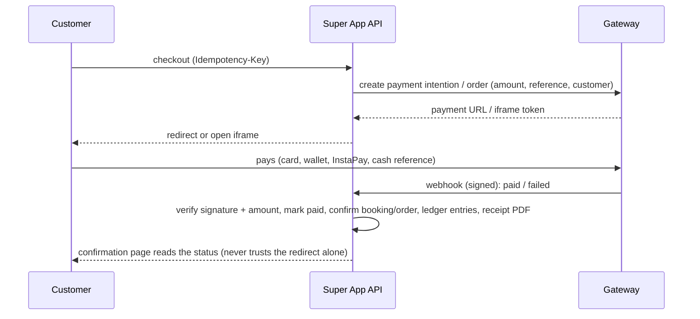

# Integrations Guide
Subtitle: Payments, couriers, email, SMS, football data, AI agents (Claude + n8n), storage and e-receipts — how each one plugs in, who uses it, and what to ask each company.
Document: INTEGRATIONS — backend phase
Version: 1.2 (public data APIs added)
Date: 17 October 2026
Owner: Sharaf (CEO)
Status: For review — providers are connected when their contracts and API details arrive
Audience: Founders (for negotiations), backend engineers, n8n builders

# 1. Principles

1. **One interface per kind of service, one adapter per company.** The business code talks to `IPaymentGateway`, `IShippingProvider`, `IEmailSender`, `ISmsSender`, `IFootballData`, `IFileStorage`, `IEInvoiceProvider`. Adding a company means writing **one adapter class**; nothing else changes.
2. **A simulated adapter exists for every interface**, so the whole site works end to end before any contract is signed (test cards, fake courier updates, emails saved as files).
3. **The CEO system controls every integration** (registry, `ops.Integrations`): which company is primary, **Simulated / Test / Live** mode, on/off, health, usage and last error. Switching courier or gateway is a setting, not a code change.
4. **Secrets never live in the code or the database in plain text.** They are environment variables (`.env` locally, server secrets in production) or encrypted values; the CEO can replace a secret but never read it back.
5. **Every incoming webhook is verified** (signature, timestamp, de-duplication) and every outgoing call has a timeout, retries with back-off, and a circuit breaker so one slow company cannot slow the site.
6. **Every call is counted** (calls, errors, quota) per day for the usage bars and alerts (`integration.down`, `quota.warning` events go to n8n).
7. **No customer card data ever touches Super App servers** — payments use the provider's hosted checkout or iframe.

# 2. Integration map

| Integration | Interface | Now | Used in systems | Responsible human | Responsible AI agent (when created) |
|---|---|---|---|---|---|
| **Payment gateway** | `IPaymentGateway` | Simulated | Site (bookings, packages, games, tournaments, shop, Fantasy Pass), Admin (refunds), CEO (switch), Finance | CFO | Payables agent (prepares only), Revenue analyst (reconciliation) |
| **Payouts / disbursement** | `IPayoutProvider` | Manual bank transfer + reference | Admin payouts, CFO approvals, Partner / Seller / Factory wallets | CFO | Payables agent (prepare) |
| **Courier** | `IShippingProvider` | Simulated (Bosta was the trial name in the front end) | Factory (printed orders), Partner & Seller stores, Admin (problems, returns), Finance (COD), Site (tracking) | Admin manager | Orders & factory agent, Courier agent |
| **Email** | `IEmailSender` | Files in `emails/` (dev) | Every system (notifications, receipts, invitations, password reset) | Admin manager | Support agents (replies), Marketing (broadcasts) |
| **SMS / OTP** | `ISmsSender` | Off | Site (phone verification), Factory (later), alerts | Admin manager | — |
| **WhatsApp** | `IWhatsAppSender` | Off (no links until the owner provides them) | Support, booking reminders | Admin manager | Support agents |
| **Football data** | `IFootballData` | API-FOOTBALL free plan | Fantasy, Matches, Marketing calendar | CEO | Fantasy & games agent |
| **AI model** | via n8n + `IAiClient` | Claude | CEO (agents), Admin (support, reviews), Marketing | CEO | AI supervisor (watches all) |
| **Automation** | Webhooks + Agent API | n8n | All (events) | CEO | AI supervisor |
| **File storage** | `IFileStorage` | Local disk | Studio artwork, photos, IDs, receipts, labels | Technology lead | Technology agent |
| **Maps** | front end (Leaflet + OpenStreetMap) | Live | Site (pitch maps), Partner (location picker) | — | — |
| **Geocoding** (address ↔ map pin) | `IGeocoder` | Nominatim (OpenStreetMap), cached | Partner pitch editor and application, factory and seller addresses | Admin manager | Partnerships agent |
| **Weather** | `IWeatherProvider` | Open-Meteo — free for testing; **paid plan needed for commercial use** | Site (pitch page, checkout, reminders), Seller marketing calendar, Partner insights | Admin manager | Pitch & bookings agent, Marketing lead |
| **Public holidays** | `IHolidaysProvider` | Nager.Date (verify Egypt) or Calendarific, synced into `ops.PublicHolidays` | Partner insights and forecast, Seller marketing calendar, CEO what-if | Admin manager | Revenue analyst, Marketing lead |
| **Phone & email validation** | local library (no external API) | `libphonenumber-csharp` + confirmation email | Sign-up, profiles, applications, addresses | — | — |
| **E-receipts (ETA)** | `IEInvoiceProvider` | Off — needs the commercial register and tax card | Finance, receipts | CFO | Compliance agent |
| **Error monitoring** | Serilog sink | Files + database (Sentry optional) | All | Technology lead | Quality & monitoring agent |

# 3. Payment gateway

## 3.1 What Super App needs from a gateway
| Need | Why | Where |
|---|---|---|
| **Hosted checkout or iframe** | Card data never touches our server (no PCI burden) | every online payment |
| Cards (Visa, Mastercard, **Meeza**) | most customers | all |
| **Mobile wallets** (Vodafone Cash, Orange, Etisalat/e&, WE Pay) | very common in Egypt | all |
| **InstaPay** | growing fast | all |
| **Cash reference** (Fawry / Aman / Masary outlets) | customers without cards | shop, packages |
| **Signed webhooks** (HMAC) | the only way a payment is confirmed | `/webhooks/payments/{provider}` |
| **Refund API** — full and partial | cancellations, returns, disputes | admin refunds, policy refunds |
| **Payouts / disbursement API** | pay pitch owners, sellers and the factory without manual transfers | wallets, payouts |
| Split payments / marketplace (optional) | send part of a payment directly to a partner | later |
| Saved cards / tokenisation (optional) | faster repeat bookings, memberships | later |
| **Sandbox** with test cards and test wallets | build and test before going live | testing |
| Settlement reports API or daily file | reconcile what the gateway paid us | finance |
| Arabic checkout page | customers | all |

## 3.2 How it works in Super App


**Interface (`Application/Abstractions/Payments/IPaymentGateway.cs`):**
- `CreatePaymentAsync(request)` → payment URL / token
- `VerifyWebhook(headers, body)` → verified event or rejection
- `RefundAsync(paymentRef, amount, reason)`
- `GetStatusAsync(paymentRef)` — used by a reconciliation job when a webhook is late
- `IPayoutProvider.SendAsync(payout)` — when the provider supports disbursements

## 3.3 Candidate companies
Egyptian gateways the owner can compare: **Paymob**, **Fawry (FawryPay)**, **Kashier**, and the payment services of banks. Super App can use **more than one**: for example one gateway for cards and wallets and Fawry for cash references; the registry marks a primary provider per method.

## 3.4 What to collect when the contract is signed
| Item | Where it goes |
|---|---|
| Sandbox and live **API keys** (secret/public) | `PAYMENTS__{PROVIDER}__SECRETKEY`, `…__PUBLICKEY` (environment) |
| **HMAC / webhook secret** | `PAYMENTS__{PROVIDER}__HMACSECRET` |
| Integration / method ids (one per method: card, wallet, kiosk, InstaPay) | integration `ConfigJson` |
| Iframe or checkout id | integration `ConfigJson` |
| The webhook URL to register at the provider | `https://{domain}/api/v1/webhooks/payments/{provider}` |
| Payout / disbursement credentials (if offered) | environment |
| Fees per method, settlement days, refund rules | finance settings and the CFO's notes |

## 3.5 Questions for payment companies
**English (to send):**
1. Do you offer a hosted checkout page or iframe so that card data never reaches our servers? Is it available in Arabic?
2. Which methods are included: Visa/Mastercard, Meeza, mobile wallets, InstaPay, Apple Pay, cash at outlets (Fawry/Aman)? Can we enable them one by one?
3. How do you confirm a payment to our server? Do you send **signed webhooks** (HMAC)? What do you do if our server is down — do you retry?
4. Do you have an API for **full and partial refunds**? How long does a refund take to reach the customer for each method?
5. Do you have a **payouts / disbursement API** so we can pay our partners (pitch owners, sellers, a factory) to bank accounts, wallets or InstaPay? Fees?
6. Do you support **split payments / marketplace** settlement?
7. Do you support **saved cards / tokenisation** for repeat customers?
8. Is there a **sandbox** with test cards and test wallets? Is there an API reference and a .NET or REST example?
9. Fees per method (percentage + fixed), monthly fees, setup fees, and **settlement time** to our bank account.
10. Do you provide **settlement reports** by API or daily file for reconciliation?
11. Documents needed to open a merchant account (commercial register, tax card, bank letter, IDs…)? Can we start in sandbox before they are ready?
12. Chargebacks: how are they handled and what are the fees?
13. Limits per transaction and per day, especially for wallets and InstaPay.
14. Technical support channel and response time; status page.

<div dir="rtl" class="ar-box" markdown="1">

**بالعربي (للإرسال لشركات الدفع):**

1. عندكم صفحة دفع جاهزة (Hosted Checkout) أو iFrame بحيث بيانات الكارت عمرها ما توصل لسيرفرنا؟ وهل الصفحة متاحة بالعربي؟
2. إيه وسائل الدفع المتاحة: فيزا وماستركارد، ميزة، المحافظ الإلكترونية، إنستاباي، Apple Pay، الدفع كاش في المنافذ (فوري / أمان)؟ وهل نقدر نشغلهم واحدة واحدة؟
3. إزاي بتأكدوا الدفع لسيرفرنا؟ بتبعتوا **Webhook موقّع (HMAC)**؟ ولو السيرفر عندنا واقع بتعيدوا الإرسال؟
4. عندكم API لـ **الاسترجاع الكامل والجزئي**؟ والفلوس بترجع للعميل في قد إيه لكل وسيلة؟
5. عندكم **API لتحويل الفلوس (Payouts / Disbursement)** علشان ندفع لشركائنا (أصحاب الملاعب والبائعين والمصنع) على حساب بنكي أو محفظة أو إنستاباي؟ وبكام؟
6. بتدعموا **تقسيم المدفوعات (Split / Marketplace)**؟
7. بتدعموا **حفظ الكارت** للعملاء اللي بيدفعوا كتير؟
8. فيه **حساب تجريبي (Sandbox)** بكروت ومحافظ تجريبية؟ وفيه توثيق للـ API ومثال REST أو .NET؟
9. النسب لكل وسيلة (نسبة + مبلغ ثابت)، والمصاريف الشهرية ومصاريف التفعيل، والفلوس بتنزل حسابنا في **قد إيه**؟
10. بتوفروا **تقارير التسويات** بالـ API أو ملف يومي؟
11. المستندات المطلوبة لفتح الحساب؟ وينفع نبدأ على الـ Sandbox قبل ما المستندات تخلص؟
12. الاعتراض على العمليات (Chargebacks) بيتعامل معاه إزاي وبكام؟
13. الحد الأقصى للعملية الواحدة ولليوم، خصوصاً المحافظ وإنستاباي.
14. الدعم الفني بيتواصل إزاي وبيرد في قد إيه؟

</div>

# 4. Courier (shipping)

## 4.1 What Super App needs from a courier
| Need | Why | Where |
|---|---|---|
| **Create shipment API** → tracking number + **label PDF** | the factory packs, the label prints automatically | Factory → shipping |
| **Pickup request API** (from the factory, a seller, a pitch owner's store) | no phone calls | Factory, stores |
| **Status webhooks** (picked up, out for delivery, delivered, refused, returned) | customers and sellers are told automatically | `/webhooks/courier/{provider}` |
| Tracking API (fallback when a webhook is missed) | reconciliation job | background |
| **Cash on delivery** + **COD remittance report** | most shop orders in Egypt are COD | Finance |
| **Reverse pickup** (returns) | Returns and exchanges (an item with a problem, within 24 hours; the store pays) | Returns |
| Cancel shipment | order cancelled after packing | Admin |
| Rates / zones by governorate | delivery fee and promises | Checkout |
| Sandbox | testing | testing |

**Interface (`IShippingProvider`):** `CreateShipmentAsync`, `RequestPickupAsync`, `GetLabelAsync`, `CancelAsync`, `TrackAsync`, `CreateReturnAsync`, `VerifyWebhook`, `GetCodRemittancesAsync`.

## 4.2 Who uses it
| System | What happens |
|---|---|
| **Factory** | when every item of an order is packed → shipment + pickup + label (automatic) |
| **Seller / Partner store** | "Ship" on an order → shipment + pickup + label |
| **Admin** | problems: rebook, cancel; returns: reverse pickup |
| **Finance (CFO)** | COD collected vs remitted; refused deliveries (cost absorbed by Super App for printed items) |
| **Site** | customer tracking page |
| **Agents** | Orders & factory agent follows late parcels; Courier agent handles refusals and returns |

## 4.3 Candidate companies
Couriers active in Egypt that the owner can compare: **Bosta**, **Mylerz**, **Aramex**, and others. The registry allows one primary courier and switching later.

## 4.4 Questions for courier companies
**English:**
1. Do you have a REST API to **create shipments**, get the **airway bill / label PDF**, and **request pickups**? Is there a sandbox?
2. Do you send **status webhooks** for every change (picked up, out for delivery, delivered, refused, returned)? Are they signed?
3. **Cash on delivery:** how and when do you transfer the collected cash? Is there a **COD remittance report** by API?
4. **Reverse pickup** for returns and exchanges — available by API? Price?
5. Can we **cancel** or change a shipment by API before pickup?
6. Prices by governorate / zone and by weight; extra fees (COD fee, return fee, re-delivery); monthly volume discounts.
7. Delivery times by governorate; how many delivery attempts; what happens after a refusal.
8. Daily pickup from our factory (one address) and from many small sellers (many addresses) — is that possible?
9. Packaging requirements and label size (A6 / thermal printer?).
10. Insurance and liability for lost or damaged parcels.
11. Contract documents and the payment terms.
12. Technical contact and support hours.

<div dir="rtl" class="ar-box" markdown="1">

**بالعربي (للإرسال لشركات الشحن):**

1. عندكم API لـ **إنشاء الشحنة**، وطباعة **البوليصة (PDF)**، و**طلب مندوب الاستلام**؟ وفيه حساب تجريبي؟
2. بتبعتوا **Webhook** مع كل تغيير في حالة الشحنة (اتاستلمت، خرجت للتوصيل، اتسلمت، اترفضت، رجعت)؟ وهل هو موقّع؟
3. **الدفع عند الاستلام:** بتحولوا الفلوس اللي حصلتوها إمتى وإزاي؟ وفيه **تقرير تحويلات** بالـ API؟
4. فيه **مندوب يستلم المرتجعات** من العميل بالـ API؟ وبكام؟
5. ينفع **نلغي** أو نعدّل الشحنة بالـ API قبل الاستلام؟
6. الأسعار حسب المحافظة والوزن، والرسوم الإضافية (رسوم التحصيل، المرتجع، إعادة التوصيل)، وخصومات الكميات الشهرية.
7. مدة التوصيل لكل محافظة، وكام محاولة توصيل، وإيه اللي بيحصل لو العميل رفض.
8. استلام يومي من المصنع (عنوان واحد)، ومن بائعين صغيرين كتير (عناوين كتير)، ينفع؟
9. شروط التغليف ومقاس البوليصة (A6 / طابعة حرارية؟).
10. التأمين والمسؤولية عن الشحنات اللي بتضيع أو بتتلف.
11. مستندات التعاقد وطريقة الدفع.
12. رقم التواصل الفني ومواعيد الدعم.

</div>

# 5. Email (official company address)

## 5.1 How email works
- **One official sender** for everything (for example `no-reply@<domain>`), with a reply-to that matches the topic (`support@`, `finance@`, `partners@`). Until the owner sends the domain and the address, the placeholder `no-reply@superapp.local` is used.
- **Development:** emails are written as `.eml` files to `emails/` in the project (open them in Outlook or a browser) — nothing leaves the machine.
- **Production:** SMTP through the company mail provider, or a transactional email service for volume.
- Emails are queued in `notify.EmailOutbox` and sent by a background job with retries; failures are visible to admins.
- Templates in **Arabic (RTL) and English** with the Super App logo: welcome, confirm email, reset password, admin invitation, booking confirmed / cancelled / reminder, package purchased, order placed / shipped / delivered, return updates, payout sent / rejected, application approved / rejected, design approved / rejected, ticket replies, receipts (PDF attached).

**Interface:** `IEmailSender.SendAsync(to, subject, html, text, attachments)` with adapters `FileEmailSender` (development), `SmtpEmailSender` (MailKit).

## 5.2 Choosing a provider
| Option | Good for | Note |
|---|---|---|
| Google Workspace or Microsoft 365 mailbox (SMTP) | company mailboxes + low volume system mail | daily sending limits apply — fine at launch |
| Transactional service (e.g. Amazon SES, SendGrid, Mailgun, Brevo) | high volume, delivery statistics | cheap per email; needs domain verification |
| Hostinger email (with the domain) | simple start | check sending limits |

## 5.3 Domain setup (when the domain exists)
| DNS record | Why |
|---|---|
| **SPF** (`TXT v=spf1 …`) | allows our provider to send for the domain |
| **DKIM** (provider key) | signs every email |
| **DMARC** (`_dmarc` TXT, start with `p=none`, then `quarantine`) | protects the brand from spoofing |
| MX | receiving mail for support@, finance@ |

## 5.4 What to send us
1. The domain name and who manages its DNS.
2. The official sender address and the reply-to addresses.
3. SMTP host, port, username and an app password (or the provider's API key) — they go into the server's environment, never into the code.

# 6. SMS, OTP and WhatsApp

## 6.1 Use cases
| Use | Channel | When |
|---|---|---|
| Phone verification at sign-up, password reset by phone | SMS OTP | after a provider is chosen |
| Booking reminders, "your parcel is out for delivery" | SMS or WhatsApp template | later |
| Support conversations | WhatsApp Business | **only after the owner provides the WhatsApp number/links** |

**Interfaces:** `ISmsSender.SendAsync(phone, text)` and `IWhatsAppSender.SendTemplateAsync(phone, template, values)`; both are off until configured.

## 6.2 Questions for SMS / WhatsApp providers
**English:**
1. Do you provide an HTTP API for single and bulk SMS, and an **OTP** product (codes, expiry, rate limits)?
2. **Sender ID** ("SuperApp"): what is the registration process and how long does it take?
3. Price per SMS (local) and any monthly fee; delivery reports by webhook?
4. Delivery rate and speed to all Egyptian networks (Vodafone, Orange, Etisalat/e&, WE)?
5. Do you offer **WhatsApp Business Platform** access (as a Meta partner)? Template approval time and price per conversation?
6. Sandbox / test credits?

<div dir="rtl" class="ar-box" markdown="1">

**بالعربي (لشركات الرسايل والواتساب):**

1. عندكم API لإرسال رسالة SMS واحدة ورسايل كتير، ومنتج **OTP** لأكواد التفعيل (صلاحية الكود والحدود)؟
2. **اسم المرسل** ("SuperApp"): التسجيل بيتعمل إزاي وبياخد قد إيه؟
3. سعر الرسالة، وفيه اشتراك شهري؟ وبتبعتوا تقرير التوصيل بـ Webhook؟
4. نسبة وسرعة التوصيل على كل الشبكات (فودافون، أورنج، اتصالات / e&، WE)؟
5. بتوفروا **WhatsApp Business Platform** (كشريك لـ Meta)؟ موافقة القوالب بتاخد قد إيه، وسعر المحادثة كام؟
6. فيه حساب تجريبي أو رصيد للتجربة؟

</div>

# 7. Football data — API-FOOTBALL

## 7.1 What it feeds
- **Fantasy:** clubs, real player names and positions, fixtures, gameweeks, per-player match statistics (minutes, goals, assists, clean sheets, saves, cards, penalties), so points are calculated automatically after each gameweek.
- **Matches page:** fixtures, live scores, results, standings for the Egyptian Premier League, CAF, Egypt and the English Premier League.
- **Marketing calendar:** big matches for sellers.
- **Logos are not shown** for now (licensing); kit colours are used instead. A switch turns logos on later.

**Interface:** `IFootballData` with methods for leagues, teams, squads, fixtures (by date / live / by id), fixture player statistics and standings. The adapter `ApiFootballClient` reads usage from the response headers (requests used and the daily limit) and writes it to `ops.IntegrationUsage` for the **usage bar** in the CEO system.

## 7.2 Staying inside the free plan (100 requests a day)
The site **never** calls API-FOOTBALL; only the server's sync jobs do, and results are cached in our database.

| Job | Calls | When |
|---|---|---|
| Today's fixtures, both leagues | 2 | once in the morning |
| Live scores (one call returns all live matches) | up to ~24 | every 10 minutes only while a match of ours is being played |
| Player statistics for each finished match | ~1 per match (EPL 10 + EGY 9 per gameweek) | once, after the final whistle |
| Standings, both leagues | 2 | after the last match of the day |
| Squads (players and positions) | 1 per club, spread over the week | weekly |
| **Reserve** | ~20 | manual re-sync by an admin |

**Usage bar:** green below 70%, **yellow at 70%**, **red at 90%** with the message *"Upgrade the API-FOOTBALL plan"*. At 100% the jobs stop until the next day and the site keeps showing cached data.

## 7.3 To confirm before relying on it
1. Which **seasons** the free plan returns (it must include the current season of both leagues).
2. Whether the free plan allows **commercial use**; otherwise the cheapest paid plan.
3. League ids for the Egyptian Premier League and the English Premier League in their system (stored in `fantasy.Competitions.ExternalLeagueId`).
4. How quickly player statistics are final after a match (late corrections are re-applied by the scoring job).

# 8. AI agents (Claude) and automation (n8n)

## 8.1 The model
- The agents use **Claude** (Anthropic API). The model is chosen per agent in the CEO panel (e.g. a fast model for routine triage, a stronger model for decisions and writing).
- **API keys for Claude are stored in n8n's credentials** (or the server environment), never in the Super App database.
- **Privacy:** agents receive only what a task needs. National ID numbers, payout details, full addresses and card data are never sent to the model; personal data is masked in prompts and logs.
- **Cost:** every run reports tokens and cost to `/agent/runs`; the CEO sets a monthly budget per agent and gets an alert near it.

## 8.2 n8n
| Item | Recommendation |
|---|---|
| Hosting | **Self-hosted on the same VPS with Docker** (community edition) for testing and launch; n8n Cloud is the paid alternative |
| Security | n8n behind HTTPS with its own login; only n8n's IP may use agent keys with money permissions (optional allow-list) |
| Triggers | Super App **outgoing webhooks** (signed events) and schedules |
| Calling Super App | n8n HTTP Request node with header `X-Api-Key` (one key per agent) |
| Calling Claude | n8n's Anthropic / AI nodes with the Claude credential |
| Human in the loop | anything over an agent's limit → `POST /agent/approvals` → wait for `approval.decided` |

## 8.3 First workflows to build (suggestions)
| Workflow | Trigger | Agent | Output |
|---|---|---|---|
| Support triage and first reply | `ticket.created` | Frontline support | reply, priority, assignment; refunds ≤ 300 EGP |
| Design pre-review | `design.submitted` | Trust & safety | flags (copyright risk, text quality) for the human reviewer |
| Payout preparation | `payout.requested` | Payables | checks and "prepared" status (never sends) |
| Late factory jobs | schedule (hourly) | Orders & factory | reminders to the factory, alert to admin |
| Review moderation | `review.reported` | Trust & safety | hide / keep suggestion |
| Morning briefing | schedule (8:00 Cairo) | AI supervisor | summary to the CEO |
| Social posts for big matches | schedule | Social media & content | drafts for approval |
| Quota and integration alerts | `quota.warning`, `integration.down` | Quality & monitoring | message to the technology lead |

## 8.4 MCP (later)
A Super App **MCP server** will expose safe tools (search bookings, read a ticket, prepare a payout, draft a reply) directly to Claude, with the same permissions and audit as the Agent API. It is designed now and built after launch.

# 9. Storage, maps, e-receipts, monitoring and public data

## 9.1 File storage
| Phase | Where | Notes |
|---|---|---|
| Development and the first VPS | **Local disk** under `storage/` (outside `wwwroot`) | `IFileStorage` adapter `LocalFileStorage` |
| Growth | S3-compatible object storage (e.g. Cloudflare R2, Backblaze B2, AWS S3) | switch the adapter; files are migrated by a script |

- **Public** files (pitch photos, product photos, design previews) are served with long cache headers.
- **Private** files (national ID scans, original artwork, receipts, labels) are served only through **signed links that expire** (e.g. 10 minutes) after a permission check.
- Images are checked (type, size, real image), re-encoded and resized on upload; SVG artwork is sanitised.
- Daily backup of the storage folder together with the database.

## 9.2 Maps and geocoding
- **Maps:** the front end already uses **Leaflet with OpenStreetMap tiles** (vendored). The server stores latitude/longitude for venues, areas and factories.
- **"Near me"** never calls an outside API: the browser gives the customer's position (with permission) and the server calculates distances in SQL from venue coordinates and area centres.
- **Geocoding** (`IGeocoder`: `SearchAsync(text)` → candidates with coordinates, `ReverseAsync(lat, lng)` → address) is used only where a person types or moves a pin: the partner pitch editor and pitch-owner application (address → pin, pin → address), factory and seller addresses.
- **Provider now — Nominatim (OpenStreetMap):** free, no key. Its usage policy must be respected: at most **1 request per second**, an identifying `User-Agent` with a contact email, **attribution** "© OpenStreetMap contributors", no bulk geocoding, and results cached on our side. Our server calls it (never the browser), rate-limits it and caches every answer, which fits the low volume of partners adding venues.
- **Later — a paid geocoder** (e.g. Geoapify or LocationIQ) when volume grows or Arabic address quality needs to be better; switched in the integrations registry.
- **Questions for a paid geocoder:** quality of Egyptian and Arabic addresses; price per request and free quota; whether results may be **stored** (some licences forbid it); rate limits; attribution rules.

## 9.3 E-receipts (Egyptian Tax Authority)
- Interface `IEInvoiceProvider` with the adapter switched **off**.
- Receipts already carry VAT inside each amount and a unique sequential number, so they can be submitted later.
- **To switch on:** commercial register, tax card, registration with the ETA e-receipt system, the issuing certificate / credentials and the POS/branch codes. The compliance agent tracks the deadline in the compliance calendar.

## 9.4 Monitoring
- **Serilog** structured logs (files + database table for errors) with a `traceId` per request.
- **Health checks** at `/health` (database, storage, background jobs, each integration's last status).
- Optional **Sentry** (or Azure Application Insights) for error alerts once the site is live.

## 9.5 Weather (Open-Meteo)
- **Interface:** `IWeatherProvider.GetHourlyAsync(lat, lng, date)` → temperature, rain probability, wind for each hour.
- **Uses:**
    - **Pitch page and checkout** (outdoor pitches only): the forecast for the chosen hour, up to 7 days ahead.
    - **Reminder the day before:** when rain probability is high or the temperature is extreme, the reminder suggests an indoor pitch nearby or another hour (Later).
    - **Seller marketing calendar** (Rising level and up): real forecasts replace the monthly Cairo averages used today.
    - **Partner insights** (Later): demand compared with weather.
- **Few calls:** the forecast is fetched **per area centre, not per pitch**, every 3 hours, and cached; the site reads only our cache.
- **Licence:** Open-Meteo's free API is for **non-commercial use**. Before launch, Super App must take their **commercial (paid) API plan**, which adds an API key. Confirm the current terms and price on their site before relying on it.
- **Responsible:** Pitch & bookings agent (alerts), Marketing lead (calendar).

## 9.6 Public holidays
- **Interface:** `IHolidaysProvider.GetHolidaysAsync(country, year)`; results are stored in the table **`ops.PublicHolidays`** (ERD A25), synced every January and refreshed monthly.
- **Providers:** **Nager.Date** (free, no key) — **its Egypt coverage must be verified first**; **Calendarific** (API key, free tier and paid tiers) as the alternative.
- **Islamic holidays** (Eid al-Fitr, Eid al-Adha, Islamic New Year, the Prophet's Birthday) depend on the moon sighting, so they are stored as **estimated**; an admin confirms or moves the date in the admin console once it is announced.
- **Uses:** partner insights (peak-price suggestions on holidays and the eve of holidays, better revenue forecast), the seller marketing calendar, the CEO what-if simulator and forecasts, a "holiday" badge on the availability grid.
- **Responsible:** Revenue analyst (forecast), Marketing lead (calendar); admins with `content.holidays` confirm dates.

## 9.7 Phone and email validation (no external API)
- **Phone numbers:** validated and normalised on the server with **libphonenumber-csharp** (the .NET port of Google's library) to the international format `+20…`; mobile numbers are required where SMS will be used (Egyptian mobile prefixes 10, 11, 12, 15). No outside service is called, so no cost and no personal data leaves the server.
- **Emails:** format validated on the server, then **proven by the confirmation link** (FR-AUTH-01). An optional local list of disposable email domains can block throw-away addresses. No paid validation API.

## 9.8 APIs from the public list that are not used
From the public API list the owner shared (public-apis, *Sports & Fitness*), these were **rejected** on 14 October 2026:
- **Betting and odds APIs:** gambling is illegal in Egypt.
- **Currency APIs:** the whole site works in EGP.
- **QR APIs:** QR codes are made and signed on our server.
- **Other sports:** outside the product's scope.
- **Goal highlight videos:** optional, only after checking their commercial terms.

# 10. Secrets and configuration

All secrets are environment variables (`.env` locally, server secrets in production). `.env` is in `.gitignore`; a `.env.example` with **empty values** is committed so engineers know the names.

```text
# Database
CONNECTIONSTRINGS__DEFAULT=Server=(localdb)\MSSQLLocalDB;Database=SuperApp;Trusted_Connection=True;TrustServerCertificate=True

# First CEO account (used once by the seed)
SEED__CEO_EMAIL=
SEED__CEO_PASSWORD=
SEED__DEMODATA=true

# Security
SECURITY__QR_SIGNING_KEY=
SECURITY__DATA_PROTECTION_KEYS_PATH=
SECURITY__ENCRYPTION_KEY=

# Email
EMAIL__MODE=File            # File | Smtp
EMAIL__FROM=no-reply@superapp.local
EMAIL__SMTP_HOST=
EMAIL__SMTP_PORT=587
EMAIL__SMTP_USER=
EMAIL__SMTP_PASSWORD=

# Payments (one block per provider)
PAYMENTS__PAYMOB__SECRETKEY=
PAYMENTS__PAYMOB__PUBLICKEY=
PAYMENTS__PAYMOB__HMACSECRET=

# Courier
SHIPPING__BOSTA__APIKEY=
SHIPPING__BOSTA__WEBHOOKSECRET=

# Football data
FOOTBALL__APIFOOTBALL__KEY=

# Automation
AUTOMATION__N8N__BASEURL=
AUTOMATION__WEBHOOK_SIGNING_KEY=

# Storage
STORAGE__MODE=Local         # Local | S3
STORAGE__LOCAL_ROOT=storage

# Geocoding, weather, holidays
GEO__PROVIDER=Nominatim       # Nominatim | Geoapify | LocationIQ
GEO__USER_AGENT=SuperApp/1.0 (contact email)
GEO__APIKEY=                  # paid providers only
WEATHER__OPENMETEO__APIKEY=   # empty = free non-commercial endpoint (testing only)
HOLIDAYS__PROVIDER=NagerDate  # NagerDate | Calendarific
HOLIDAYS__CALENDARIFIC__APIKEY=
```

Rules:
- Rotate a secret by replacing it in the environment (or in the CEO system for integration secrets) — no code change.
- Secrets are **never logged** and never returned by any API.
- Each environment (development, testing, production) has **different** keys.

# 11. Controls in the CEO system

| Screen | What the CEO can do |
|---|---|
| **Integrations** | See every integration with status (Healthy / Degraded / Down), mode (Simulated / Test / Live), primary provider, last call, last error, calls and errors today; switch provider; switch test ↔ live; turn on/off; replace a secret; run a test call |
| **Usage bars** | API-FOOTBALL requests today vs the daily limit (yellow 70%, red 90%); email sent today; AI cost per agent this month |
| **Webhooks** | n8n subscriptions: URL, events, on/off, delivery log, re-send a failed event |
| **API catalogue** | Every Super App endpoint group with purpose, permission, callers, calls and errors in 24 h; switch a group off |
| **AI agents** | Keys, permissions, limits, tasks, pause / emergency stop |

# 12. Responsibility matrix

**R** = does the work · **A** = accountable / approves · **I** = informed

| Integration | CEO | Admin manager | CFO | Technology lead | AI agent |
|---|---|---|---|---|---|
| Payment gateway — contract, live switch | A | I | R | R (technical) | — |
| Refunds over the limit | A | R | R (second approval > 50,000) | — | Support lead prepares |
| Payouts | A (> 10,000) | I | R (sends) | — | Payables prepares |
| Courier — contract, switch | A | R | I (COD) | R (technical) | Orders & factory, Courier agent follow up |
| COD reconciliation | I | I | A | — | Revenue analyst R |
| Email & domain | A | R | — | R | — |
| SMS / WhatsApp | A | R | — | R | Support agents use it |
| API-FOOTBALL plan and quota | A | I | I (cost) | R | Fantasy & games agent watches |
| Claude + n8n | A | I | I (cost) | R | AI supervisor R |
| File storage and backups | I | I | — | A / R | Quality & monitoring watches |
| Geocoding (Nominatim / paid geocoder) | A | R | — | R | Partnerships agent uses it |
| Weather (Open-Meteo plan) | A | R | I (cost) | R | Pitch & bookings agent, Marketing lead |
| Public holidays (sync + confirming Islamic dates) | I | R | — | R | Revenue analyst, Marketing lead |
| E-receipts (ETA) | A | — | R | R | Compliance agent tracks |

# 13. Connecting a new company — step by step

When the owner sends a company's API documentation and test credentials:

1. **Read the docs** and map them to our interface (create shipment ↔ `CreateShipmentAsync`, etc.). List anything they don't support.
2. **Add the adapter** class in `Infrastructure/Integrations/{Category}/{Company}` with its options class and unit tests (using recorded sample responses).
3. **Add the webhook verifier** (signature, timestamp, de-duplication) and its endpoint mapping.
4. **Register** the company in the integrations registry (seed or CEO screen) in **Test** mode; put the test secrets in the environment.
5. **Run the integration tests** and the Postman folder for that area against the company's sandbox (normal and failure cases: declined card, timeout, duplicate webhook, refused parcel).
6. **CEO review:** check the registry screen shows Healthy and the usage counters move.
7. **Go live:** put the live secrets in the server environment, switch the mode to **Live**, make it **Primary**, watch errors for the first days.
8. **Fallback:** keep the previous provider (or the simulated one) available to switch back from the CEO system.
