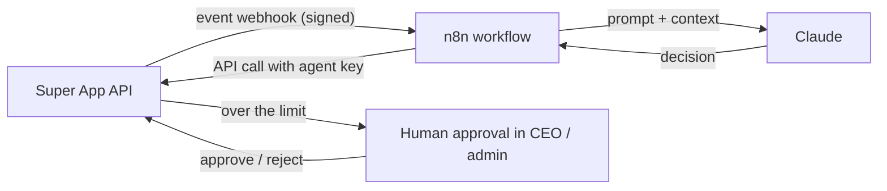
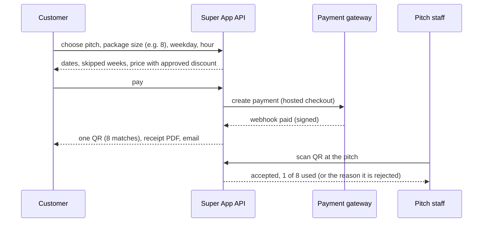

# Product Requirements Document (PRD)
Subtitle: Super App — the Egyptian sports super app: pitches, players, fantasy, shop, print on demand, and the systems that run the company.
Document: PRD — backend phase
Version: 1.2 (public data APIs added)
Date: 16 October 2026
Owner: Sharaf (CEO)
Status: For review — no code is written until this is approved
Audience: Founders, backend and frontend engineers, QA

# 1. About this document

## 1.1 Purpose
Super App already exists as a complete front end (HTML, CSS, vanilla JavaScript) that stores its data in the browser. This document defines **what the backend must do**, so the same product runs on a real server with a real database, real accounts, real money flows and real integrations. It is the reference for engineers who build, test and review the backend.

The companion documents are:

| Document | Answers |
|---|---|
| **PRD** (this one) | What the product does, for whom, and the rules it must follow |
| **ERD** | Every table, column, relationship, constraint and index |
| **API** | Every endpoint, who may call it, request and response shapes |
| **INTEGRATIONS** | Payments, couriers, email, SMS, football data, n8n, AI agents, e-receipts |
| **STRUCTURE** | Solution layout, packages, how to run, migrate, seed and test |

## 1.2 Decisions already made (fixed rules)

| Area | Decision |
|---|---|
| Backend | **ASP.NET Core Web API on .NET 10** (latest LTS), object-oriented, clean code, dependency injection everywhere |
| Pattern | Controllers → Services → Repositories, with Middlewares for authentication, authorization and validation, and one **global error handler** |
| Database | **Microsoft SQL Server**, **EF Core Code-First**. The owner runs `Add-Migration` and `Update-Database` himself |
| Front end | The existing site is served unchanged from `wwwroot`; its `js/services/*` files are switched from browser storage to API calls one by one. **The design must not change.** |
| Sign-in | **ASP.NET Core Identity** with a **secure cookie** (HttpOnly, Secure, SameSite). Two-factor sign-in is mandatory for the CEO and admins |
| First user | A default **CEO** account is created by the seed |
| Approvals | The CEO approves pitch owners, sellers and factories. The CEO can grant the **Approvals** permission to chosen admins |
| Admins | Created **directly by the CEO** with their permissions. Admins never sign up as customers |
| Seed data | Today's demo data becomes the seed, so the site is not empty on day one. The owner then adds real pitches and products |
| AI | AI agents **really run** (Claude + n8n). The backend gives them scoped access, events, approvals and full logs |
| Football data | **API-FOOTBALL, free plan** first. No club logos for now. A usage bar warns before the free quota runs out |
| Chat | Support chat (customer ↔ Super App team) is live. **No private messages between customers** — they talk in communities |
| Email | One official company address sends everything. Until the domain exists, a placeholder address is used and, in development, emails are saved as files |
| Hosting | Local (SQL Server LocalDB) → free .NET hosting for testing → **Hostinger VPS** for launch |
| Not yet | Commercial register, tax card and ETA e-receipts: prepared in code but switched off |

## 1.3 How to read the requirements
Each requirement has an ID such as **FR-BOOK-04** (functional) or **NFR-SEC-02** (non-functional). "Must" is mandatory for launch; "Should" is expected unless agreed otherwise; "Later" is designed for but built after launch.

# 2. Product overview

## 2.1 Vision
One app for everything football in Egypt: book a pitch, fill your squad, play fantasy, buy gear, and sell your own designs — run by a small human team with AI agents doing most of the daily work.

## 2.2 The seven systems

| # | System | Path | Who uses it | Purpose |
|---|---|---|---|---|
| 1 | **Public site** | `/` | Customers (players, fans, shoppers) | Pitches, bookings, find players, tournaments, matches and news, fantasy, shop, communities, help |
| 2 | **Partner dashboard** | `/dash` | Pitch owners and their staff | Pitches, availability, bookings, QR check-in, packages, offers and codes, tournaments, free slots, reviews, store, finance, wallet |
| 3 | **Seller dashboard** | `/seller` | Sellers (print on demand and/or own products) | Designs, studio, orders, store settings, codes, analytics, marketing calendar, wallet, returns |
| 4 | **Factory system** | `/factory` | Factory owner and floor staff | Print jobs, stages, quality check, packing, courier shipping, team, money, reports |
| 5 | **Admin console** | `/admin` | Super App team (human admins and AI agents) | Approvals, money, people, orders, support, content, marketing, fantasy, communities, catalogue, factories, analytics, audit |
| 6 | **CEO Command Center** | `/ceo` | The CEO (and the CFO for second approvals) | Approvals over limits, org and permissions, admins, AI agents, integrations and APIs, kill switches, goals, budgets, reports, audit |
| 7 | **AI & automation layer** | (API only) | AI agents (Claude), n8n workflows | Scoped service accounts, events, tasks, human approvals, logs, costs |

The systems share **one database and one API**. A change in one system is visible in the others immediately (for example, a pitch approved in the admin console appears on the site, and a booking made on the site appears in the partner dashboard).

## 2.3 Scope

**In scope for the backend phase**
- Accounts, roles, permissions, applications and approvals for every system.
- Every feature that exists in the front end today, moved to the server with the same behaviour and the same business rules (section 6).
- Payments, payouts, courier and email behind adapters, so a provider is plugged in when its contract is signed.
- Real football data and real fantasy scoring from API-FOOTBALL.
- Live support chat and live notifications.
- The integrations registry, API catalogue and AI-agent panel in the CEO system.
- Security, performance, logging, backups, seed data, tests and a Postman collection.

**Out of scope for now (designed for, built later)**
- Native mobile apps (the site becomes an installable PWA after the backend).
- Freelancer services marketplace (after launch).
- ETA e-receipts (after the commercial register and tax card).
- Club logos (after licensing).
- SMS and WhatsApp sending (after a provider is chosen).

# 3. Users, roles and permissions

## 3.1 Account types
Everyone has **one account** (one email, one phone). What an account can do comes from its **roles** and **permissions**.

| Role | How it is obtained | Signs in to |
|---|---|---|
| **Customer** | Signs up on the site (email or phone + password, or a one-time code later) | Site |
| **Pitch owner** | A customer applies at `/partner/apply`; approved by the CEO or an admin with the Approvals permission | Site + `/dash` |
| **Pitch staff** | Created by a pitch owner, limited to that owner's pitches | `/dash` (limited) |
| **Seller** | A customer (or pitch owner) applies at `/sell` or `/dash/sell`; approved as above | Site + `/seller` |
| **Factory owner** | Applies through a factory application (link shared by Super App); approved by the CEO | `/factory` |
| **Factory staff** | Created by the factory owner: supervisor, printer, quality check, packer. Sign in with name + 4-digit PIN on a factory device | `/factory` |
| **Admin** | **Created by the CEO** with a set of permissions; receives an invitation email to set a password and two-factor sign-in | `/admin` |
| **CFO** | An admin with the Finance permissions and the right to give the **second approval** | `/admin`, `/ceo` (approvals only) |
| **CEO** | Created by the seed. All permissions. Cannot be deleted or suspended by anyone else | Everything |
| **AI agent** | Created by the CEO in the AI panel; a service account with an API key, permissions and a money limit | API only |

One person can hold several roles (for example a pitch owner who is also a seller). One button switches between their dashboards.

## 3.2 Permission model
- Permissions are **fine-grained codes** grouped by area, for example `approvals.partners`, `payouts.prepare`, `payouts.send`, `refunds.issue`, `content.banners`, `community.moderate`, `fantasy.manage`, `settings.platform`, `audit.read`.
- **Roles** are named bundles of permissions (for example "Admin manager", "Support", "Finance"). The CEO creates and edits roles and assigns them to admins and AI agents.
- **Scopes:** partner, seller and factory permissions are always limited to the records they own (their pitches, their designs, their jobs). This is enforced on the server for every request, not only hidden in the UI.
- **Money limits** are attached to a role or a person: refunds and credits up to X EGP, payouts up to Y EGP. Above the limit, the action becomes an **approval request**.
- **Separation of duties** (enforced): preparing a payout ≠ sending it; adjusting a balance ≠ approving it; creating promo codes ≠ reviewing revenue; nobody can edit or delete the audit log.

## 3.3 Requirements — accounts and access

| ID | Requirement | Priority |
|---|---|---|
| FR-AUTH-01 | Customers sign up with name, email, phone (Egyptian format) and password; email verification by link; phone verification by code when an SMS provider exists | Must |
| FR-AUTH-02 | Sign-in issues a secure HttpOnly cookie; sessions expire after inactivity (14 days for customers, 8 hours for admins and the CEO); sign out everywhere is available | Must |
| FR-AUTH-03 | Account lockout after 5 failed attempts for 15 minutes; rate limits on sign-in, sign-up and password reset | Must |
| FR-AUTH-04 | Password reset by email link (single use, 30-minute expiry) | Must |
| FR-AUTH-05 | Two-factor sign-in (authenticator app) is mandatory for the CEO and every admin | Must |
| FR-AUTH-06 | The seed creates the CEO account; its password and email come from environment variables, never from code | Must |
| FR-AUTH-07 | The CEO creates admin accounts (name, work email, role, permissions, money limits); the admin gets an invitation email to set a password | Must |
| FR-AUTH-08 | The CEO (or an admin with the right permission) can suspend any non-CEO account; suspension signs the account out and blocks sign-in | Must |
| FR-AUTH-09 | Factory staff sign in on a registered factory device with their name and a 4-digit PIN; PINs are hashed and rate-limited | Must |
| FR-AUTH-10 | Customers can download their data and request account deletion (Egyptian data protection law 151/2020); money records are kept for legal periods and anonymised | Should |
| FR-AUTH-11 | "Open as" (the CEO or an admin opening a partner's, seller's or factory's view to help) is logged with who, when and why | Must |

## 3.4 Applications and approvals

| ID | Requirement | Priority |
|---|---|---|
| FR-APP-01 | Pitch owner application: owner name, phone, email, national ID number and photos, venue name, governorate, area, address, map pin, number and format of pitches, photos, payout method (bank or InstaPay), acceptance of the partner agreement | Must |
| FR-APP-02 | Seller application: name, store name, type (print on demand / own products / both), national ID number and photos, phone, payout method, about the store, acceptance of the seller agreement | Must |
| FR-APP-03 | Factory application: company name, owner, address, capacity per day, techniques (DTF), contact, bank details, documents | Must |
| FR-APP-04 | Applications go to the **Approvals** queue in the CEO system and in the admin console (for admins with `approvals.*`) | Must |
| FR-APP-05 | Approve opens the dashboard for the applicant and notifies them (in-app + email); reject needs a reason and the applicant can fix and resend | Must |
| FR-APP-06 | New pitches added by an approved owner are "waiting for review" and hidden from the site until approved | Must |
| FR-APP-07 | "Approve new sellers" can be switched off in settings (sellers then go live immediately) | Should |
| FR-APP-08 | ID documents are stored privately (not publicly reachable), viewable only by roles with `kyc.read` | Must |

# 4. Functional requirements — public site and pitches

## 4.1 Pitches

| ID | Requirement | Priority |
|---|---|---|
| FR-PITCH-01 | A pitch has: name, venue, governorate, area, address, map location, format (5/7/11-a-side), surface, indoor/outdoor, photos, facilities, opening hours per weekday, price per hour (with peak/off-peak), cancellation policy, weekly-package options, status | Must |
| FR-PITCH-02 | Search and filter by area, distance from the user (when location is allowed), format, price, rating, facilities, free hours today | Must |
| FR-PITCH-03 | Pitch page shows live availability for the next 14 days, hour by hour, including offers and the waitlist | Must |
| FR-PITCH-04 | Owners add, edit, close/reopen and delete pitches; deleting a pitch with upcoming bookings cancels and refunds them in full | Must |
| FR-PITCH-05 | Owners block single hours or date ranges (maintenance, private events) with a reason | Must |
| FR-PITCH-06 | Reviews: only customers with a played booking can review; owners reply publicly; owners can report a review; admins hide/restore | Must |

## 4.2 Bookings and checkout

| ID | Requirement | Priority |
|---|---|---|
| FR-BOOK-01 | A customer books one or more consecutive hours; the hour is **locked for 10 minutes** while paying so two people cannot pay for the same hour | Must |
| FR-BOOK-02 | Price = pitch price (with offer) − discount code; a **booking service fee** (3%, editable) is added; all prices **include VAT 14%** (editable) | Must |
| FR-BOOK-03 | Payment: online through the payment gateway, or cash at the venue when the owner allows it | Must |
| FR-BOOK-04 | The injury and conduct waiver must be accepted; the acceptance (version, time) is saved with the booking | Must |
| FR-BOOK-05 | Every booking has a **signed QR ticket** and a PDF receipt; the customer gets an email and an in-app notification | Must |
| FR-BOOK-06 | Cancellation follows the policy saved on the booking (table below); the venue cancelling always refunds in full | Must |
| FR-BOOK-07 | Walk-in bookings added by the owner carry no commission | Must |
| FR-BOOK-08 | Commission on app bookings is 10% (editable per partner by an admin deal); the owner earns the rest | Must |
| FR-BOOK-09 | Online booking money becomes **available** to the owner after the match; available money is settled every **Monday** (editable) | Must |
| FR-BOOK-10 | Waitlist: a customer can wait for a booked hour; when it frees up, everyone waiting is notified with a direct checkout link | Must |
| FR-BOOK-11 | Maintenance mode (set by an admin) pauses new bookings with a message | Must |

**Cancellation policies** (chosen per pitch, saved on each booking):

| Policy | Full refund | 50% refund | No refund |
|---|---|---|---|
| Flexible | up to 2 h before | until kick-off | — |
| Standard | up to 6 h before | until kick-off | — |
| Moderate | up to 24 h before | up to 6 h before | after that |
| Strict | up to 48 h before | up to 24 h before | after that |

The owner keeps the non-refunded share of a late cancellation, minus commission.

## 4.3 Weekly packages and QR (one QR for the whole package)

| ID | Requirement | Priority |
|---|---|---|
| FR-PKG-01 | The pitch owner chooses which package sizes the pitch offers, from **1 to 12 matches** (for example 4, 8 and 12), and a **discount for each size** | Must |
| FR-PKG-02 | Each package discount is sent to the admin for **approval**; it is not shown to customers until approved. The CEO sets a **maximum package discount** (company policy, e.g. 20%); an admin cannot approve above it | Must |
| FR-PKG-03 | Editing an approved discount sends it back for review; packages already sold keep their original price | Must |
| FR-PKG-04 | The customer picks a size, a weekday and an hour; weeks that are already taken are shown and skipped **before** paying; the whole package is prepaid | Must |
| FR-PKG-05 | The package has **one QR code** for all its matches, with a counter: played / remaining | Must |
| FR-PKG-06 | Each valid scan uses **one** match. A scan is valid only at the right pitch, within the booked hour's window (from 30 minutes before to the end of the hour), and once per scheduled match | Must |
| FR-PKG-07 | A missed match counts as used. An admin can grant **one exception per package** (after agreeing with the pitch manager); a new package allows a new exception | Must |
| FR-PKG-08 | When all matches are used or the last date has passed, the QR expires | Must |
| FR-PKG-09 | The admin and the owner see every scan: time, staff member, device, result (accepted or the reason it was rejected) | Must |
| FR-PKG-10 | Venue memberships (recurring 4-game blocks that renew automatically) are renewed by a nightly job | Should |

## 4.4 QR check-in (single bookings and packages)

| ID | Requirement | Priority |
|---|---|---|
| FR-QR-01 | The QR holds a **signed token** (booking or package id + HMAC signature), never raw data that can be edited | Must |
| FR-QR-02 | Staff scan with the camera, a photo, a USB/Bluetooth scanner, or by typing the booking code | Must |
| FR-QR-03 | The server rejects with a clear reason: edited code, other venue, wrong day or hour, cancelled, already used, package finished, account blocked | Must |
| FR-QR-04 | A successful scan marks the booking "checked in" and the customer's ticket shows it live | Must |
| FR-QR-05 | Scans work on a slow connection: the request is small and idempotent (scanning twice does not use two matches) | Must |

## 4.5 Find players, free slots, ratings and alerts

| ID | Requirement | Priority |
|---|---|---|
| FR-GAME-01 | A customer posts a game (pitch booking, date, players needed, positions, level, share price) and chooses **auto-accept** or **decide manually** | Must |
| FR-GAME-02 | Players ask to join with a position and a message; their share is **paid online and held by Super App** until accepted; declined, withdrawn and removed players are refunded in full | Must |
| FR-GAME-03 | The host sees each player's record (games, attendance, rating, no-shows); accepts, declines, removes, closes requests; a waitlist fills freed spots | Must |
| FR-GAME-04 | After kick-off the host rates players (stars, showed up / no-show); reliability is shown on player cards; admins can block unreliable players | Must |
| FR-GAME-05 | Owners post **free slots** (with an optional last-minute discount) as live cards in "Pitches & free slots"; the card shows Booked/Gone automatically; daily limit per owner (admin setting) | Must |
| FR-GAME-06 | Alerts: a customer follows a pitch or an area with a time window and is notified when a matching free slot is posted | Must |

## 4.6 Tournaments and leagues

| ID | Requirement | Priority |
|---|---|---|
| FR-TOUR-01 | Venues create knockout cups (4/8/16 teams) or leagues (3–10 teams, round robin) with entry fee, prize, dates and hours; match hours are reserved on the pitch automatically | Must |
| FR-TOUR-02 | Teams register and pay online; the waiver is accepted per team | Must |
| FR-TOUR-03 | The organiser draws fixtures and enters results (penalties for cup draws); tables, next rounds and the champion update live | Must |
| FR-TOUR-04 | Cancelling a tournament refunds every team; admins can oversee and cancel any tournament | Must |

# 5. Functional requirements — shop, print on demand and factory

## 5.1 Shop, stores and orders

| ID | Requirement | Priority |
|---|---|---|
| FR-SHOP-01 | Products belong to a **store**: the official Super App Store, a pitch owner's store, or a seller's own-products store | Must |
| FR-SHOP-02 | A product has name, brand, category, description, specs, photos, sizes, colours, price, compare-at price, stock per variant, low-stock level, status | Must |
| FR-SHOP-03 | Categories are managed by admins (rename, icon, order, hide, add); hiding a category hides its products | Must |
| FR-SHOP-04 | Cart, wishlist, promo codes (store codes and Super App codes), delivery fee (standard 60 / express 120 EGP, free over 1,500 EGP — editable) | Must |
| FR-SHOP-05 | Checkout: address, phone, payment (online or cash on delivery); COD is blocked for customers who must prepay (section 5.2) | Must |
| FR-SHOP-06 | Stock is reserved at checkout and released if payment fails or the order is cancelled | Must |
| FR-SHOP-07 | Store orders move New → Packed → Shipped (courier + tracking) → Delivered, or Cancelled (stock back, refund) | Must |
| FR-SHOP-08 | Store commission: 12% default, lower by seller level (11/10/8%), or a per-partner deal; the official store pays none | Must |
| FR-SHOP-09 | Store money becomes available when the order is delivered | Must |
| FR-SHOP-10 | An admin can hide one product with a reason; the owner is notified | Must |
| FR-SHOP-11 | Product pages show "Sold by" with a link to the store page `/s/{handle}` | Must |

## 5.2 Print on demand (POD)

| ID | Requirement | Priority |
|---|---|---|
| FR-POD-01 | **Catalogue** (managed by admins, made by the factory): products (classic tee, oversized tee, hoodie), base price (includes Super App's margin), factory cost (never shown to sellers), back-print extra, big-size extra (2XL/3XL), colours, sizes, print areas, **details** (fabric, fit, print method, care) and **size chart** (cm) | Must |
| FR-POD-02 | **Design studio:** a seller uploads a **front** and/or **back** design (PNG/JPG/WebP/SVG, ≤ 8 MB), places it on a 3D garment, checks print quality (dpi), picks colours, writes the listing and sets the price | Must |
| FR-POD-03 | Original files are stored in private object storage; the site uses resized previews | Must |
| FR-POD-04 | **Base price** for a design = catalogue base + back-print extra (if the back is printed) − the seller's level discount. The seller's price may **equal** the base (0 profit is allowed) and may not exceed the maximum | Must |
| FR-POD-05 | Adding the back print raises the suggested price by the back-print extra so the profit stays the same | Must |
| FR-POD-06 | Every design goes through **review** (Pro first; Elite publishes instantly with a later spot check); reject needs a reason; editing a live design sends it back to review | Must |
| FR-POD-07 | Customers can report a design (copyright, trademark, offensive); admins take it down or keep it; **copyright strikes** freeze the level for 90 days; 3 strikes suspend the seller | Must |
| FR-POD-08 | Active design limits per level (25 / 100 / 300 / unlimited); bulk upload for Pro and Elite | Must |
| FR-POD-09 | Samples: sellers order their own design; price = base (Starter, Rising), −30% (Pro), one free a month (Elite); paid from the seller's available balance | Must |
| FR-POD-10 | Customers who refuse delivery **2 times** (editable) must pay online for printed items; admins can force on/off per customer | Must |
| FR-POD-11 | The owner of a store sees designs that are not public yet (in review, draft, not approved, paused) on their own store page | Must |
| FR-POD-12 | **Catalogue changes requested by the factory** (price, colours, product pause) are **change requests**: an admin approves or rejects; only approved changes reach seller pages, and sellers using that product are notified | Must |

**Seller levels** (all values editable by admins):

| | Starter | Rising | Pro | Elite |
|---|---|---|---|---|
| Delivered items sold (lifetime) | 0 | 10 | 50 | 200 |
| Minimum rating | — | 4.0 | 4.3 | 4.6 |
| Active designs | 25 | 100 | 300 | unlimited |
| Base-price discount | 0 | 10 EGP | 20 EGP | 35 EGP |
| Store commission | 12% | 11% | 10% | 8% |
| Active discount codes | 2 | 5 | 15 | unlimited |
| Review | normal | normal | priority | instant + spot check |
| Samples | base | base | −30% | 1 free / month |
| Fantasy Pass | full price | full price | −50% | free |

Level-ups are immediate. A drop below a level's requirements gives a **grace month** at the monthly review; the level goes down only if it is still not fixed at the next review.

## 5.3 Factory system

| ID | Requirement | Priority |
|---|---|---|
| FR-FAC-01 | Every printed item becomes a **job** routed to a factory, with a deadline (SLA, 48 h default) | Must |
| FR-FAC-02 | Stages: new → printing → quality check → packing → ready. A failed quality check sends it back to printing (reprint at the factory's cost, counted in the defect rate) | Must |
| FR-FAC-03 | Staff roles: owner (everything), supervisor (production, shipping, reports; no money/team), printer, quality check, packer. Every action is logged with the person's name | Must |
| FR-FAC-04 | Problems (out of stock, machine down) alert the supervisor and Super App | Must |
| FR-FAC-05 | When **all items of an order are packed**, a shipment is created with the courier automatically: airway bill, COD amount, pickup request, label PDF with the Super App logo | Must |
| FR-FAC-06 | Courier updates (webhooks) move items to shipped, out for delivery, delivered or refused; customer and seller are notified | Must |
| FR-FAC-07 | Factory money: earnings per piece, deductions, payouts, statement; Excel exports with a dashboard sheet | Must |
| FR-FAC-08 | Settings: capacity per day, SLA, pause intake (printed products are hidden from the shop), pause a product or colour, request a price change (FR-POD-12) | Must |
| FR-FAC-09 | Admins see all factories: late jobs, problems, reassign, cancel, send for reprint after a complaint (with an optional deduction), pay, suspend | Must |

## 5.4 Shipping (courier)

| ID | Requirement | Priority |
|---|---|---|
| FR-SHIP-01 | Couriers sit behind one interface (`IShippingProvider`); the active courier and test/live mode are chosen in the CEO system / admin console | Must |
| FR-SHIP-02 | Create shipment, request pickup, print label, track, cancel, reverse pickup (returns), COD remittance report | Must |
| FR-SHIP-03 | Used by: factory (printed orders), sellers and pitch owners (own-store orders), admins (returns, problems), finance (COD reconciliation), customers (tracking page) | Must |
| FR-SHIP-04 | Until a contract exists, a **simulated courier** produces realistic status updates for testing | Must |

## 5.5 Returns and exchanges

| ID | Requirement | Priority |
|---|---|---|
| FR-RET-01 | Customers request a return within **14 days** of delivery from the order page | Must |
| FR-RET-02 | Store products: return or exchange (another size/colour); "changed my mind" pays the return delivery | Must |
| FR-RET-03 | Printed designs: reprint or refund **only** for a defect or a wrong print (made to order) | Must |
| FR-RET-04 | The seller / store owner (or Super App for the official store and printed items) accepts or rejects within 2 working days; then a courier pickup is booked | Must |
| FR-RET-05 | On receipt: refund to the wallet with a receipt PDF, or ship the replacement; the seller is charged its share; Super App returns its commission; stock goes back | Must |

# 6. Functional requirements — money

## 6.1 Payments
| ID | Requirement | Priority |
|---|---|---|
| FR-PAY-01 | All online payments go through `IPaymentGateway` (hosted checkout or iframe — **card data never touches our server**) | Must |
| FR-PAY-02 | A payment is confirmed **only** by the gateway's signed webhook (HMAC verified), never by the browser redirect alone | Must |
| FR-PAY-03 | Every payment, refund, top-up, voucher and payout produces a **PDF receipt** with VAT shown inside the amount | Must |
| FR-PAY-04 | Refunds (full or partial) go back through the gateway, or to the customer's wallet when the customer chooses it | Must |
| FR-PAY-05 | Until a gateway contract exists, a **simulated gateway** with test cards is used; the CEO switches the live provider on | Must |
| FR-PAY-06 | Idempotency: retrying a payment or a webhook never charges or credits twice | Must |

## 6.2 Wallets, holds and payouts
| ID | Requirement | Priority |
|---|---|---|
| FR-WAL-01 | Every partner, seller and factory has a wallet with pockets: **pending**, **available**, **settled**. Pitch owners have separate booking and store pockets | Must |
| FR-WAL-02 | Money moves only through a **ledger** (double-entry style rows); balances are computed from the ledger and never edited directly | Must |
| FR-WAL-03 | Holds: booking money after the match; store money on delivery; POD profit **7 days after delivery** (editable) | Must |
| FR-WAL-04 | Withdrawals: minimum **500 EGP**; ID verified before the first one; payout method on file | Must |
| FR-WAL-05 | Withdrawal flow: requested → **prepared** (payables agent or admin) → **sent** (CFO or an admin with `payouts.send`) with a transfer reference → PDF + notification; rejected requires a reason and returns the money to available | Must |
| FR-WAL-06 | **CEO limits** (editable): payouts and settlements over **10,000 EGP** and customer refunds or credits over **1,000 EGP** need the CEO; anything over **50,000 EGP** needs **two approvals** (CEO + CFO). The person who prepared a request cannot approve it | Must |
| FR-WAL-07 | Adjustments (credit or debit a balance) need a reason and are logged; the counterparty is notified | Must |
| FR-WAL-08 | Payouts through the gateway's disbursement API when available; manual bank transfer with a reference otherwise | Should |
| FR-WAL-09 | **Customer wallet top-up:** customers add money to their Super App wallet (quick amounts 200 / 500 / 1,000 or any amount within the limits in settings, default 50 – 10,000 EGP) through the payment gateway; the wallet is credited only after the gateway's signed webhook; a top-up receipt PDF is issued; the wallet balance can pay bookings, orders, game shares, tournaments and the Fantasy Pass; wallet money is not withdrawable as cash | Must |

## 6.3 Points, vouchers and codes
| ID | Requirement | Priority |
|---|---|---|
| FR-PTS-01 | Customers earn points on played bookings, delivered orders and tournament fees (+20 for a review); tiers Bronze / Silver (×1.25) / Gold (×1.5) | Must |
| FR-PTS-02 | **20 points = 1 EGP**; the smallest voucher is **100 EGP = 2,000 points**; points never become cash | Must |
| FR-PTS-03 | Vouchers work on bookings, the shop, printed designs, tournaments, Fantasy Pass and game shares | Must |
| FR-PTS-04 | Admins add or remove points with a reason | Must |
| FR-CODE-01 | **Owner codes** (pitch owners and stores) are funded by the owner and only discount that owner's pitches or products | Must |
| FR-CODE-02 | **Super App codes** (e.g. KICKOFF10, PITCH50, FREESHIP) are funded by Super App; on bookings the partner still earns on the full price | Must |
| FR-CODE-03 | Code options: percent or fixed, minimum spend, total uses, uses per customer, dates, pause/resume; usage, discount given and revenue are reported | Must |

## 6.4 Fees and taxes (all editable in settings)
| Item | Default |
|---|---|
| Booking commission | 10% (per-partner deal possible) |
| Booking service fee (customer) | 3% |
| Store commission | 12% (by seller level: 11 / 10 / 8%) |
| VAT | 14%, included in prices |
| Delivery | standard 60 EGP, express 120 EGP, free over 1,500 EGP |
| POD hold | 7 days after delivery |
| Minimum withdrawal | 500 EGP |
| Settlement day | Monday |
| COD refusal limit | 2 refusals → prepay |

# 7. Functional requirements — fantasy, communities, support

## 7.1 Fantasy (Egyptian Premier League and English Premier League)
| ID | Requirement | Priority |
|---|---|---|
| FR-FAN-01 | Clubs, players, positions, fixtures, gameweeks and per-player match stats come from **API-FOOTBALL**; the site never calls it directly — the server syncs on a schedule and caches | Must |
| FR-FAN-02 | **Real player names**; **no club logos** for now (kit colours instead), behind a switch to turn logos on after licensing | Must |
| FR-FAN-03 | Squad of 15 within a budget, max 3 per club, captain/vice, bench, transfers with free transfers and point hits, chips | Must |
| FR-FAN-04 | **Scoring runs automatically after each gameweek** (background job): minutes, goals by position, assists, clean sheets, saves, cards, own goals, penalties, bonus; captain ×2 | Must |
| FR-FAN-05 | Points, ranks and group tables update after scoring; late corrections from the data provider are re-applied | Must |
| FR-FAN-06 | Groups: official leagues and private groups with invite codes | Must |
| FR-FAN-07 | **Paid groups** (monthly subscription) stay **hidden** until a payment gateway is live; then admins can create them | Must |
| FR-FAN-08 | Fantasy Pass: 50 EGP/month per league, 80 for both (editable); seller-level discounts | Must |
| FR-FAN-09 | **No cash prizes and no prize pool from entry fees** (to stay clear of gambling law); prizes are sponsor rewards and vouchers | Must |
| FR-FAN-10 | The CEO system shows the API-FOOTBALL **daily usage bar** (requests used / 100 on the free plan): yellow at 70%, red at 90%, with the message "upgrade the plan" | Must |
| FR-FAN-11 | Sponsors, league prizes, announcing winners (voucher codes created automatically) | Must |

## 7.2 Matches and news
| ID | Requirement | Priority |
|---|---|---|
| FR-MATCH-01 | Fixtures, live scores and results (Egyptian league, CAF, Egypt, Premier League) from API-FOOTBALL with caching | Must |
| FR-NEWS-01 | Super App news posts written by admins (headline, summary, body, photo, category, breaking); feed stories can be hidden | Must |

## 7.3 Communities (forum, no private messages)
| ID | Requirement | Priority |
|---|---|---|
| FR-COM-01 | Only Super App creates communities; audience: everyone / sellers / Pro & Elite sellers | Must |
| FR-COM-02 | Posts (text, photo, poll), comments with replies, reactions, pinned posts and announcements, badges (seller level, Super App team, store owner) | Must |
| FR-COM-03 | Super App links become rich cards (pitch, free slot, game, product, design, store, tournament, post); outside links, phone numbers and banned words are blocked | Must |
| FR-COM-04 | Report a post or comment; admins remove, keep, or remove and mute the author; slow mode; muted members can read but not post | Must |
| FR-COM-05 | Admins post and reply as **"Super App Admin"** | Must |
| FR-COM-06 | **No private messages between customers** | Must |
| FR-COM-07 | New posts and comments appear live (SignalR) | Should |

## 7.4 Support and live chat
| ID | Requirement | Priority |
|---|---|---|
| FR-SUP-01 | Customers, partners, sellers and factories open **tickets** (topic, order/booking link, message, photos) from the help center, "Get help" on a booking or order, or their dashboard | Must |
| FR-SUP-02 | Each ticket is a **live chat** with the Super App team (SignalR): typing, read status, attachments; offline replies arrive by email | Must |
| FR-SUP-03 | Disputes show who opened it and against whom; refund with a choice of who pays (Super App, partner, seller); every reply notifies both sides | Must |
| FR-SUP-04 | Auto-reply: "we reply within 24 hours"; priority and assignment (to an admin or an AI support agent) | Must |
| FR-SUP-05 | AI support agents answer within their limits (refunds up to 300 EGP for the frontline agent, 1,000 EGP for the support lead); above that, the ticket is escalated to a human | Must |
| FR-SUP-06 | Help center articles in Arabic and English, search, "was this helpful" votes | Must |

# 8. Functional requirements — platform, admin and CEO

## 8.1 Notifications and email
| ID | Requirement | Priority |
|---|---|---|
| FR-NOT-01 | **Every action notifies everyone it concerns** (customer, owner, seller, factory, admin) — in-app (bell, live via SignalR) and by email for important events | Must |
| FR-NOT-02 | Notification categories (bookings, orders, designs, money, level, store, account, community, support); users mute categories except account and money | Must |
| FR-NOT-03 | All email is sent from **one official company address** through `IEmailSender`; templates in Arabic and English with the Super App logo | Must |
| FR-NOT-04 | Development: emails are saved as `.eml` files in a local folder; production: SMTP of the company mail provider | Must |
| FR-NOT-05 | Email is sent by a background queue with retries; failures are visible to admins | Must |
| FR-NOT-06 | SMS and WhatsApp through `ISmsSender` / `IWhatsAppSender` when a provider is contracted | Later |
| FR-NOT-07 | Broadcasts by admins (now or scheduled) to a segment | Must |

## 8.2 Site content
| ID | Requirement | Priority |
|---|---|---|
| FR-CNT-01 | Home banners (up to 3 live, dates, order), announcement bar (tone, link, until) | Must |
| FR-CNT-02 | **Pop-up ads** for Super App services with a 3D object; timing (first, every, stays, per visit), on/off, views and clicks per pop-up | Must |
| FR-CNT-03 | Legal documents (terms, privacy, refunds, waiver, seller agreement, partner agreement, cookies) in Arabic and English, versioned; every acceptance is stored with the version; the CEO marks a version "reviewed by the lawyer" | Must |
| FR-CNT-04 | Cookie consent (essential / analytics) stored per visitor | Must |
| FR-CNT-05 | SEO: per-page description, canonical, Open Graph, JSON-LD; `robots.txt` and `sitemap.xml` generated from live data; private systems are `noindex` | Must |
| FR-CNT-06 | Maintenance mode: pause bookings and/or shop checkout with a message | Must |

## 8.3 Admin console (`/admin`)
Every page and action below requires the matching permission; every action is written to the audit log.

| Area | What the admin can do |
|---|---|
| Overview | KPIs, money through the platform, what needs attention, latest activity |
| Approvals | Partners, sellers, factories (with `approvals.*`), new pitches, package discounts, catalogue change requests |
| Money | Withdrawals (prepare/send/reject), adjustments, revenue report, Fantasy Pass sales, finance approvals (CFO) |
| People | Customers (block, prepay, notes, points, wallet credit), partners (deal, suspend, open dashboard, hide product), sellers (levels, ID checks, strikes, feature, suspend), factories |
| Orders & bookings | Everything in one place; cancel and refund; printed items before shipping |
| Support | Tickets, live chat, disputes |
| POD | Design review, reports, level review, samples, catalogue, print queue |
| Factories | Production, couriers, prices, money, teams |
| Marketing | Super App promo codes, broadcasts |
| Content | Banners, announcement, pop-ups, news, pickup games, shop categories, help, legal |
| Fantasy | Leagues, sponsors, prizes, winners, paid groups (after payments go live) |
| Communities | Reports, posts, communities, muted members, banned words, post as Super App Admin |
| Tournaments | Oversee and cancel with refunds |
| Super App Store | Products and orders of the official store |
| Analytics | Platform analytics with Excel export (dashboard sheet) |
| Settings | Platform settings (fees, holds, levels, loyalty, delivery, VAT) — admin manager only |
| Audit log | Read-only, filter, export — admin manager only |

## 8.4 CEO Command Center (`/ceo`)
| ID | Requirement | Priority |
|---|---|---|
| FR-CEO-01 | Overview: live KPIs, department health, "needs your decision", smart alerts; morning briefing | Must |
| FR-CEO-02 | **Approvals inbox:** partner/seller/factory applications and everything over the money limits, with the two-person rule | Must |
| FR-CEO-03 | **Admins:** create, edit, suspend admin accounts; assign roles and permissions, including Approvals; money limits | Must |
| FR-CEO-04 | **Roles & permissions matrix:** create roles, tick permissions per area, see who holds each role | Must |
| FR-CEO-05 | **AI agents panel** (section 9): add, edit, pause, delete agents; tasks, permissions, money limits, schedule, model, reports-to; activity, errors and cost | Must |
| FR-CEO-06 | **Org chart:** a pyramid drawn from the data (humans and AI agents), showing who reports to whom; clicking a box opens the person or agent | Must |
| FR-CEO-07 | **Integrations registry:** every external service (payments, courier, email, SMS, API-FOOTBALL, n8n, AI model, storage, e-receipts) with status, mode (test/live), last call, error rate, usage, on/off switch; secrets are shown only as "set / not set" and can be replaced but never read | Must |
| FR-CEO-08 | **API catalogue:** every Super App endpoint (generated from OpenAPI), grouped by system, with purpose, permission, callers (site, dashboards, agents, n8n), calls and errors in the last 24 h; an endpoint group can be **switched off** with a feature flag (code is never deleted at runtime) | Must |
| FR-CEO-07a | **New CEO screens in the front end:** `/ceo/integrations` (registry, usage bars, secrets status, test call), `/ceo/api-catalogue` (endpoint groups, switch on/off) and `/ceo/webhooks` (n8n subscriptions, delivery log). They are added to the existing CEO system with **the same design** (same layout, components and styles), in Arabic and English, and linked from the CEO navigation and the Every page map | Must |
| FR-CEO-09 | **Kill switches (9):** bookings, shop, printed designs, payouts, new applications, fantasy, community posting, **joining games (free-slot games)**, AI agents (all or one) | Must |
| FR-CEO-10 | **Limits:** payout, refund, two-person thresholds; maximum package discount; company settings (commissions, fees, points, payout day) | Must |
| FR-CEO-11 | Goals (OKRs), department budgets, compliance calendar, what-if simulator | Should |
| FR-CEO-12 | Reports: finance, operations, customers, partners, sellers, marketing, support, agents — date range, Excel (with a dashboard sheet), PDF | Must |
| FR-CEO-13 | "Open as" any partner, seller, factory staff or admin (logged) | Must |
| FR-CEO-14 | Company audit log | Must |

## 8.5 Public data services (from the public API list)
| ID | Requirement | Priority |
|---|---|---|
| FR-GEO-01 | **Address ↔ map pin** in the partner pitch editor and the pitch-owner application (search an address to drop the pin; moving the pin fills the address), plus factory and seller addresses — through `IGeocoder` (Nominatim now, respecting its usage policy: 1 request per second, identifying user agent, attribution, server-side cache) | Must |
| FR-GEO-02 | **"Near me"** search uses the customer's browser position and distances calculated in SQL from venue coordinates and area centres — no outside API call per search | Must |
| FR-WX-01 | **Weather on the pitch page and at checkout** for outdoor pitches: forecast for the chosen hour up to 7 days ahead (Open-Meteo, cached per area every 3 hours) | Should |
| FR-WX-02 | **Rain / heat alert** in the day-before reminder, suggesting an indoor pitch nearby or another hour | Later |
| FR-WX-03 | **Seller marketing calendar** uses real forecasts (Rising and up) instead of monthly averages | Should |
| FR-WX-04 | Open-Meteo **commercial plan** taken before launch (the free API is non-commercial) | Must (before launch) |
| FR-HOL-01 | **Egyptian public holidays** stored in `ops.PublicHolidays`, synced yearly from the holidays provider (Nager.Date after confirming Egypt coverage, or Calendarific); Islamic holidays saved as **estimated** and confirmed or moved by an admin | Should |
| FR-HOL-02 | Holidays feed partner insights (peak-price suggestions, forecast), the seller marketing calendar, the CEO what-if simulator and a "holiday" badge on availability | Should |
| FR-VAL-01 | **Phone and email validation without an outside API:** phones normalised with libphonenumber to `+20…` (mobile required where SMS is used), emails proven by the confirmation link; optional local block list of disposable email domains | Must |

Not used from the same list: betting and odds (illegal in Egypt), currency (EGP only), QR (made on our server), other sports, highlight videos until their terms are checked.

# 9. AI agents and automation (Claude + n8n)

The company will be run largely by AI agents. The backend must make that **safe, visible and controllable**.

## 9.1 How agents work with the backend
- Each agent is a **service account** with: name, title, department, reports-to, description, tasks, **permissions** (same model as admins), **money limit**, model (e.g. Claude), schedule, status (active / paused), monthly cost budget.
- Agents call the Super App API with their own **API key** (sent as a header, stored hashed, rotatable, can be revoked instantly). Every call is checked against the agent's permissions and limits exactly like a human admin.
- **n8n** receives **events** from Super App (webhooks) and runs workflows that may call Claude and then call the Super App API back as an agent.
- Anything above an agent's limit becomes an **approval request** for a human; the agent waits for the decision.
- Every agent action is written to the audit log with the agent's name, the input, the result and the cost.



## 9.2 Requirements
| ID | Requirement | Priority |
|---|---|---|
| FR-AI-01 | CRUD for agents in the CEO system; deleting an agent revokes its keys and keeps its history | Must |
| FR-AI-02 | Tasks per agent: title, description, trigger (event, schedule, manual), expected output, status, last run | Must |
| FR-AI-03 | **Outbox events** for n8n: written in the same database transaction as the change, delivered with retries and an HMAC signature; event types such as `booking.created`, `order.paid`, `order.shipped`, `design.submitted`, `ticket.created`, `payout.requested`, `review.reported`, `fantasy.gameweek.finished` | Must |
| FR-AI-04 | Webhook subscriptions are managed in the CEO system (URL, events, secret, on/off, delivery log) | Must |
| FR-AI-05 | Emergency stop: pause one agent or all agents at once | Must |
| FR-AI-06 | Cost tracking: tokens and money per agent per day; budget alerts | Should |
| FR-AI-07 | An **MCP server** exposing safe Super App tools to Claude | Later |
| FR-AI-08 | **With demo data on** (`SEED__DEMODATA=true`) the seed creates the **18 AI agents** of today's front end (`js/data/org.js`) in their 8 departments, **paused**, with their duties, permissions and money limits, so testing matches the preview. **With demo data off** (real launch) the panel starts empty and the CEO adds the real agents | Must |

**Separation of duties for agents** (from the org design): the payables agent prepares payouts but never sends them; the AI supervisor stays separate so it can watch and stop the others; trust & safety is never merged with customer service.

# 10. Key flows

## 10.1 A customer becomes a pitch owner
1. The customer opens `/partner/apply`, fills the application (FR-APP-01) and accepts the partner agreement.
2. The application appears in the **CEO Approvals** inbox (and for admins with `approvals.partners`).
3. Approved → the account gets the **Pitch owner** role, the `/dash` dashboard opens, a welcome email is sent.
4. The owner adds pitches, prices, hours, packages and discounts. Each new pitch and each package discount waits for admin approval.
5. Approved pitches appear on the site immediately; bookings flow into the owner's dashboard and wallet.

The same pattern applies to **sellers** (`/sell` → `/seller`) and **factories** (factory application → `/factory`).

## 10.2 Booking with a package and QR


## 10.3 A printed-design order, end to end
1. The customer pays (online or COD) → one **POD order line** per item.
2. The line is routed to a factory as a **job** with a deadline; the seller is notified.
3. Factory: printing → quality check → packing. When the whole order is packed, the **courier shipment** is created automatically.
4. Courier webhooks: picked up → out for delivery → delivered (or refused).
5. Delivered → the sale counts for the seller's level; profit is **pending 7 days**, then **available**.
6. Refused → Super App absorbs the cost; the customer's refusal count goes up.

## 10.4 A payout over the limit
1. A seller requests a 12,000 EGP withdrawal.
2. The payables agent **prepares** it (checks ID, disputes, balance).
3. 12,000 > 10,000 → an approval request goes to the CEO (and, above 50,000, also to the CFO).
4. Approved → sent with a transfer reference → the seller gets a PDF and a notification.

## 10.5 Fantasy gameweek
1. A scheduled job pulls fixtures and live scores from API-FOOTBALL (cached, inside the free quota).
2. When every match of the gameweek is finished, the scoring job calculates player points, then team points, ranks and group tables.
3. Customers are notified of their points; the `fantasy.gameweek.finished` event goes to n8n.

# 11. Non-functional requirements

## 11.1 Security
| ID | Requirement |
|---|---|
| NFR-SEC-01 | HTTPS only, HSTS, secure cookies (HttpOnly, Secure, SameSite=Lax/Strict), anti-forgery tokens on state-changing requests |
| NFR-SEC-02 | **Never trust user input:** every request body, route value and query string is validated (FluentValidation) before it reaches a controller action; EF Core parameterised queries only, no string-built SQL |
| NFR-SEC-03 | Authorization on the server for every endpoint: role + permission + **ownership** (a partner can only touch their own pitches, etc.) |
| NFR-SEC-04 | Rate limiting per IP and per account (sign-in, sign-up, password reset, QR scan, chat, uploads) |
| NFR-SEC-05 | Security headers: Content-Security-Policy, X-Content-Type-Options, Referrer-Policy, Permissions-Policy, frame protection |
| NFR-SEC-06 | Uploads: type and size checks, re-encoding of images, private storage for IDs and original artwork, signed time-limited URLs |
| NFR-SEC-07 | Secrets only in environment variables / user-secrets (`.env` in `.gitignore`); integration secrets encrypted at rest; never logged |
| NFR-SEC-08 | Webhooks (payments, courier) verified by signature and replay-protected; outgoing webhooks to n8n signed |
| NFR-SEC-09 | Audit log is append-only; personal data is masked in logs |
| NFR-SEC-10 | Dependency and vulnerability checks before every release; OWASP Top 10 review |

## 11.2 Performance and reliability
| ID | Requirement |
|---|---|
| NFR-PERF-01 | API p95 < 300 ms for reads and < 600 ms for writes under normal load; pages stay as fast as today |
| NFR-PERF-02 | Pagination on every list; indexes on every foreign key and every filter/sort column (see ERD) |
| NFR-PERF-03 | Caching for public read data (pitches, products, fixtures, content) with invalidation on change; response compression; static files with long cache headers |
| NFR-PERF-04 | Background jobs (Hangfire) for email, webhooks, fantasy scoring, settlements, holds, renewals, reports — never inside a request |
| NFR-PERF-05 | Health checks (database, storage, background jobs); structured logs (Serilog) with a correlation id per request |
| NFR-PERF-06 | Daily database backups with 14-day retention; restore tested before launch |

## 11.3 Code quality (fixed rules)
- Controllers → Services → Repositories; **dependency injection** for everything; interfaces for services and repositories.
- **Single responsibility:** a method does one thing; more than ~30–40 lines or several unrelated steps → split it.
- **Routes carry no logic**; **middlewares** do authentication, authorization and validation; one **global error handler** turns exceptions into the unified error response.
- **Unified response** for every endpoint:

```json
{ "success": true, "data": { }, "message": "Booking created", "errors": null, "traceId": "00-4bf9…" }
{ "success": false, "data": null, "message": "Validation failed", "errors": { "hour": ["The hour is already booked."] }, "traceId": "00-9ac2…" }
```

- **Correct HTTP status codes:** 200/201/204 for success, 400 invalid input, 401 not signed in, 403 not allowed, 404 not found, 409 conflict (e.g. hour already booked), 422 business rule broken, 429 too many requests, 500 server error. Never 200 with an error inside.
- Every endpoint is tested in the normal case and the edge cases (Postman collection + automated tests).

## 11.4 Localisation and accessibility
- Arabic (RTL) and English everywhere; content that customers see is stored in both languages where it is written by Super App (legal, help, catalogue details, notifications, emails).
- Money in EGP, dates in Africa/Cairo time; stored in UTC.
- Keyboard and screen-reader support as today.

## 11.5 Legal and compliance
- Data protection law 151/2020: consent records, purpose, retention, deletion requests, data-protection licence before launch.
- Consumer protection: 14-day returns for store products; clear prices with VAT.
- No gambling: fantasy has no cash prizes and no prize pool from fees.
- ETA e-receipts: interface ready, switched on after the commercial register and tax card.

# 12. Data, seed and migration
- **Code-First:** entities and Fluent API configurations define the schema; the owner runs the migrations.
- **Table order:** lookup tables → child tables → junction tables (see ERD).
- **Seed** (idempotent, can run many times): the CEO account (from environment variables), roles and permissions, governorates and areas, shop categories, POD catalogue with details and size charts, seller levels, settings, legal documents, help articles, pop-ups, communities, **and today's demo data** (pitches, products, stores, sellers, designs, orders, bookings, tournaments) so the site is not empty. A switch `Seed:DemoData=false` removes demo data for the real launch.
- The owner then adds real pitches and products through the admin console.

# 13. Environments
| Environment | Where | Database | Email | Payments / courier |
|---|---|---|---|---|
| Development | Owner's PC (VS Code, `dotnet run`) | SQL Server LocalDB | saved as files | simulated |
| Testing | Free .NET hosting (e.g. MonsterASP.NET or Azure free tier) | SQL Server (hosted) | placeholder SMTP | simulated / sandbox |
| Production | **Hostinger VPS** (KVM 2 or larger — shared hosting cannot run .NET or SQL Server) with Docker | SQL Server Express on Linux (10 GB limit, upgrade when needed) | company mail provider | live |

# 14. Delivery plan
| Phase | Content |
|---|---|
| 0. Planning | PRD, ERD, API, Integrations, Structure — approved by the owner |
| 1. Foundation | Solution, Domain, DbContext, configurations, seed, Identity, roles/permissions, global error handler, unified responses, logging |
| 2. Accounts & approvals | Sign-up/in, CEO, admins, applications, approvals |
| 3. Pitches & bookings | Pitches, availability, bookings, packages, QR, waitlist, games, tournaments |
| 4. Shop & POD | Stores, products, orders, POD catalogue, designs, studio uploads, factory, courier adapter, returns |
| 5. Money | Payment adapter (simulated), ledger, wallets, holds, payouts, approvals, points, codes, receipts |
| 6. Fantasy & content | API-FOOTBALL sync and scoring, groups, content, pop-ups, communities, support chat |
| 7. Admin & CEO | Every admin page, CEO system, integrations registry, API catalogue, AI panel, org chart |
| 8. Hardening | Security review, performance, backups, tests, Postman, PWA |
| 9. Launch | Real providers, domain and email, data-protection licence, demo data off |

# 15. Risks and open items
| Item | Note |
|---|---|
| Payment gateway | Needs the commercial register and tax card; until then the simulated gateway is used |
| Courier contract | Simulated courier until a contract; Bosta/Mylerz/Aramex adapters later |
| API-FOOTBALL free plan | 100 requests per day; the seasons it covers must be confirmed on their site before relying on it for the current season |
| Club logos | Need licensing; hidden behind a switch |
| SQL Server Express | 10 GB per database; plan an upgrade path |
| AI agents | Costs and mistakes: limits, approvals, emergency stop and logs are mandatory |
| Official email & domain | Placeholder until the owner provides them |

# 16. Glossary
| Term | Meaning |
|---|---|
| POD | Print on demand: a seller's design printed by the factory when a customer orders |
| Base price | What Super App keeps for a printed item (factory cost + margin), minus the seller's level discount |
| Hold | Time before earned money becomes available to withdraw |
| Package | 1–12 prepaid weekly matches at one pitch, one QR |
| Agent | An AI worker with a service account, permissions and limits |
| Outbox | A table where events are saved with the change, then delivered to n8n |
| Two-person rule | Large money actions need two different people to approve |
