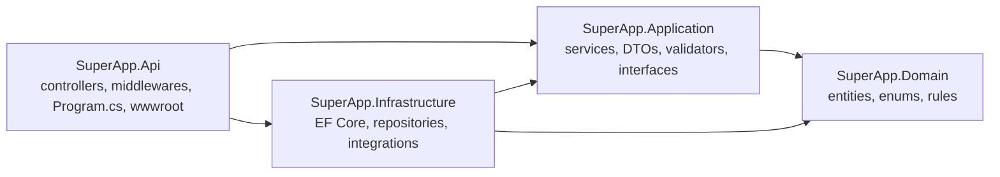

# Project Structure and Setup
Subtitle: How the ASP.NET Core solution is organised, which packages it uses and why, and how to run, migrate, seed and test it from VS Code.
Document: STRUCTURE — backend phase
Version: 1.1 (review fixes applied)
Date: 17 October 2026
Owner: Sharaf (CEO)
Status: For review — the solution is created from this document after approval
Audience: Backend engineers, the owner (running the project from VS Code)

# 1. Solution layout

## 1.1 Layers
The backend is one solution with four projects (Clean Architecture) and a tests project. Each layer has one job, and dependencies point **inwards only**:



| Project | Holds | May reference |
|---|---|---|
| **SuperApp.Domain** | Entities (the tables), enums, value objects, domain errors, business constants. **No packages, no EF, no ASP.NET** | nothing |
| **SuperApp.Application** | Services (business logic), DTOs (requests/responses), validators (FluentValidation), mapping, **interfaces** for repositories and external services, the `Result` and `ApiResponse` types | Domain |
| **SuperApp.Infrastructure** | `AppDbContext`, Fluent API configurations, migrations, seed, repositories, Identity setup, integrations (payments, courier, email, football data, storage), background jobs | Application, Domain |
| **SuperApp.Api** | `Program.cs`, controllers, middlewares, filters, SignalR hubs, OpenAPI, configuration files, **`wwwroot` (the existing site)** | Application, Infrastructure (only to register services) |
| **SuperApp.Tests** | Unit tests (services, validators) and integration tests (API + SQL Server) | all |

**Mapping to the folder list in the owner's rules** (written for Node.js; this is the .NET equivalent):

| Rule | Here |
|---|---|
| `config/` | `Api/appsettings*.json`, `.env`, `Options` classes in `Application/Common/Options` and `Infrastructure/*/Options` |
| `models/` (schemas) | `Domain/Entities` + `Infrastructure/Persistence/Configurations` (Fluent API) |
| `controllers/` | `Api/Controllers` |
| `services/` | `Application/Features/*/Services` |
| repositories | `Application/Abstractions/Persistence` (interfaces) + `Infrastructure/Persistence/Repositories` (classes) |
| `routes/` | attribute routes on each controller (`[Route]`, `[HttpGet]`…), **no logic** |
| `middlewares/` | `Api/Middlewares` + validation filter + authorization policies |
| `views/` / `utils/` | `wwwroot` (the site) and `Application/Common` (response envelope, paging, helpers) |
| `app.js` | `Api/Program.cs` (+ `DependencyInjection.cs` in each layer) |

## 1.2 Full tree
```text
SuperApp/
├── SuperApp.sln
├── Directory.Build.props            # shared settings: net10.0, nullable, warnings as errors, analyzers
├── Directory.Packages.props         # one place for every package version
├── .editorconfig                    # code style (enforced on build)
├── .env.example                     # variable names only — copy to .env
├── .gitignore                       # .env, bin, obj, storage, emails, *.user
├── docker-compose.yml               # api + sqlserver (+ n8n) for the VPS
├── README.md                        # how to run (short version of this document)
├── database/
│   ├── seed/                        # seed exported as SQL for review in SSMS
│   └── diagrams/                    # screenshots of the SSMS diagrams
├── docs/backend/                    # PRD, ERD, API, INTEGRATIONS, STRUCTURE (+ PDFs)
├── src/
│   ├── SuperApp.Domain/
│   │   ├── Common/                  # BaseEntity, AuditableEntity, ISoftDelete, IHasRowVersion
│   │   ├── Entities/
│   │   │   ├── Auth/                # User, Role, Permission, Application, KycDocument…
│   │   │   ├── Geo/  Ops/  Ai/  Pitch/  Booking/  Shop/  Pod/  Factory/
│   │   │   └── Ship/  Money/  Fantasy/  Community/  Support/  Content/  Notify/
│   │   ├── Enums/                   # BookingStatus, DesignStatus, PayoutStatus…
│   │   ├── Errors/                  # DomainErrors (codes like "slot_taken")
│   │   └── Constants/               # Permissions.cs (all permission codes), Roles.cs
│   ├── SuperApp.Application/
│   │   ├── Abstractions/
│   │   │   ├── Persistence/         # IRepository<T>, IUnitOfWork, IBookingRepository…
│   │   │   ├── Payments/  Shipping/  Email/  Sms/  Football/  Storage/  EInvoice/  Ai/
│   │   │   └── Services/            # ICurrentUser, IClock, IAuditLogger, IEventPublisher
│   │   ├── Common/
│   │   │   ├── Responses/           # ApiResponse<T>, PagedResult<T>, Result, Error
│   │   │   ├── Exceptions/          # NotFoundException, ConflictException, BusinessRuleException…
│   │   │   ├── Paging/  Mapping/  Options/
│   │   ├── Features/                # one folder per area, same names as the API
│   │   │   ├── Auth/
│   │   │   │   ├── Dtos/            # SignUpRequest, SignInRequest, MeResponse…
│   │   │   │   ├── Validators/      # SignUpRequestValidator…
│   │   │   │   └── Services/        # IAuthService, AuthService
│   │   │   ├── Pitches/  Bookings/  Packages/  CheckIn/  Games/  Tournaments/
│   │   │   ├── Shop/  Orders/  Returns/  Sellers/  Designs/  Factory/  Shipping/
│   │   │   ├── Payments/  Wallets/  Payouts/  Approvals/  Points/  Codes/
│   │   │   ├── Fantasy/  Matches/  Communities/  Support/  Notifications/  Content/
│   │   │   ├── Admin/  Ceo/  Agents/  Integrations/
│   │   └── DependencyInjection.cs   # services.AddApplication()
│   ├── SuperApp.Infrastructure/
│   │   ├── Persistence/
│   │   │   ├── AppDbContext.cs
│   │   │   ├── Configurations/      # one IEntityTypeConfiguration<T> per table, by schema
│   │   │   ├── Interceptors/        # audit fields, soft delete, outbox events
│   │   │   ├── Migrations/          # created by the owner with Add-Migration
│   │   │   ├── Repositories/        # Repository<T>, BookingRepository…
│   │   │   ├── Seed/                # Seeder.cs + one seeder per area (idempotent)
│   │   │   └── UnitOfWork.cs
│   │   ├── Identity/                # Identity setup, permission handler, 2FA
│   │   ├── Integrations/
│   │   │   ├── Payments/            # SimulatedPaymentGateway, (Paymob…) adapters
│   │   │   ├── Shipping/            # SimulatedCourier, (Bosta…)
│   │   │   ├── Email/               # FileEmailSender, SmtpEmailSender, templates
│   │   │   ├── Football/            # ApiFootballClient
│   │   │   ├── Storage/             # LocalFileStorage
│   │   │   └── Webhooks/            # outgoing webhook dispatcher (n8n)
│   │   ├── Jobs/                    # Hangfire jobs: holds release, fantasy sync/scoring, emails, outbox…
│   │   ├── Pdf/  Excel/  Qr/        # QuestPDF documents, ClosedXML exports, QR signing
│   │   └── DependencyInjection.cs   # services.AddInfrastructure(config)
│   └── SuperApp.Api/
│       ├── Program.cs               # composition + middleware pipeline (section 3)
│       ├── Controllers/
│       │   ├── Site/                # AuthController, MeController, PitchesController, BookingsController…
│       │   ├── Partner/  Seller/  Factory/  Admin/  Ceo/  Agent/  Webhooks/
│       │   └── ApiControllerBase.cs # helpers to return ApiResponse with the right status
│       ├── Middlewares/             # ExceptionHandling, CorrelationId, SecurityHeaders, FeatureFlag
│       ├── Filters/                 # ValidationFilter, IdempotencyFilter
│       ├── Authorization/           # policies, [HasPermission] attribute, ownership checks
│       ├── Hubs/                    # NotificationsHub, SupportHub, CommunityHub, DashboardHub, CheckInHub
│       ├── appsettings.json  appsettings.Development.json
│       └── wwwroot/                 # the existing site (index.html, css/, js/, models/, vendor/…)
└── tests/
    ├── SuperApp.Tests/
    │   ├── Unit/                    # services and validators
    │   └── Integration/             # API endpoints against a test SQL Server database
    ├── http/                        # .http files to run requests from VS Code
    └── postman/                     # SuperApp.postman_collection.json + environments
```

# 2. Code rules

## 2.1 Clean code
| Rule | In practice |
|---|---|
| **Single responsibility** | a class has one reason to change; a method does one thing; ~30–40 lines maximum, otherwise split |
| **Controllers are thin** | read the request, call **one** service method, return `ApiResponse` — no business logic, no `DbContext` |
| **Services hold the business logic** | e.g. `BookingService.CreateAsync` checks the hold, prices, code, waiver, writes the booking, slots, ledger and outbox event through repositories, in one transaction |
| **Repositories hold data access** | queries and persistence only; return entities or projections; no business decisions |
| **Routes carry no logic** | attribute routes only |
| **Dependency injection everywhere** | constructor injection of interfaces; no `new` of services; lifetimes: DbContext/repositories/services **scoped**, clients via `IHttpClientFactory`, options singleton |
| **OOP** | base entities (`BaseEntity`, `AuditableEntity`), interfaces for every service, small classes, composition over inheritance, enums instead of magic numbers |
| **Names** | `PascalCase` classes and methods, `camelCase` locals, `I` prefix for interfaces, `Async` suffix, plural table names, singular entity names |
| **No magic values** | settings come from `ops.Settings` or `Options`; permission codes from `Permissions.cs` |
| **Async** | every I/O method is `async` and takes a `CancellationToken` |
| **Errors** | services throw typed exceptions (or return `Result`) — the **global handler** turns them into the unified response with the right status |
| **Comments** | explain *why*, not *what*; public interfaces have XML summaries |
| **Analyzers** | nullable reference types on, warnings as errors, `.editorconfig` enforced at build |

## 2.2 Exceptions → status codes
| Exception | Status | Example |
|---|---|---|
| `ValidationException` (FluentValidation) | 400 | phone format |
| `UnauthorizedException` | 401 | session expired |
| `ForbiddenException` | 403 | missing permission |
| `NotFoundException` | 404 | booking of another customer |
| `ConflictException` | 409 | hour already booked, stale rowVersion |
| `BusinessRuleException` | 422 | price below base, withdrawal under 500 |
| `FeatureDisabledException` | 423 | kill switch on |
| any other | 500 | logged with traceId, generic message |

## 2.3 A request, end to end
```text
HTTP request
 → CorrelationId middleware (traceId)
 → SecurityHeaders middleware
 → Exception handling middleware (wraps everything below)
 → Rate limiter
 → Authentication (cookie / API key)  → Authorization (policy + [HasPermission])
 → FeatureFlag middleware (423 when the area is switched off)
 → Controller action
     → ValidationFilter (FluentValidation, 400 before the action runs)
     → IdempotencyFilter (payments, checkout, payouts, scans)
     → Service (business rules, ownership checks)
         → Repositories / UnitOfWork (EF Core, one transaction)
         → Outbox event + audit log in the same transaction
 → ApiResponse<T> with the right status code
```

# 3. Composition (Program.cs and dependency injection)

`Program.cs` only **wires** things together; each layer registers its own services:

```csharp
var builder = WebApplication.CreateBuilder(args);
DotNetEnv.Env.TraversePath().Load();                 // reads .env into environment variables

builder.Host.UseSerilog((ctx, cfg) => cfg.ReadFrom.Configuration(ctx.Configuration));

builder.Services
    .AddApplication()                                 // services, validators, mapping
    .AddInfrastructure(builder.Configuration)         // DbContext, Identity, repositories, integrations, jobs
    .AddApiLayer(builder.Configuration);              // controllers, filters, auth policies, rate limits, hubs, OpenAPI

var app = builder.Build();

app.UseCorrelationId();
app.UseSecurityHeaders();
app.UseGlobalExceptionHandler();                      // unified error response
app.UseHttpsRedirection();
app.UseDefaultFiles();                                // wwwroot/index.html
app.UseStaticFiles();                                 // the existing site, unchanged
app.UseRouting();
app.UseRateLimiter();
app.UseAuthentication();
app.UseAuthorization();
app.UseFeatureFlags();                                // 423 when the CEO switched an area off

app.MapControllers();                                 // /api/v1/...
app.MapHubs();                                        // /hubs/...
app.MapHealthChecks("/health");
app.MapFallbackToFile("index.html");                  // the site's own routes

await app.Services.SeedAsync();                       // idempotent seed (development / on demand)
app.Run();
```

Example of the dependency rule in practice:

```csharp
// Application layer — knows only interfaces
public sealed class BookingService(IBookingRepository bookings, IPitchRepository pitches,
    IPricingService pricing, IUnitOfWork uow, IEventPublisher events, ICurrentUser me) : IBookingService
{
    public async Task<BookingResponse> CreateAsync(CreateBookingRequest request, CancellationToken ct) { … }
}

// Infrastructure layer — the EF Core implementation
public sealed class BookingRepository(AppDbContext db) : Repository<Booking>(db), IBookingRepository { … }

// Api layer — thin controller
[Route("api/v1/bookings")]
public sealed class BookingsController(IBookingService bookings) : ApiControllerBase
{
    [HttpPost, Authorize, Idempotent]
    public async Task<IActionResult> Create(CreateBookingRequest request, CancellationToken ct)
        => Created(await bookings.CreateAsync(request, ct), "Booking created");
}
```

# 4. Packages

All versions are pinned once in `Directory.Packages.props` (the latest stable releases for .NET 10 at setup time). Packages whose licence became paid (AutoMapper, MediatR, FluentAssertions) are **not** used.

| Package | Project | Why |
|---|---|---|
| `Microsoft.EntityFrameworkCore.SqlServer` | Infrastructure | SQL Server provider for EF Core |
| `Microsoft.EntityFrameworkCore.Design` · `.Tools` | Infrastructure / Api | migrations (`Add-Migration`, `Update-Database`, `dotnet ef`) |
| `Microsoft.AspNetCore.Identity.EntityFrameworkCore` | Infrastructure | users, roles, cookie sign-in, 2FA, lockout |
| `FluentValidation` + `FluentValidation.DependencyInjectionExtensions` | Application | validation of every request (run by our ValidationFilter) |
| `Microsoft.AspNetCore.OpenApi` + `Scalar.AspNetCore` | Api | OpenAPI document and the interactive docs at `/docs`; also feeds the CEO API catalogue |
| `Serilog.AspNetCore` + `Serilog.Sinks.File` + `Serilog.Sinks.MSSqlServer` | Api / Infrastructure | structured logs with traceId |
| `Hangfire.AspNetCore` + `Hangfire.SqlServer` | Infrastructure | background jobs: emails, outbox, holds release, fantasy sync and scoring, renewals, reports |
| `MailKit` | Infrastructure | SMTP email |
| `QRCoder` | Infrastructure | QR images for tickets, packages and job tickets |
| `QuestPDF` | Infrastructure | receipts, statements, labels, tickets (Community licence: free for companies under USD 1 M yearly revenue) |
| `ClosedXML` | Infrastructure | Excel exports with a dashboard sheet |
| `SkiaSharp` | Infrastructure | image resize / re-encode on upload (MIT licence) |
| `HtmlSanitizer` | Infrastructure | cleans SVG artwork and any rich text |
| `Microsoft.Extensions.Http.Resilience` | Infrastructure | retries, timeouts, circuit breaker for providers |
| `AspNetCore.HealthChecks.SqlServer` | Api | `/health/ready` |
| `DotNetEnv` | Api | loads `.env` in development |
| `Mapster` | Application | DTO mapping (or hand-written mappers where clearer) |
| Built in: SignalR, Rate Limiting, Data Protection, Output Caching, Response Compression | Api | realtime, limits, encryption of secrets, caching, gzip/brotli |
| **Tests:** `xunit`, `xunit.runner.visualstudio`, `Microsoft.NET.Test.Sdk`, `Microsoft.AspNetCore.Mvc.Testing`, `NSubstitute`, `Shouldly`, `coverlet.collector` | Tests | unit and integration tests, coverage |

Installing them is part of the first setup step (`dotnet add package …`, listed in the README), **after** this plan is approved.

# 5. Running the project from VS Code

## 5.1 Install once
| Tool | Check |
|---|---|
| .NET SDK 10 | `dotnet --list-sdks` (already installed: 10.0.303) |
| SQL Server LocalDB (or SQL Server Developer/Express) | `sqllocaldb info` (already installed: MSSQLLocalDB) |
| SQL Server Management Studio (SSMS) | to browse tables and diagrams |
| EF Core tools | `dotnet tool install --global dotnet-ef` |
| VS Code extensions | **C# Dev Kit**, **REST Client** (runs `.http` files), **SQL Server (mssql)**, **EditorConfig**, Docker (optional) |
| Postman (or Insomnia) | import `tests/postman/*.json` |

## 5.2 First run
```bash
git clone https://github.com/MBSharaf/super-app.git
cd super-app
copy .env.example .env          # then fill SEED__CEO_EMAIL, SEED__CEO_PASSWORD, SECURITY__* keys
dotnet restore
dotnet build
```

## 5.3 Migration and database (the owner runs these)
In **VS Code terminal** (EF Core CLI):
```bash
dotnet ef migrations add InitialCreate --project src/SuperApp.Infrastructure --startup-project src/SuperApp.Api --output-dir Persistence/Migrations
dotnet ef database update --project src/SuperApp.Infrastructure --startup-project src/SuperApp.Api
```
Or in **Visual Studio → Package Manager Console** (default project: `SuperApp.Infrastructure`, startup: `SuperApp.Api`):
```powershell
Add-Migration InitialCreate -OutputDir Persistence/Migrations
Update-Database
```
Then open SSMS → `(localdb)\MSSQLLocalDB` → **SuperApp** and follow the checks in the ERD (section 13).

## 5.4 Start the site and the API
```bash
dotnet run --project src/SuperApp.Api
```
| Address | What |
|---|---|
| `https://localhost:5001/` | the Super App site (same design as today) |
| `https://localhost:5001/docs` | interactive API documentation (Scalar) |
| `https://localhost:5001/jobs` | background jobs dashboard (CEO / admin) |
| `https://localhost:5001/health` | health check |

The **seed** runs automatically in development: lookups, settings, the CEO account from `.env`, the catalogue, legal and help content, and — while `SEED__DEMODATA=true` — the demo data. Emails appear as files in `emails/`.

# 6. Testing

| Kind | Where | Run |
|---|---|---|
| Unit tests (services, validators, pricing, policies, QR signing) | `tests/SuperApp.Tests/Unit` | `dotnet test --filter Category=Unit` |
| Integration tests (real HTTP calls to the API with a test database) | `tests/SuperApp.Tests/Integration` | `dotnet test --filter Category=Integration` |
| `.http` files (click "Send Request" in VS Code) | `tests/http/*.http` | REST Client extension |
| Postman collection + environments (Local, Testing) | `tests/postman/` | Postman → Import → Run collection |

Every endpoint is tested in the **normal case and its edge cases** (the matrix in the API document, section 11). A change is not finished until its tests pass.

# 7. The existing site inside the project
1. The current site files (`index.html`, `css/`, `js/`, `models/`, `vendor/`, `og-image.png`, `robots.txt`…) are **copied unchanged** into `src/SuperApp.Api/wwwroot/`. **Existing screens keep their design exactly.** New screens that the backend needs are **added** in the same design (same layout, components and CSS classes) — the first ones are the CEO screens `/ceo/integrations`, `/ceo/api-catalogue` and `/ceo/webhooks` (PRD FR-CEO-07a).
2. The site's routes keep working through `MapFallbackToFile("index.html")`. The GitHub Pages base path (`/super-app/`) becomes `/`; links that hard-code it are updated in one place.
3. The site already talks to its data through `js/services/*` (and `SA.services.http`). Those services are switched **one at a time** from browser storage to `fetch('/api/v1/…')` calls with the CSRF header — screens stay the same. Until a service is switched, it keeps working on browser storage, so the site never breaks during the move.
4. Rules that existed only in the browser are now **enforced on the server** (permissions, prices, limits, availability); the browser checks stay only for a fast user experience.
5. Each switched service is tested on desktop and mobile, in Arabic and English, light and dark, before the next one.

# 8. Servers

## 8.1 Testing (free)
A free ASP.NET Core + SQL Server host (for example MonsterASP.NET, or the Azure free tier). Deploy with `dotnet publish -c Release` and the host's publish profile; set environment variables in the host panel; `SEED__DEMODATA=true`.

## 8.2 Launch — Hostinger VPS
Hostinger **shared/web hosting cannot run ASP.NET Core or SQL Server**; a **VPS (KVM 2 or larger)** is needed.

```yaml
# docker-compose.yml (outline)
services:
  sql:
    image: mcr.microsoft.com/mssql/server:2022-latest   # Express edition: MSSQL_PID=Express
    environment: [ACCEPT_EULA=Y, MSSQL_PID=Express, MSSQL_SA_PASSWORD=${SQL_SA_PASSWORD}]
    volumes: [sqldata:/var/opt/mssql]
  api:
    build: .
    env_file: .env
    depends_on: [sql]
    volumes: [./storage:/app/storage, ./keys:/app/keys]
  n8n:
    image: n8nio/n8n
    volumes: [n8ndata:/home/node/.n8n]
  proxy:
    image: caddy        # HTTPS certificates automatically, reverse proxy to api and n8n
    ports: ["80:80", "443:443"]
    volumes: [./Caddyfile:/etc/caddy/Caddyfile, caddy_data:/data, caddy_config:/config]   # certificates survive restarts
volumes: { sqldata: {}, n8ndata: {}, caddy_data: {}, caddy_config: {} }
```

Steps: create the VPS (Ubuntu) → install Docker → copy the project and `.env` → `docker compose up -d` → point the domain's DNS to the VPS → HTTPS is issued automatically → set `SEED__DEMODATA=false` before the real launch → daily backups of the database and `storage/` to off-server storage.

# 9. Checklists before launch

## 9.1 Security
- [ ] HTTPS only, HSTS, secure cookies, CSRF on every write
- [ ] 2FA for the CEO and every admin; lockout and rate limits on sign-in
- [ ] Every endpoint has a permission or ownership check (integration tests prove a stranger gets 403/404)
- [ ] Every input validated; no raw SQL; uploads checked and re-encoded; private files behind signed links
- [ ] Secrets only in environment variables; `.env` not in git; different keys per environment
- [ ] Webhook signatures verified; idempotency on money and scans
- [ ] Security headers (CSP, frame, referrer, permissions); error responses never show stack traces
- [ ] Audit log append-only; database user without DELETE on audit tables
- [ ] Dependency vulnerability scan (`dotnet list package --vulnerable`) clean

## 9.2 Performance
- [ ] Indexes from the ERD in place; no N+1 queries (`AsNoTracking` + projections on reads)
- [ ] Paging on every list; output caching on public reads; response compression
- [ ] Long work in background jobs, never in a request
- [ ] Static files cached; images resized
- [ ] API p95 under 300 ms (reads) on the VPS with demo data; load test of booking and checkout

# 10. Definition of done and workflow
A change is **done** when:
1. It follows this structure and the code rules (section 2).
2. Validators, services and endpoints have **tests** (normal + edge cases) and they pass.
3. The Postman / `.http` requests for it are added.
4. The unified response and correct status codes are used.
5. Every action that concerns someone sends a notification, every payment has a PDF, every export is Excel with a dashboard sheet (standing rules).
6. Arabic and English texts exist for anything a user sees.
7. It is committed with a clear message and pushed; the progress checklist is updated.

Branches: `main` is always runnable; work happens in small commits per finished piece, each tested before it is pushed.
