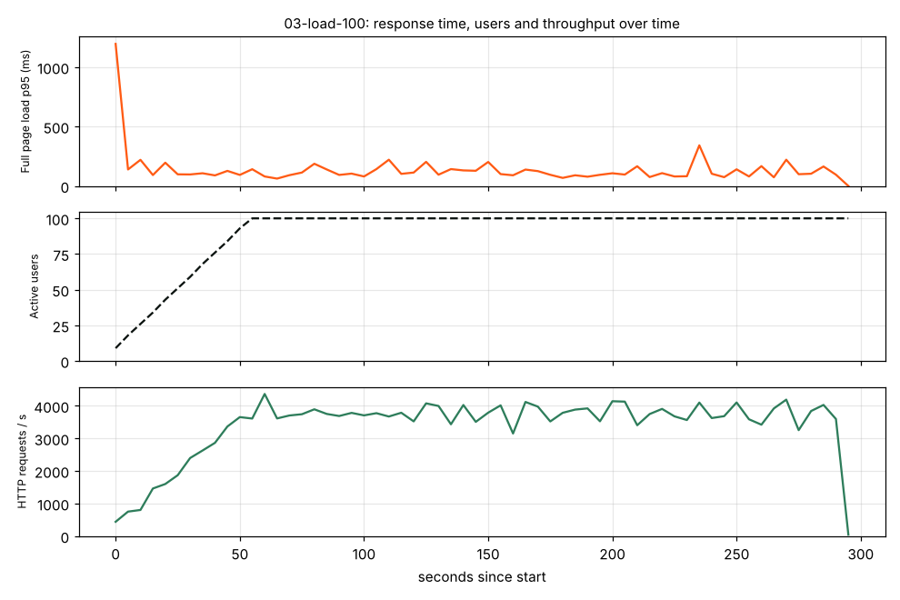
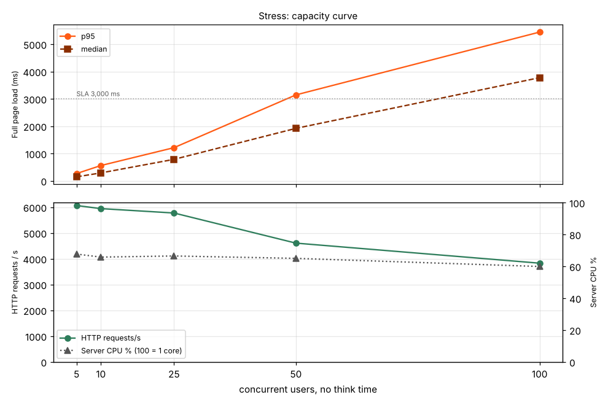
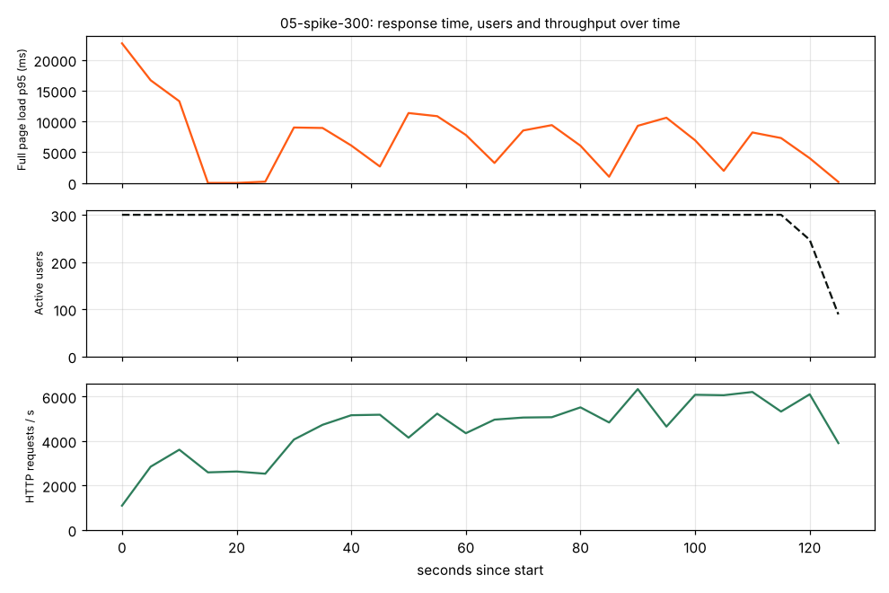
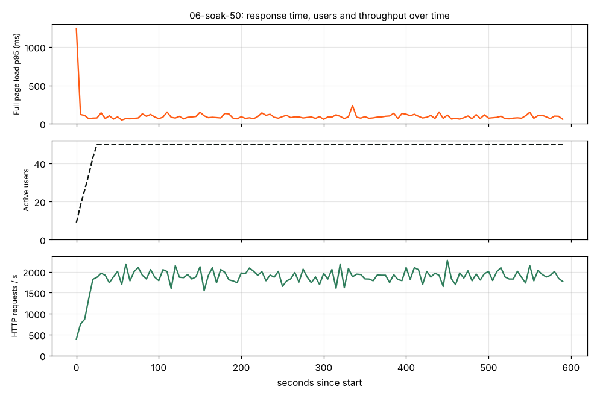

# Super App: Performance Test Report (Apache JMeter)

| | |
|---|---|
| Date | 2026-10-31 |
| Tool | Apache JMeter 5.6.3 (Java 21), plus Chromium (Playwright) for real page-load metrics |
| System under test | Web front end (`index.html` + 216 css/js/font files), served the way GitHub Pages serves it |
| Test plans | `tools/perf/super-app-web.jmx` (website), `tools/perf/super-app-api.jmx` (public API, ready to run) |
| Raw material | `docs/perf/2026-10-31/`: `summary.json`, `browser-metrics.json`, `charts/`, `super-app-performance.xlsx` (Dashboard sheet first), JMeter HTML dashboards for the load and spike runs (`dashboards/*/index.html`) |
| How to repeat | `tools/perf/README.md` |

---

## 1. Executive summary

| Question | Answer |
|---|---|
| Does the site handle **100 visitors browsing at the same time**? | **Yes, comfortably.** Full page load p95 = **127 ms** on the server side, 0 errors in about 1 million requests. |
| Is it **stable over time** (memory leaks, slowdown)? | **Yes.** In the 10-minute soak test the p95 stayed between 82 and 98 ms, server memory stayed flat at 117 MB, and there were 0 errors. |
| Where does it **break**? | With 50 or more visitors loading pages back to back with no pause (the stress test), the page load p95 goes above the 3-second SLA. A sudden **spike of 300 visitors in 5 seconds** pushes the p95 to about 20 s, and 77% of page loads miss the SLA. |
| What is the **real bottleneck**? | **The size and shape of the front end, not the server.** Every first visit downloads **217 files** and **1.33 MB** compressed (3.8 MB uncompressed), most of it code only staff use (admin, CEO, factory, seller dashboards). On a real phone this means **about 4 s on good 4G and about 10 s on slow 4G** before anything is drawn. |
| Hosting risk | Each new visitor costs 1.33 MB. GitHub Pages has a soft limit of 100 GB/month, which is only about **75,000 first visits a month**. |

**Verdict:** the server side is healthy. Performance work should go into **bundling, code splitting and cutting what the first page loads**. Section 8 lists those actions in order of impact.

---

## 2. Scope and environment

### What was tested
* **Website (front end)**, using a production-like copy of the GitHub Pages hosting (`tools/perf/serve-static.js`): site under `/super-app/`, gzip, ETag + Last-Modified, `Cache-Control: max-age=600`, HTTP 404 + `404.html` for clean URLs. These are exactly the GitHub Pages behaviours.
* **Public API (`super-app-api.jmx`)**: plan written and checked (it loads and runs in JMeter) but **not run here**, because the API needs SQL Server and .NET 10, which this test machine does not have. Section 9 explains how to run it.

### Why not the live demo site?
This test environment's network blocks `mbsharaf.github.io`, and GitHub Pages is a shared service that is not meant to be load-tested (it can throttle or block heavy traffic). The local copy serves the exact same files with the same caching rules. The README explains how to run a small, polite test against the live site.

### Test machine
4 vCPU, 15 GB RAM, Linux. JMeter (load generator) and the web server ran **on the same machine**. This matters for reading the stress numbers (section 7).

---

## 3. Test design

### User journeys (`super-app-web.jmx`)

| Transaction | What it does | Requests |
|---|---|---|
| **T01 Home page: full load** (new visitor, empty cache) | `GET /super-app/` + every css/js/font the page references, **6 parallel downloads like a browser**, + `manifest.json`, `sw.js`, `offline.html`, `icon-192.png` (service worker / PWA install) | 221 |
| **T02 Deep link** (`/super-app/pitches`) | GitHub Pages answers **404 + 404.html**, whose script sends the browser to the app; the app's files are then already in cache | 1–2 |
| **T03 Shop: 3D shirt model** | `models/tee.glb` (556 KB) | 1 |
| **T04 SEO files** | `robots.txt`, `sitemap.xml`, `og-image.png` | 3 |
| **T05 Home page: reload** (returning visitor, warm cache) | page + **conditional request (If-None-Match) for every file** → 304 Not Modified | 217 |

* Mix: **80% new visitors, 20% returning visitors**.
* Think time: **2–5 s** (uniform random) between steps, except in stress steps (0 s).
* Browser-like headers: Android Chrome user agent, `Accept-Encoding: gzip`, `Accept-Language: ar-EG`.
* Cookies and cache cleared on every new-visitor iteration.

### Pass/fail criteria (SLA)

| Metric | Target |
|---|---|
| T01 full page load (server side, LAN) | ≤ **3,000 ms** per sample (Duration Assertion) |
| T05 warm reload | ≤ **1,500 ms** |
| Error rate | < **1 %** |
| Real browser, mobile 4G | LCP ≤ 2.5 s (Google "good"), ≤ 4 s ("needs improvement") |

### Scenarios

| # | Scenario | Users (new + returning) | Ramp-up | Duration | Think time | Goal |
|---|---|---|---|---|---|---|
| 1 | Smoke | 1 + 1 | 1 s | 3 iterations | 0 | The plan works, all files return 200/304 |
| 2 | Baseline | 8 + 2 | 20 s | 2 min | 2–5 s | Reference numbers at light load |
| 3 | **Load** | **80 + 20 = 100** | 60 s | **5 min** | 2–5 s | Expected peak traffic |
| 4 | Stress (5 steps) | 5 → 10 → 25 → 50 → 100 | 5–10 s | 1 min each | **0** | Capacity and breaking point |
| 5 | Spike | 240 + 60 = **300** | **5 s** | 2 min | 2–5 s | Sudden burst (e.g. a match-day post goes viral) |
| 6 | Soak | 40 + 10 = 50 | 30 s | **10 min** | 2–5 s | Stability, memory leaks |

---

## 4. Results at a glance

Times are **server-side** (the test machine fetching from a local server, no internet latency). Section 6 shows what a real phone sees.

| Scenario | Max users | HTTP req/s | Page loads/s | T01 p50 | T01 p90 | **T01 p95** | T01 p99 | T05 reload p95 | Errors | Result |
|---|---|---|---|---|---|---|---|---|---|---|
| Smoke | 2 | – | – | 302 ms | – | 1,045 ms* | – | 991 ms* | 0 % | ✅ Pass |
| Baseline | 10 | 358 | 1.1 | 43 ms | 150 ms | **188 ms** | 275 ms | 132 ms | 0 % | ✅ Pass |
| **Load 100** | 100 | **3,441** | 10.3 | 48 ms | 97 ms | **127 ms** | 212 ms | 89 ms | **0 %** | ✅ Pass |
| Stress 5 | 5 | 6,063 | 26.8 | 145 ms | 232 ms | 265 ms | 329 ms | – | 0 % | ✅ |
| Stress 10 | 10 | 5,942 | 26.2 | 289 ms | 511 ms | 559 ms | 698 ms | – | 0 % | ✅ |
| Stress 25 | 25 | 5,772 | 25.3 | 785 ms | 1,089 ms | 1,213 ms | 1,547 ms | – | 0 % | ⚠️ Saturated |
| Stress 50 | 50 | 4,605 | 20.0 | 1,919 ms | 2,838 ms | **3,144 ms** | 3,648 ms | – | 5.1 % over SLA | ❌ Fail |
| Stress 100 | 100 | 3,827 | 16.3 | 3,775 ms | 5,124 ms | **5,444 ms** | 5,970 ms | – | 63.8 % over SLA | ❌ Fail |
| **Spike 300** | 300 | 4,558 | 13.4 | 7,359 ms | 16,941 ms | **19,988 ms** | 22,257 ms | 9,220 ms | 77 % over SLA | ❌ Fail |
| **Soak 50 (10 min)** | 50 | 1,863 | 5.6 | 48 ms | 82 ms | **98 ms** | 144 ms | 74 ms | **0 %** | ✅ Pass |

\* The smoke figures include the JVM's first-request warm-up (about 1 s). Every run shows one such slow first sample.

**About errors:** "Errors" in the stress and spike rows are **SLA misses** (page load longer than 3 s); the files themselves all returned 200/304. Real network failures happened only in the spike (451 of 591,322 requests = **0.08 %**), all JMeter-side socket timeouts while the machine was overloaded (load average 205 on 4 cores). JMeter also produces a few "Connection pool shut down" errors when the test timer ends mid-download. They come from the tool, not the site, so the analysis drops the last 5 seconds of every run (`shutdown_errors_dropped` in `summary.json`).

---

## 5. Detailed results

### 5.1 Load test: 100 concurrent users, 5 minutes ✅

| Transaction / request | Samples | Avg | p50 | p90 | p95 | p99 | Max | Errors | Size |
|---|---|---|---|---|---|---|---|---|---|
| T01 Home page: full load | 3,038 | 60 ms | 48 | 97 | **127** | 212 | 1,204 | 0 % | 1,335 KB |
| T05 Home page: warm reload | 1,519 | 42 ms | 33 | 72 | **89** | 159 | 1,037 | 0 % | 81 KB |
| T02 Deep link /pitches (404 page) | 2,997 | 1 ms | 1 | 1 | 2 | 4 | 83 | 0 % | 0.6 KB |
| T03 3D model `tee.glb` | 2,958 | 2 ms | 2 | 3 | 4 | 16 | 90 | 0 % | 556 KB |
| T04 SEO files | 2,958 | 2 ms | 1 | 3 | 5 | 11 | 29 | 0 % | 104 KB |
| **All 1,015,850 HTTP requests** | – | 0.9 ms | 1 | 2 | **3** | 7 | 90 | **0 %** | 6 KB avg |

* Throughput: **3,441 requests/s**, **10.3 full page loads/s**, **170 Mbit/s** sent by the server.
* Status codes: 689,069 × 200, 323,784 × 304 (revalidations by returning visitors), 2,997 × 404 (deep links, expected).
* Server: CPU avg 34 % of one core (max 61 %), memory 78 → 105 MB.
* After the ramp-up, response time stays flat for the whole 5 minutes. No degradation.

### 5.2 Stress test: capacity curve

* Throughput peaks at **about 6,000 requests/s ≈ 27 full page loads/s** with only **5 users** downloading back to back. It does not rise with more users. Extra users only queue, so response time grows in direct proportion (265 ms → 559 ms → 1,213 ms → 3,144 ms → 5,444 ms).
* The **3-second SLA breaks between 25 and 50 back-to-back users**. With real 2–5 s think time, the same capacity serves about **180–200 active visitors** (27 page loads/s × about 7 s per visitor cycle).
* Server CPU stays about 65 % (never 100 %). The machine was saturated because **JMeter itself used about 3 of the 4 cores** generating this traffic. See section 7. On real hosting (a CDN, or a separate server) the limit is higher. The **shape** of the result still holds: each page costs 217 requests, so capacity per page is 217 times lower than capacity per request.

### 5.3 Spike test: 300 users in 5 seconds ❌

| | p50 | p95 | Max | Over SLA |
|---|---|---|---|---|
| T01 full load | 7.4 s | **20.0 s** | 24.0 s | 77 % |
| T05 warm reload | 3.0 s | 9.2 s | 13.0 s | 61 % |
| Single small files (`manifest.json`, `robots.txt`) | 25–45 ms | 0.7 s | 4.6 s | – |

* The first wave (300 cold page loads × 221 requests = **about 66,000 requests at once**) takes about 15 s to drain. After that the system settles into waves (p95 swinging between 1 and 11 s) because users who finished at the same time come back at the same time.
* **No server crash, no 5xx errors.** The server kept answering and recovered by itself. Only 0.08 % of requests timed out on the JMeter side.
* **Meaning:** a flash crowd hurts because of the **217-files-per-visitor design**. With a 10-file bundle the same burst would be about 20 times lighter.

### 5.4 Soak test: 50 users, 10 minutes ✅

* 1,108,566 requests, **0 errors**, T01 p95 **98 ms**, T05 p95 74 ms.
* Server memory **117 MB at the start and 117 MB at the end**: no leak. Response time flat from the first to the last minute.

### 5.5 Baseline and smoke ✅
* Smoke: every one of the 217 embedded files + all extra files returned 200; reload returned 304 for every file; the deep link returned 404 + redirect page, as on GitHub Pages.
* Baseline (10 users): T01 p95 188 ms, 0 errors, server CPU 3 %.

---

## 6. Real browser results (what a visitor actually sees)

JMeter downloads files but **does not run JavaScript**. The page only appears after all 187 scripts have run, so Chromium was used to measure real page loads (median of 3 cold visits, 412×915 phone screen, service worker off, `tools/perf/browser-metrics.js`).

| Network profile | Page | First paint (FCP) | **LCP** | Load | Total Blocking Time | Requests | Transferred | Warm reload |
|---|---|---|---|---|---|---|---|---|
| Desktop, no throttling | Home | 508 ms | 1,440 ms | 760 ms | 53 ms | 238 | 1,353 KB | 607 ms |
| | Pitches (deep link) | 508 ms | 1,700 ms | 705 ms | 7 ms | 233 | 1,353 KB | 617 ms |
| | Shop (deep link) | 472 ms | 1,144 ms | 691 ms | 0 ms | 251 | 1,353 KB | 597 ms |
| **Mobile 4G** (9 Mbps, 85 ms RTT, 2× CPU) | Home | 3,832 ms | **4,892 ms** | 4,065 ms | 355 ms | 236 | 1,353 KB | 896 ms |
| | Pitches | 3,856 ms | **5,160 ms** | 4,114 ms | 189 ms | 228 | 1,353 KB | 843 ms |
| | Shop | 3,836 ms | **4,684 ms** | 4,025 ms | 139 ms | 240 | 1,353 KB | 838 ms |
| **Slow 4G** (1.6 Mbps, 150 ms RTT, 4× CPU) | Home | 9,180 ms | **10,540 ms** | 9,453 ms | 1,176 ms | 236 | 1,353 KB | 1,708 ms |
| | Pitches | 9,196 ms | **10,588 ms** | 9,484 ms | 654 ms | 228 | 1,353 KB | 1,598 ms |
| | Shop | 9,060 ms | **10,076 ms** | 9,316 ms | 634 ms | 240 | 1,353 KB | 1,342 ms |

Every page downloads the same 1,353 KB (3.8 MB once unpacked) and uses about 10–13 MB of JS heap.

**Reading it:**
* **First paint ≈ DOMContentLoaded** on every profile: the screen stays **blank until every deferred script has downloaded and run**. The page is drawn by JavaScript, so nothing shows before then.
* **LCP on mobile 4G is about 4.9 s** ("poor" by Google's Core Web Vitals, which affects SEO ranking) and **about 10.5 s on slow 4G**, which is common in Egypt outside the big cities.
* **Every page costs the same** (Home, Pitches, Shop): the app has no per-page loading. Visiting the shop also downloads the factory system, the CEO system and the admin console.
* Returning visitors are fast (0.6–1.7 s) because files are cached. The first visit is the problem, and it is also the visit that decides whether a new user stays.
* Deep links (`/pitches`, `/shop`) add one more round trip: GitHub Pages first sends the 404 page, which then opens the app.

---

## 7. Limits of this test (read before quoting numbers)

1. **Same machine for load and server.** JMeter used about 2.8–3.2 of 4 cores in the stress and spike runs. The breaking points in 5.2 and 5.3 are therefore **lower bounds** for the server. The client-side findings (217 files, 1.33 MB, about 5 s LCP on 4G) do not depend on this.
2. **Local network.** JMeter times (section 4–5) have no internet latency. Section 6 adds realistic mobile networks.
3. **HTTP/1.1 locally vs HTTP/2 on GitHub Pages.** HTTP/2 sends many files over one connection, which helps the real site somewhat, but it does not remove the download size, the parsing cost or the blank screen until all scripts run.
4. **The API was not load-tested** (no SQL Server here). The plan is ready (section 9).
5. **The live site was not hit** (blocked here, and GitHub Pages is a shared service).

---

## 8. Findings and recommendations (by impact)

| # | Finding | Evidence | Recommendation | Expected gain |
|---|---|---|---|---|
| **1** | **187 separate JS files + 28 CSS files on every visit** | 217 requests/page; capacity per page is 217 times lower than per request (5.2); flash-crowd collapse (5.3) | **Bundle and minify**: one or a few JS bundles and one CSS file (esbuild or Vite, a build step in the GitHub Pages workflow). Keep the source files as they are. | About 200 fewer requests; 30–40 % smaller files after minification; spike load about 20 times lighter |
| **2** | **Staff-only code is loaded by every visitor** | `js/pages/dash` (380 KB), `js/pages/admin` (289 KB), `js/pages/ceo` (120 KB), `js/pages/factory` (78 KB) = **867 KB of 3.8 MB** before counting their services and the `i18n-ar-admin/ceo/dash/sellers/factory` files | **Code-split**: load the partner, seller, admin, CEO and factory bundles only when their route opens (the router already knows the routes). | Public pages download about 30–40 % less |
| **3** | **Arabic text is loaded for every visitor, including English-mode visitors** | 18 `i18n-ar*.js` files = **589 KB (179 KB gzipped, 14 % of the download)** load on every visit | Load Arabic text only when Arabic mode is on, split per area like #2 | About 14 % less for English-mode visitors |
| **4** | **Blank screen until all scripts run** (FCP ≈ DCL) | Section 6: FCP 3.8 s on 4G | Inline a small HTML/CSS **app shell** (header + skeleton) in `index.html` so something shows at once; preload the main bundle | FCP under 1 s even on 4G |
| **5** | **LCP ≈ 4.9 s on 4G, about 10.5 s on slow 4G** | Section 6 | Result of #1–#4; target LCP ≤ 2.5 s on 4G | SEO (Core Web Vitals) and conversion |
| **6** | **Deep links get HTTP 404** on GitHub Pages | T02: every `/pitches`, `/shop`… answers 404 then redirects | When moving to own hosting (backend phase), serve `index.html` with **200** for app routes (the API already hosts the site, `src/SuperApp.Api/Site`). Until then, add `<link rel=canonical>` per page and keep the sitemap. | One less round trip; search engines index real pages |
| **7** | **Short cache life** (`max-age=600`, every file revalidated) | T05: 217 conditional requests on every reload; 81 KB and 89 ms p95 even with nothing changed | After bundling, give bundle files a **content hash in the name** and `Cache-Control: max-age=31536000, immutable` (own hosting or CDN); keep `index.html` short-lived | Repeat visits make about 1 request instead of 217 |
| **8** | **GitHub Pages bandwidth** | 1.33 MB per new visitor; 100 GB/month soft limit ≈ 75,000 first visits/month | Plan launch hosting on a CDN (Cloudflare Pages / Azure Static Web Apps / Front Door) in front of the API server | Removes the hosting ceiling; edge caching in or near Egypt |
| **9** | **3D model `tee.glb` = 556 KB** | T03 | Compress with Draco or meshopt (`gltf-transform optimize`), load only in the designer | About 70–90 % smaller |
| **10** | **Web font 59 KB**, the largest single file | `archivo-latin.woff2` | Subset to the characters used; keep `font-display: swap` | About 20–40 KB less |
| 11 | Server side healthy | 0 errors at 100 users, flat 10-minute soak, no memory growth | No action. Repeat this suite after every big front-end change (`tools/perf/run-all.sh`) | – |

**Suggested order:** #1 + #2 in one build-step change (largest gain), then #4, then #7 + #8 together when hosting moves.

---

## 9. Next steps: API performance test

`tools/perf/super-app-api.jmx` covers the anonymous read endpoints a visitor hits:
`/health`, `/api/v1/lookups/settings/public`, `/api/v1/lookups/governorates`, `/api/v1/content/home`,
`/api/v1/pitches` (search) → `/pitches/{slug}`, `/{slug}/availability`, `/{slug}/reviews` (the slug is taken from the search result),
`/api/v1/free-slots`, `/api/v1/news`, `/api/v1/fantasy/competitions`. Assertions: HTTP 2xx and **≤ 500 ms per call**.

**Before running:** the API limits each caller to **300 read requests/minute** (`RateLimits:Read`). All JMeter users share one IP, so raise the limit for the test run only (`$env:RateLimits__Read=1000000`), or every user will get 429. This also confirms the rate limiter works.
Run with the demo seed database; the plan only reads. Suggested scenarios: 20, 50, 100 and 200 users for 5 minutes each, then a 30-minute soak at 50 users while watching SQL Server CPU and the output cache hit rate (pitch search is cached 60 s, availability 30 s, lookups 1 h).

---

## Appendix: files in `docs/perf/2026-10-31/`

| File | Content |
|---|---|
| `super-app-performance.xlsx` | **Dashboard** sheet (all scenarios + charts) and one sheet per scenario (every label's statistics + time series and chart) |
| `summary.json` | All numbers in this report, per scenario (labels, percentiles, status codes, slowest and largest files, server CPU/RAM) |
| `browser-metrics.json` | Real Chromium metrics per network profile and page, including the warm reload |
| `charts/*.png` | Time series for baseline, load, spike and soak runs; stress capacity curve |
| `dashboards/03-load-100/index.html`, `dashboards/05-spike-300/index.html` | Full JMeter HTML dashboards (APDEX, response time over time, percentiles, throughput, codes). Other runs: regenerate with `tools/perf/run-all.sh` |
